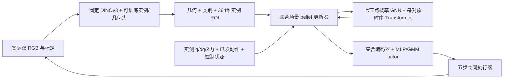

# Ubuntu 开发交接：双机位对象世界模型与清扫策略

更新：2026-10-28，Asia/Singapore。分支：`codex/wam-ubuntu-handoff-20261026`。

本分支发布实现计划和研究背景，供 Ubuntu 后续开发。**新 WAM 尚未实现或训练；本次没有访问 Ubuntu 数据、启动训练或操作真机。** 用户确认 Ubuntu 已有 **300 条双机位 A* 成功示教**，应优先审核复用，不默认重新采集或截成旧计划的 120 条。

**R14（2026-10-28）：** 按用户要求将逐对象GRU替换为共享参数的因果时序Transformer。每场景、每对象独立维护历史，有限窗口、重采样、版本重建和动作前缀因果见主计划 §2.2；其他任务与对比边界不变。

## 先读什么

1. 本页：当前决定、代码来源和接手边界。
2. [现有 300 条示教兼容性审核](ubuntu-dataset-compatibility.md)：分阶段复用、合法补齐、只读盘点与报告模板。
3. [分阶段实现与验收](wam-implementation-stages.md)：阶段 0–7 的输入、训练对象、冻结边界、产物、通过和失败标准。
4. [完整主计划 v1.00](occlusion-aware-world-model-plan.md)：当前架构、数值工程起点、训练和评估协议。
5. [数据流与论文审计 v1.30](world-model-dataflow-and-paper-audit.md)：概率模型、各类观测/动作、监督与梯度、论文依据及迁移缺口。

冲突优先级：本次 R13 的数据来源修订优先于旧“120 条 D0”配额；其他架构以主计划的最新已确认决定为准。历史 Q22、R3、ACT 备选和旧四格设计均有失效标记，不重新启用。步骤文档新增的工程默认须记录并试验，不能冒充论文规定或已取得结果。

## 当前要实现什么

任务是六件固定外观小零件的单次连续清扫，目标为任意身份的恰好 N 件完整入区，N=1…6。从固定复位开始控制接近、落桌和清扫。双路 RGB 为顶部及腕部机位，可做相机/手眼标定。



- **世界模型：** 六零件＋机器人/刷头七节点图；概率 GNN＋时序 Transformer，每对象、每联合场景假设保存独立历史和记忆摘要。先采用 M=16 联合场景、场景级 3 分量 GMM 与相关轨迹分布。提议/条件桥/权重必须一致；不能只平均掉被挡零件的不同去向。
- **前端：** DINOv3-S/16 骨干固定，不用 ResNet；轻量实例分割和几何头在监督训练及后续回合间继续学习。固定骨干池化的 384 维 ROI 用于关联，想象中不生成新 ROI 或未来 RGB。
- **动作与时间：** 小型随机 actor 输出 5×4 增量命令 `[dx,dy,dz,dyaw]`，25 Hz 执行五步后重决策，共 0.2 秒。WM 按 100 Hz 预测该宏步 20 个子步；机器人量是原生 q(6)＋dq(6)＋有符号 Z 力(1)，共 13 维。
- **动作身份：** 策略样本 `U_pi`、共同预控制命令 `U_cmd`、绝对参考 `U_ref`、实际应用控制记录 `C_applied`、实测响应须分开。WM 条件含插入本段之前的 `C_ctrl_start`，不得经队列或末记忆偷读动作后缀。
- **想象：** 隐藏场景产生状态转移及低维几何/可见性/误差观测，同一 filter 更新完整 belief 给 actor/critic；隐藏场景或真实未来不直接作为已知策略输入。即时奖励按预测摘要解析计算，不另训练 reward 网络。

## 一次训练和两种最终部署

1. 先完成数据/执行接口、前端与启动链、完整 WM 监督初始化。
2. 同一个 belief actor 用正式 D0 做 BC，正常完成 100 个等效 epoch。只在终点进行一次 60 场闭环检查：每 N 10 场，随机采样执行，不搜索；至少 12 次 exact-N 成功才进入 MBRL。启动失败计入分母，未达标报告诊断，不自动续训或加数据。
3. 同一个 actor 继续想象 REINFORCE＋critic。实际采集每次直接采一个 chunk，**训练不做候选评分**；回合结束后更新任务头、按当前版重编码历史、监督 WM，再做 fresh 想象 actor–critic。DINO 固定；MBRL 不加持续 BC 或行为 KL。
4. 本轮只完整训练一次，新增 MuJoCo 训练交互总上限 30,000 宏步；BC、感知/模型初始化、校验和测试成本另记。原始示教的历史成本也报告，不把 30k 称为全部项目成本。
5. 按预定 direct 开发验证选择唯一完整 checkpoint，全部模块和统计冻结。**实验组 direct** 直接执行该 actor 样本；**baseline search** 只增加 K=32 候选、J=4 外层分支、H=5 宏步预测及同一 critic 的尾值评分。两组模型完全相同，区别仅为推理搜索开关。
6. 最终每 N 20 个共同测试任务，共 120 个任务×两方式＝240 回合。无第二套 BC baseline、无独立 V_BC、无四格或多训练 seed。

公共规则保留：启动保持 0.4 秒，在 0/0.2/0.4 秒采三对图并支持齐六件；80 秒硬截止、两秒目标确认、三秒停滞早停及既定安全条件。完整仿真比较是本轮结果范围。**保留仿真 GT 裁判**；对象 GT 可作规定的监督标签，不能进入策略/filter 的运行输入。真机可测停止层与完整安全/时序接口尚未实现，不能宣称全系统无 GT 或已具备真机实时性。

## 已有 300 条数据怎样接入

`D_source=300` 是用户确认的源规模；不是已验收可用条数。数据路径、格式、N 分布、图像尺寸、频率、标定和采集版本未知。其他分支 README 所说的五机位/300 条不自动等于本批双机位数据。

先做只读库存，再按 episode/layout 分区与用途生成候选清单：视觉、启动、BC 和完整 WM 分别判断。前端/启动初始 snapshot 通过独立验收后，再按 Q21 首次因果准入正式 D0；后续换版重编码，不按模型表现悄悄换样。BC 的等效轮次按实际合法窗口数计算，不强制 120 条或假定每 N 50 条。

最需核对的是完整 100 Hz 子步、原生 dq、控制器隐状态、动作定义和标签来源。若记录只有帧级 q/pose/RGB，可能可供部分视觉或 BC，仍不等于完整 WM 监督。合法补齐优先找同次原始日志/标定；经过验证的重录另列版本和成本。禁止补零或低频差分冒充原生高频真值、把不一致的新 GT 拼进旧 RGB。

数据原地保留，不上传示教、缓存或权重。第一次只读命令见[兼容性审核 §5](ubuntu-dataset-compatibility.md#5-首次只读盘点命令)。不用旧 ACT 固定条数检查器代替新审核，也不先运行采集器覆盖现有目录。

## Ubuntu 获取分支

先等现有采集/训练作业结束，进入已有仓库检查状态：

```bash
git status --short
git fetch origin
git switch -c codex/wam-ubuntu-handoff-20261026 --track origin/codex/wam-ubuntu-handoff-20261026
```

上面切换命令适用于工作区干净且本地还没有同名分支。若 Ubuntu 已有更合适的开发分支或未发布代码，先保留其状态；可在干净开发分支引入交接分支上的**全部所需文档提交**，无需替换现有仿真实现。下面先检查提交记录和差异，再按需逐个挑选：

```bash
git log --oneline --stat 34d2d9ca699d9d1f334d12adf68b54815d1e3fc0..origin/codex/wam-ubuntu-handoff-20261026
```

文档现包含初始交接提交及后续架构更新；如果尚未包含初始交接，不能只挑选最新的增量提交。cherry-pick 前核对基底、每个提交的 stat 和差异，并按依赖顺序选择。有冲突就人工合并文档，不 reset、不强推、不覆盖数据，不在运行中的 checkout 切分支。若后续分支已有其他开发提交，应只选经过核对的交接 commit。

## 环境和第一轮开发边界

目标资源是 Ubuntu＋RTX 3070 Ti 8 GB，主机内存、CUDA/驱动、空余磁盘和吞吐未检查。仓库 `pyproject.toml` 基础依赖要求 Python≥3.10、MuJoCo≥3.1；旧 `[act]` extra 包括 LeRobot 0.6.1，不应因新 actor 是 MLP 就机械沿用全部旧 ACT 依赖。DINO/PyTorch/CUDA 的具体安装组合要在目标机验证和锁定版本。

```bash
nvidia-smi
python3 --version
df -h .
```

不自动改已有环境。先记录现有版本和可用资源，随后在项目专用虚拟环境适配必要依赖。`pip install -e .` 只安装当前仓库基础包，**不会安装或实现新 WAM**。根 README 的旧 ACT 训练/采集命令是历史功能；目前不存在已验收的新 WAM 完整训练入口，开发时需实现并验证后才能运行。

第一轮开发到阶段 0/1 的接口/数据审核报告为止，再按阶段门槛推进：同一执行器完整发出五步、IK 异常无状态副作用、旧 GT 向量隔离、相机时间/坐标一致、高频记录拒缺、概率/前缀因果检查及 8 GB 一次更新可运行。只读盘点可与接口开发并行，不必等新模型写完。

## 代码来源和未发布内容

- 本交接发布基线为远端 `feat/mt-act-goal-embedding` 的 `34d2d9ca699d9d1f334d12adf68b54815d1e3fc0`；只在其上追加文档。
- 计划/审计来自 Mac 规划工作区，原代码 HEAD 是 `1a0d484fa3725753edc97a8fd54a9db5262b6a2b`，并含未提交的控制器、机器人资产和采集变更。这些源码/资产没有混入本交接。
- 审计中的“当前参数/行号/缺口”是规划时的静态证据，不保证远端或 Ubuntu 的实现完全相同。尤其 robot_model、UR10/UR10e、相机、FT 来源、TCP/手眼和执行器要按实际 checkout 复核；不要因为文档提到 Rudra/某参数就认定分支已包含它。
- 本分支不修改默认仿真配置、执行控制、依赖、模型实现或训练脚本；不含原始演示、checkpoint、运行目录、凭据或本机路径清单。来源摘要见[发布来源](handoff-source-state.json)。

## 给 Ubuntu 开发会话的开场说明

> 请先阅读 docs/research/ubuntu-wam-handoff.md、ubuntu-dataset-compatibility.md、wam-implementation-stages.md，再核对完整主计划与数据流审计。目标是实现一次示范暖启动的对象 belief MBRL 训练，最终同 checkpoint 比较 direct/search，保持既定 0.2 秒五步执行、GT 边界和仿真结果范围。Ubuntu 已有 300 条双机位 A* 成功示教，先只读盘点实际 schema/来源/分区，按视觉、启动、BC、完整 WM 分别报告可用性；不假定每 N 50 条或高频字段齐备，不重采/覆盖已有数据。先完成阶段 0/1 与必要接口验收，再逐阶段训练。不要恢复 ACT/未来 RGB、独立 baseline BC、多 seed 或额外完整 pilot；无法达标时给出具体证据和最小修复，不把计划写成已有结果。
