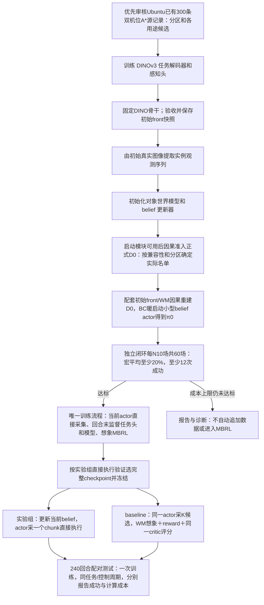
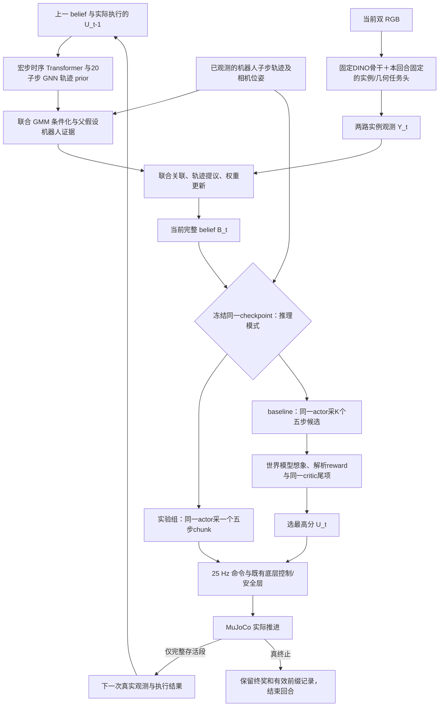
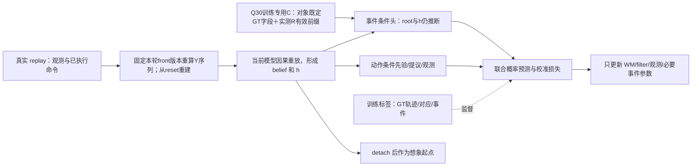
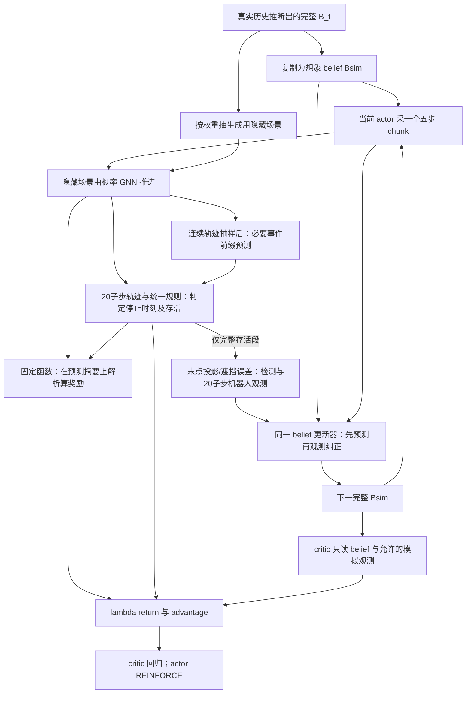

# 双机位清扫：完整数据流与论文核查

**R14（2026-10-28）：** 按用户要求将每对象 GRU 替换为共享参数的逐对象因果时序 Transformer。每个联合场景、每个对象分别持有有限历史，随关联与场景祖先一起复制；其余 GNN、概率 belief、动作前缀和训练对比边界不变。窗口、缓存和重编码契约以主计划 §2.2 为准；此前 GRU 具体实现的历史描述被本修订取代。

更新：2026-10-28，Asia/Singapore。版本：1.30。依据：[主计划v1.00](occlusion-aware-world-model-plan.md)。**R1最新组别修订优先于旧BC对照：只训练一套经过MBRL的WM、actor、critic；实验组直接执行actor样本，baseline在同一完整checkpoint上增加候选未来预测/评分选优。** 两组模型、actor、critic、前端及统计哈希相同；取消事后baseline BC及独立V_BC。Q1–Q37的概率/观测/真值边界保留，Q22中事后baseline重编码BC安排被R1取代，Q34改按实验组直接执行验证选模。 **R2采集修订：唯一MuJoCo训练流程也直接采样当前actor并执行，不作候选评分/搜索重采；训练想象与critic学习照常。** 旧搜索采集协议被R2取代，只有最终baseline推理启用在线搜索。**R6-D已确认：采用小型belief集合编码器＋MLP＋GMM actor，先以D0做BC暖启动得到π0、完成独立基础能力检查，再继续同一actor的想象MBRL；不加载旧ACT，不生成未来RGB/新ROI。R3的“取消初始BC、随机actor直接RL”已被取代。** D0供感知/模型监督、初始BC与想象起点，Q35/Q36真实value辅助仍只取新增交互。R7-B已确认：独立检查最低任务成功率达标后才进入MBRL，暖启动设成本上限，未达报告诊断、不自动追加数据。R8-A等权宏平均及R9-B每N10场共60场、至少20%（12次成功）已确认；R10-A已确认100等效epoch终点仅检查一次；R11-A已确认BC仅初始化，MBRL阶段不加持续BC或行为KL；R12已确认只训练一次，不安排额外完整pilot训练；最终同checkpoint两部署共240回合配对测试，新增训练总预算30,000宏步。工程与真机边界复核见§15。

**Ubuntu交接更新R13：** 用户确认另一台电脑已有300条双机位A*成功示教；仅这一事实已确认，尚未读取数据。优先复用审核，不再默认重采120条。实现入口见[Ubuntu交接](ubuntu-wam-handoff.md)，步骤见[分阶段实施](wam-implementation-stages.md)，数据审查见[兼容性清单](ubuntu-dataset-compatibility.md)。R13优先于旧文固定D0数量；旧120个最终测试任务/240回合不变。


本文解释已选架构，并审查尚未闭合的实现接口。**已定**是用户确认的设计；**接口补全建议**和**待验证问题**不是新增的既定决定。没有修改模型代码、运行训练或验证任务成功。

**R4裁判边界（2026-10-26已确认）：第一版保留共同仿真GT任务/安全裁判；模型观测不读取隐藏真值，但不宣称整个执行链无运行GT。真机可测停止接口尚未实现。** 80/3/2秒及既定终检语义保持，详细审计见§15。

**R5视觉更新（2026-10-26已确认A）：固定DINOv3骨干，实例分割decoder/分类及几何任务头随新增和旧训练数据持续监督学习；回合内固定完整配套版本，回合末更新任务头，按新front重算所用replay并从reset重建belief/h/ROI模板，观测模型同版更新校准。actor/critic的回报目标不反传front。** 384维DINO通道、池化规则及固定归一化保留，但mask变化仍改变ROI分布；不生成未来ROI。初始D0准入使用固定初始快照，不代表整个前端永久冻结；最终两种部署仍共享并冻结完整匹配checkpoint。R5取代旧“初期达标后整套前端永久冻结”的安排，不自动解冻DINO、采用LoRA或改变动作架构。

## 1. 总体顺序

最终比较同一已训练系统的两种推理方式：**实验组为MBRL actor直接执行；baseline为同一MBRL actor＋在线候选规划**。baseline是用户指定的组名，不代表未训练/BC策略。该比较检验增加在线搜索的收益与延迟，不检验是否进行MBRL训练。



R5下DINO骨干保持固定，任务头在回合末监督更新；同版观测重算/误差校准后，唯一训练流程更新GNN、时序Transformer、提议/观测模型及必要事件预测，再做想象actor–critic。即时reward为固定解析函数。训练完成后同时冻结WM*、actor π*、critic Vπ*、最终任务头/骨干及全部统计，两个推理分支直接复用，不再训练另一份baseline actor或value。运行belief/h各自由本回合真实观测和实际命令更新，不复制另一个测试回合的在线状态。R6-D已将初始BC接在配套模型初始化之后，π0指BC完成的策略；参数在BC之前仍可普通随机赋值，但首批在线策略不因此称未经学习的随机actor。

R2已确认训练采集也采用direct：每0.2秒从当前π(U|B)采一个5步chunk，交现有低层控制/安全链执行，不生成K候选、不作候选未来评分或搜索重采。训练仍正常用WM更新当前belief，并在回合末以真实replay监督WM、用想象轨迹更新actor/critic。R6-D确认先用D0完成actor BC暖启动与独立基础能力检查，再进入该直接采集/想象更新循环；初始BC不改变R2；R11-A已确认后续不增加持续BC或行为KL。

| 项目 | 实验组：直接执行 | baseline：同模型＋搜索 |
|---|---|---|
| 已训练参数 | 同一WM*、MBRL actor π*、critic Vπ*、冻结前端及统计 | 完全同一完整checkpoint，无额外训练 |
| 当前状态估计 | WM/filter根据合法双机位观测、proprioception、历史命令更新belief/h | 同一接口；不同执行历史可产生不同belief |
| 下一动作 | 从π*(U\|B)采一个5×4 chunk并执行 | 从同一π*采K个首段，模型推演后选最高分首段 |
| 在线未来推演 | 不为本次动作选择展开未来轨迹 | K首段、H=5宏步、J个观测分支；续写均由同一π*完成 |
| critic部署用途 | 不为本次动作选择调用V评分 | 同一Vπ*作为预测窗口末端的价值尾项 |
| 真值与测试学习 | 模型/actor观测无对象GT或真实未来，无参数/统计更新；现行仿真停止裁判仍用GT，见§15 | 相同；搜索不查询MuJoCo真实候选未来，不能据此宣称整套停止链无GT |

## 2. 先区分六类数据

| 记号/数据 | 内容和来源 | 可以流向哪里 |
|---|---|---|
| `S_GT`：仿真真值 | 零件位置/速度/姿态、可见性、接触、收集/丢失等 | 训练标签/校准/终止监控/评估；Q30仅事件条件项训练可读既定对象连续GT字段，不含真实z/答案接触。actor/filter/root/连续prior运行输入不填隐藏真值 |
| `O_t`：真实观测 | 两路 RGB、实测机器人量、标定、时间戳、目标 N | 前端、belief 更新、actor 可用的机器人上下文 |
| 前端丰富输出 | 可见 mask、框、confidence/soft 类别概率，以及几何、类别和 ROI | 前端几何估计、池化、启动质量检查和日志；不是全部直接给 filter |
| `Y_t`：共同实例观测 | 几何估计、离散类别、相机/时间元数据、固定 384 维 ROI 与可用性 | 关联、观测引导提议、测量似然、外观记忆；真实/想象同一白名单 |
| `B_t`：当前 belief | M 份联合场景假设及权重；每份包含六件状态、对象记忆 h、外观模板和事件历史 | actor、critic、候选搜索根状态、想象起点 |
| `ξ̃_t`：想象隐藏场景 | 从 B 抽样，再由学习模型推进的一份场景 | 生成未来模拟观测、预测奖励/事件；不直接成为 actor 的已知真相 |
| `Ō_t`、`Ỹ_t`：想象观测 | 预测的 20 子步机器人测量轨迹及由末状态投影/遮挡/噪声生成的低维检测 | 存活到宏步末时送同一更新器；不经过未来 RGB/ROI/mask/confidence 生成器 |

**实测量、预测量、训练标签必须在数据结构中分开命名。** `S_GT` 和 `ξ̃` 都不能因为在仿真程序里容易取到，就当成策略的观测。现行仿真GT终止监控是环境裁判的一部分，仍影响轨迹何时结束；它与模型观测无GT是两项不同声明，不能将后者扩大成整个真机执行链已闭合。

### 2.1 一次决策真正能看到什么

底层动作 25 Hz；宏步 t 每隔 0.2 秒决策一次。下表不把单帧估计冒充完整物理状态。

| 接口 | 输入/输出字段 | 关键限制 |
|---|---|---|
| 双相机原始输入 | `I_global, I_wrist`；工程起点为各 1280×1280、5 Hz | 两视角保留各自时间戳；不能把旧低分辨率图放大当新采集 |
| 相机几何 | 内参 K、全局相机外参、手眼标定；腕相机外参由对应时间戳实测 q 经 FK 得到 | 标定提供投影约束，不自动给出遮挡对象的完整中心/高度 |
| 机器人观测 `P_t` | 六关节q、六关节原生瞬时dq、signed f_z，共13个基础连续量；另带软件可读的已知控制状态C_ctrl | C_ctrl显式含参考锚/接触保持计时、导纳/限速/LPF及待执行命令状态，见§17；非新增随机机器人似然字段，不假定能读取硬件servo内部状态。其他五轴仅后台日志，FK/TCP等派生量不重复计证据 |
| 已知任务上下文 | 目标N、时间、桌面/托盘/刷头几何；Q31公开类别—规格目录与已知统一scale | 目录不是每实例真类/ID/位置，不能读layout或GT隐藏计时器给actor；无固定类别配额 |
| 每相机实例列表 `Y_t^c` | 0…12 条：几何估计、离散类别、ROI、有效/缺失标志及相机/时间元数据 | mask/框/confidence/soft 类别概率只保留上游；不要求每路六条，同件双路支持仍只算一件 |
| 几何观测 | 估计XY、平面角度、尺寸；Q29无前端Sigma字段，Q31尺寸是分类/关联测量证据，物理几何由该分支推断类别查目录 | 可见mask质心不是完整中心，尺寸测量不直接覆盖物理尺寸；速度时序推断，角度按类别对称性处理；误差模型内部参数非新观测 |
| ROI | 固定 DINOv3-S/16 实例池化的 384 维空间特征＋固定标准化 | 已取消独立 128 维可训练 projector；不用整图 CLS/存储 tokens，不保证唯一物理 ID |
| belief `B_t` | 默认M=16；每份六件XY/角度/速度、推断静态类别及其目录几何、h/模板/关联/计时；另带机器人上下文；Q28无独立支撑模式 | 保留合理类别/关联解释，不先平均半径；静态属性与对象状态/记忆一起传递；GMM/控制模式/可见性/终止事件保留 |
| actor 输入 | 完整 belief 的集合编码＋P_t＋N/时间等上下文 | 可先逐对象编码、再在场景内聚合、最后按带权场景集合编码；不能只给一个生成用的隐藏粒子 |
| actor 输出 | 整段 GMM：模式权重、均值、方差；一次样本为 `U_t∈R^(5×4)` | 五个有序 `[dx,dy,dz,dyaw]` 命令，共 0.2 秒，整段共享一个混合模式 |
| 执行结果 | 实际100 Hz机器人轨迹、命令/子步有效前缀、实际Δt/τ、事件及下一帧 | 动作之后的数据；终止后不补下一帧；对象GT轨迹仅训练/评估，含Q30事件条件项训练例外，非运行观测 |

七节点 GNN 为六件＋机器人/刷头节点。边表示潜在相互作用，按相对几何/运动计算，不由真实接触标签创建。h 是各假设内的对象时间记忆；同一时间步的三轮消息传递不是三个时间步。

### 2.2 模块间的具体输入/输出契约

下表纳入记忆次序、proprio条件化、规则终止、末状态提议/条件桥与逐生成转移奖励。Q18奖励摘要、Q19 Z单通道、Q23十三维机器人、Q24配对创新、Q25硬前缀、Q29观测误差接口均已选；Q29不增前端Sigma字段，归一化误差模型的具体校准/实现仍须规范。

| 模块 | 输入 | 输出与下游 |
|---|---|---|
| `Frontω` | 当前 RGB、预处理/标定上下文 | 丰富前端记录与严格白名单 Y 分流；GT 不进入观测 |
| `Init` | t=0 的 Y/P、宽位置 p0、h0=0 | 复用 q 的 reset 模式得到 B0；再按实际保持命令处理 t=0.2/0.4，过启动门槛才交 actor |
| `Transitionθ` | 每份场景root/h_t、机器人量、同版本软件控制状态C_ctrl及共同预执行器U_cmd；各头按Q25限制有效前缀 | 一次宏步Transformer历史更新得到h_end；早期轨迹参数不读h_end，模式权重/共享AR只读root/h_t＋u_1；输出20点GMM，供prior/生成/监督 |
| `RobotCondition` | 每个 parent 的 joint-GMM、之后实际观测的完整 R_1:20 | p(R_obs\|parent,U)、模式重权与 p(X\|R_obs,parent,U)；供对象提议和父假设权重 |
| `Associationψ` | 预测场景、旧模板、两路当前检测、当前 P | 每相机一对一关联 A 或 null，及实际条件概率 q_A；不输出唯一 GT 身份 |
| `Proposalψ` | A、条件化轨迹 prior/h、当前白名单检测/R | q_end 末状态样本和混合密度，再用 prior 条件 Gaussian mixture 补齐中段；模式用 prior 条件重权，不沿用 q_end 分量编号 |
| `Likelihoodω` | 候选末状态、A、相机、旧模板、当前 Y | 检测/漏检/杂波/几何/离散类别/ROI 概率；不重复计算已在 RobotCondition 中的证据 |
| `BeliefUpdate` | prior、proposal、likelihood、旧权重 | 归一化权重、ESS、重采样后的完整 B；再更新模板与假设内历史 |
| `ObsEmissionω` | 生成用 20 子步隐藏轨迹、预测机器人测量/FK/相机 | 存活段提供 R 与末点检测；去掉生成 ID、打乱列表、新 ROI=missing；终止段不补停止后观测 |
| `RewardFn`（Q26固定纯函数） | 每条生成转移起点/有效终点的潜势所需状态、N/latch/相关历史、本段终检成功/失败/首次过收、有效Δt及真终止摘要 | 按既定公式逐分支解析算shaped reward，再求外层期望；无网络/损失、无额外20子步编码器、无完整belief共用平均奖励，无隐藏actor输入 |
| `Eventη`（Q27附属预测） | 已抽出的连续轨迹前缀C_≤j、root/h_t、控制上下文与已生效命令 | 必要跌落/非刷头不安全接触等概率事件→RuleEvaluator；不重写本宏μ/Σ，不读未来C或full-U记忆，不把内层预测终止用于筛粒子 |
| `RuleEvaluator` | 同一抽样对象/机器人轨迹、必要事件预测、旧计时器/控制器上下文 | 已知规则唯一决定 latch/计时/停止 τ/c；不另抽独立 continuation；实际环境使用相同任务口径 |
| `Actorφ` | 完整 B、当时可得的机器人量/目标/时间 | 五命令整段 GMM；训练时一个样本和 log-prob，搜索时 K 个首段候选 |
| `Valueν` | 与actor同信息范围的完整B/上下文 | 唯一MBRL actor π的shaped-return分布或期望；训练作critic，baseline搜索时同一Vπ作尾项，实验组直接执行不调用评分 |
| `Controller/Env` | 专家或本组actor给出的五步命令、真实当前传感/控制状态 | Q20共用执行链：接触锁存/保持、限速、Z导纳、失联/安全检查；输出实际响应、下一O及标签/终止记录 |

**Q17逐分支期望、Q18摘要、Q26解析reward与Q27附属事件已确认，Q35增加价值辅助。** 摘要由同分支的连续轨迹、后采样的必要终止事件和统一规则产生，不另编码全部20点奖励网络。终止主依据仍是RuleEvaluator；跌落高度阈值/非刷头不安全接触等由必要事件头补充，不以非平面/不可见直接判失败。实际reward保留记账/校验，并按Q35进入critic辅助目标，不监督reward网络或进入actor/critic输入特征；真实中途GT不得用于候选未来奖励计算。具体字段见§13，不抹去中途首次过收。

Q15 已选择不把原始 mask、bbox、confidence、soft 类别概率送入 filter；无需未来这些字段的生成器。几何/可见性及漏检噪声仍要模拟，ROI 缺失仍须训练覆盖。真实与想象的白名单一致不等于误差分布已经匹配。

Q31静态κ与检测class_hat分离：每个场景/对象携带κ及目录几何，连续q_end不改κ，κ不进运动Gaussian/AR(1)。q0含离散类别prior/proposal并计概率，可用公开均匀五类作工程起点，无固定配额；初始化因子在reset计一次，后续κ确定保持，不每段重乘类别先验。分类证据通过测量模型调已有解释权重，重采样将κ/几何与h/关联/祖先搬移，不能恢复已从全部假设消失的类别；q_A均匀混合也不解决该退化。不声称已实现额外rejuvenation，须报告覆盖/校准。

## 3. 真实执行时，一步数据怎样转移



1. **先解释现在。** 使用上次真正执行的 `U_(t−1)` 和旧 belief，预测本次时刻。未执行的候选不更新真实 belief。
2. **再接入本次观测。** 用已实际观测到的机器人区间轨迹条件化 prior，并保留父假设证据；前端只处理当前 RGB，关联/提议网络结合白名单 `Y_t` 和条件化 prior 形成 posterior。
3. **更新随对象携带的状态。** 重采样整份场景，连同 h、模板、关联和假设内计时一起搬移。当前 ROI 先作为测量打分，再更新模板。
4. **按推理模式生成动作。** 实验组从同一MBRL actor采一个chunk；baseline从该actor采K个候选，并从同一当前belief复制搜索分支推演。actor不需要本次动作的真实未来。
5. **只执行当前首段。** 实验组执行直接样本，baseline执行评分最高的首段；均为五个底层命令，安全/任务终止可中断。随后以新真实观测重新决策，不沿用旧ACT chunk均值融合。

### 3.1 已确认的 reset、启动门槛和热身

Q1–Q3：先观测齐六件再动作，初始化失败计入测试分母。在 reset 姿态实际保持 0.4 秒，采 t=0/0.2/0.4 三对 RGB。末帧须支持全部六件，每件还须在任一较早时刻被支持；同一时刻两个相机不算两次时间支持。相邻图像不是独立重采样，不能自动将几何方差除以三。具体置信度/几何一致性数值门槛仍待校准。

Q5–Q7：位置 p0 为覆盖已知合法出生区域的显式宽先验，不改变环境聚簇 reset，不读取本回合布局 seed/GT。复用观测引导提议的 reset 模式 q0；t=0 时每对象 h0=0，首帧后用真实保持命令和后两帧依次推进。t=0.4 不重新清零，actor 读取热身后的 B/h。具体 p0 归一化密度、角度/类别先验和 q0 损失仍须规范。

当前代码在沉降后明确将零件速度置零，因此真正 reset t=0 的 v0=0 是已知协议，不是隐藏状态输入；t=0.4 的速度仍要推断。确定速度维度不再套普通连续 Gaussian 密度，也不能采样后 clamp 却报原密度。后续 reset 变化时须重新核查该事实。

0.4秒计入80秒任务时间和实际交互；不默默重试布局。对象进入托盘、暂时不可见、离开安全区是不同状态；六个文件不因漏检删除，重现不无条件创建第七件。D0 bootstrap按Q21保留；Q22的事后baseline BC重编码被R1取消，其合法/有限belief与部署门控分离原则仍适用于训练回放。0.4秒前仅保持/热身，无actor决策或BC动作损失；R6-D初始BC只取符合决策资格的专家命令段。采集/记录适配尚未实现。

### 3.2 h 在哪一步更新

**R14时序替换：** 原Q4宏GRU改为每对象因果Transformer历史；Q25的full-U和动作前缀限制保留：

`g_root = GNN(s_t, P_t, C_ctrl_t, h_t, old_templates)`，h_t来自已有历史，不含本段U；各预测头可融合h_t。

`token_t = embed(g_root_i, U_t)`；`h_end = Tθ(tail20(H_t ⊕ token_t))`，每场景每对象维护一个有限历史，完整宏步才提交token。

工程起点：每条对象历史最多保留20个完整宏步token，使用因果mask和有效padding；h_t为对应历史末token摘要，空历史为零。每次从截断后的token窗口重算，训练、真实和想象采用相同位置编码及窗口约定；token由历史h和状态产生，整个belief可能带有窗口之前的信息；缓存优化须验证等价，不把存在跨窗口残留的KV缓存称作严格截断。不同粒子/关联、隐藏生成、filter及候选分支持有独立历史，重采样时同状态、模板及祖先一起复制；模型/前端换版后从reset因果重建。上述20步只是起点，显存、长遮挡和吞吐需实测。

`prior = mixture_α N(μ_1:20, Σ_AR)`；α和跨20点共享的AR系数只依赖root/h_t＋u_1，μ_j/L_j只依赖root/h_t及u_1…u_ceil(j/4)。h_end仅可用于已覆盖全部命令的末点头，不得广播到早期轨迹或事件头。连续参数抽样前固定；Q27事件头随后可读已抽出的C_≤j，不能误套为所有事件参数也须在C抽样前产生。

`proposal: q_A(A | context) × q_end(X_end | A, h_end, Y_next, R_obs, root,U)`，再按Q16使用同一次prior的条件Gaussian mixture补齐中段；不得重跑网络制造另一套prior，q_end不重复包含关联概率。

当前观测通过后验状态/模板影响下一次转移，不为试探关联或同帧posterior重复追加时序token。隐藏生成场景用prior末状态继续，滤波分支用posterior末状态继续；各自历史产生各自h。禁止当前观测先写入h/模板再给自身计似然。

Transformer持久历史每完整0.2秒追加一次；20子步、AR(1)及三轮图消息不等于20次宏步历史更新。R14替换了Dreamer式GRU核心；全轨迹硬前缀、末点摘要及解析桥均为本项目改造，不复刻原RSSM或SWB。首轮工程默认根图每宏步只编码一次，复用节点特征，用共享前缀MLP批处理20点，不增加第二套子步时序Transformer或每点完整GNN。禁止跨时间BatchNorm/全段池化泄漏，允许逐点LayerNorm/固定统计；此工程默认需用NLL/吞吐检验。

### 3.3 已确认的机器人条件化与 belief 范围

令 parent=m，完整观测机器人轨迹为 R，六件轨迹为 X。对 joint-GMM 计算 pθ(R|m,U)，以 α_l p_l(R|m,U) 重加权模式，并得到 pθ(X|R,m,U)。重要性权重保留：

`w_new ∝ w_m pθ(R|m,U) pθ(X|R,m,U) ℓ(Y,A|X_end,old_templates) / [q_A q_X]`。

Q16已确认 `q_X=q_end(X_end|A,Y,R,m,U) pθ(X_mid|X_end,R,m,U)`。当前目标与提议的桥接因子相同，化简为：

`w_new ∝ w_m pθ(R|m,U) pθ(X_end|R,m,U) ℓ(Y,A|X_end,old_templates) / [q_A q_end]`。

条件模式按 `pθ(l|X_end,R,m,U)` 抽样，不沿用q_end的分量编号。中段仍抽样保存，用于事件/历史；不是线性插值，也不是删除20子步输出。若另外存在随机离散因子或独立中途事件测量，仍须纳入相应密度/likelihood，不能无条件抵消。详见§13。

Q27附属终止E的特例：p(C,E)=pθ(C)pη(E|C)，当前filter不观测E、视觉likelihood不依赖E且不按存活筛选时，Σ_E pη(E|C)=1，E边缘化后不另乘事件概率，连续Q16桥保持。Q28不引入独立非终止支持模式，无对应mode prior/proposal/测量因子；未来若修订并增加变量，需另行规范，不能无条件沿用此边缘化。

p(R|m,U)是Q23已定20×13机器人轨迹的完整边缘密度；按Q24用AR(1)＋q/dq配对2×2创新块及f_z标量计算，含块logdet，不按独立标量或逐帧边缘乘积计算。不同配对块/对象/机器人之间的创新仍条件独立，其他纠正主要经GNN均值/模式/parent传递，不声称完整跨对象协方差。原生dq不等于q差分，联合建模不天然重复；TCP/相机、裁剪/滤波/latch等确定性派生量不重复计证据。旧数据/执行器版本仍须审计。

本 filter 只按视觉与 proprio 更新，**忽略 GT 任务成功/收集和“环境仍存活”的选择证据，是近似 belief，不是包含全部环境事件的完整 POMDP 后验。** 终止分支保留终奖并停止，不虚构停止后 R 或继续 posterior。未来若添加独立中途事件测量，应增加因子并重审 Q16 桥接抵消条件。

## 4. replay 保存什么，以及监督如何使用

一条真实宏转移建议保存：

```text
episode_id, target_N, timestamps, model/frontend versions
O_t = 双 RGB、相机标定、实测机器人量、已知控制器上下文
U_cmd = 共同预执行器的五步有序命令；actor时等于其有界样本U_pi，专家以同一域记录BC标签
U_ref = 基于C_ctrl参考锚累计后的绝对参考；C_applied = 100Hz实际应用控制参考
C_ctrl_start/end, U_pi及其策略版本/log-prob（actor来源时）；候选/分数仅作诊断
result = 20子步机器人实测轨迹、五命令执行mask/有效子步前缀、实际Δt/停止τ、事件
O_next, terminated, truncated
training_only = 六件GT的20子步轨迹、可见实例标签、reward与必要事件标签
```

感知标签是本帧**可见 mask**；完整中心/尺寸/姿态是另一组训练标签。完全遮挡时不能用 GT mask 造一条可见检测。部分遮挡的完整中心监督可以训练推断能力，但推理输出仍应带误差与有效性。

R6-D初始BC将合法D0中的专家U_cmd五步命令作为actor监督标签；不足五条的真终止/安全中断段仅用实际有效命令前缀的同一GMM边缘NLL，不补后缀、不丢整个D0；对应B/h由配套初始front/WM从reset因果推断，不从对象GT构造。专家和在线命令也继续作为动力学条件，不能替换为接触后实际TCP位移；导纳接管后的Z响应与下发dz不是同一量。在线行为不作为后续BC标签；R11-A已确认BC仅初始化，MBRL阶段不再计算专家或在线动作模仿loss，不加行为KL。

宏步内安全记录要覆盖过滤力超阈的持续/累计状态、最大连续接触丢失时间、事件时刻、执行掩码和实际时长。20 N/dwell 或连续 100 ms 条件不能只看 0.2 秒末端值。计数器须跨宏步保留，例如跨边界两段 60 ms 不能被误记为两次均未达 100 ms。

机器人与对象标签共用 10 ms 网格；提前终止只监督有效前缀，不补停止后的假数据。RGB 仍为宏步 5 Hz，不增加 100 Hz 图像。段开始的预测只接受当时已知命令/状态；未来实际机器人轨迹、执行 mask/τ 是执行之后的观测或标签，不是 prior 的提前输入。

Q30仅事件条件项训练可读取training_only中的对象既定XY/平面角度/速度与实测R，组成C_obs,≤j；不读真实z/完整姿态/接触答案，不把该路径接入root/filter/连续prior/actor。训练数据组名不应暗示GT可作一般运行观测。

## 5. 阶段一：初始化视觉前端，随后按R5持续更新任务头

输入是真实记录的双RGB；前向为DINOv3空间特征→轻量decoder→实例/几何/ROI观测。标签只流向对应loss，推理结果仍从RGB得到。当前R5持续监督以MuJoCo可用标签为前提；硬件不默认具备同等GT，迁移首轮建议冻结完整checkpoint先验接口，后续监督来源另见§17.6。

| 输出 | 监督/检查 | 更新范围 |
|---|---|---|
| 类别、框、visible mask | 可见实例标注；同类相邻实例分离、漏检/误检 | 初始化和后续回合末监督训练decoder/任务头；DINO骨干按R5固定 |
| 完整中心/姿态/尺寸估计 | 仿真几何标签；按可见比例、相机、姿态验证误差 | 几何分支和实际位于该 loss 路径上的模块 |
| 几何误差诊断 | 当前front版本实际输出相对标签的bias/残差/覆盖，按相机/遮挡分桶；不要求前端输出Sigma供filter读取 | 以同版输出更新/校准下游观测模型，质量报告只用于诊断/启动；测试记录不用于拟合 |
| ROI 向量 | 已选择固定 DINOv3-S/16 的实例池化 384 维特征及固定标准化；校验同类关联、视角和遮挡 | 无独立 128 维 projector 及其训练目标；池化 mask 来自训练后的实例头 |

DINOv3骨干、384维通道定义、ROI池化规则、固定通道标准化及预处理保持既定版本，不解冻骨干或自动加入LoRA。初始化达到质量门槛后保存初始front快照，供Q21正式D0准入；**R5取代整套前端永久冻结：** decoder、分类/实例mask和几何任务头继续用新增与旧训练RGB/标签监督学习。回合内前端及配套WM/actor/critic固定，回合末才换版；真实执行、重编码和验证均使用该快照的推理模式，不能让BatchNorm等运行统计暗中变化。最终评估时整套完整checkpoint固定。下游belief编码器仍可学习变换，但不偷偷改变上游ROI标准化或在部署中更新统计。

冻结骨干不等于ROI测量完全不变：池化mask随实例头更新，ROI的值、可见区域及误差分布会变化。新front版本启用前，重算本轮所用replay的实例观测/ROI，从reset顺序重建belief、h、关联和按相机区分的ROI模板；不将旧模板/旧h接到新mask观测，也不把缺失ROI伪装成有效零向量。Y缓存须含完整front版本键，旧任务头的Y缓存失效；无需持久保存全集dense特征，真实RGB及标定保留作重编码依据。固定D0名单不随任务头变更重筛或补换。

回合末的配套更新顺序为：真实训练RGB/标签监督更新任务头 → 本轮持有新front版本不再改动，重算所用回放 → 用同版实际检测输出与标签更新/校准观测生成及likelihood → 因果重建状态并监督WM/提议/必要事件模型 → fresh想象actor–critic → 下回合启用配套版本。任务头loss只更新实际监督路径；WM、actor及critic目标均不借此反传front。训练中可交替多轮该流程，但各轮必须记录版本，不允许重编码途中改头，或让一轮likelihood与检测器错版。观测模型的pD/漏检、类别、几何bias/协方差、ROI及杂波分布均针对同版检测器；校准不使用最终测试记录。具体每回合梯度次数、校准覆盖和缓存吞吐仍需工程验证，不因R5自动增加实际交互预算。观测模型/WM更新后，actor想象根须按最终当前版本因果重建，不能把这轮较早版本的h/模板当成永久可复用缓存；观测拟合与状态重建可交替，但版本边界保持明确。

想象中仍只生成几何/可见性/类别等既定低维观测，新ROI为missing；真实序列训练继续覆盖连续ROI缺失。任务头变好不等于想象已获得未来外观信息；真实/想象的关联和分布差异须独立检查。R5改善新策略数据适应能力，不保证完全遮挡或未知真机域下感知可靠。

[DINOv3 §6.3.1–6.3.2](https://arxiv.org/html/2508.10104v1#S6.SS3.SSS2)支持冻结骨干后训练任务decoder；分割评估为语义分割，并指出16像素patch的粒度问题。[SOLD §3.1/§4.2](https://arxiv.org/html/2410.08822v2)说明新策略状态分布下持续适配对象编码器的动机；它适配SAVi，不直接验证本项目“固定DINO＋监督任务头＋SMC重编码”组合。[DINO-WM §3.1.1](https://arxiv.org/html/2411.04983v2#S3.SS1)固定DINOv2特征，也不规定本项目任务头必须永久冻结。这些来源均不提供现成的毫米级实例/几何观测或3070Ti显存保证。

## 6. 阶段二：监督训练对象世界模型



从中途抽训练段时，先以当前模型从 reset 无梯度重放前缀，重建记忆，再训练连续段。不能把中途片段当零记忆开始，也不能长期复用旧模型生成的 h。损失所需 GT 可以在对应时刻出现，但本次 prior 不得提前看到下一帧观测。

**Q9 已确认以有监督概率目标为主，不以 AESMC/ELBO 为主；以下为模块契约，具体损失组合/权重仍待规范，不是已实现结果：**

| 模块 | 真实输入与预测 | 建议监督方式/边界 |
|---|---|---|
| GNN＋时序Transformer dynamics | 当前推断 belief/h、已知控制上下文、五命令→20子步联合轨迹 GMM | 有效前缀 GT 作标签，对含 AR(1) 的轨迹分布做 NLL，不把每个粒子 MSE 拉向同一 GT |
| 机器人响应 | 同一七节点图→同网格的连续机器人测量轨迹 | 实际响应作标签；FK/控制器确定性派生量不重复作为独立随机目标 |
| proposal/关联 | 先验＋当前两路检测/R→末状态q_end和关联概率；中段按prior条件桥补齐 | Q37已选A：初始/末状态GT标签监督归一化提议密度；合法/歧义绑定按Q32，GT仅目标端，q_end保持parent类别；实际q概率可算，无全20点额外proposal头 |
| 观测生成/似然 | Q29：候选状态、相机、预测遮挡、旧历史→pD、归一化几何bias/正定协方差、类别/杂波及缺测 | 当前front版本训练/calib-fit输出—标签配对拟合；独立dev验收不用于拟合，生成与likelihood同版，可异方差；无前端Sigma mark/未来mark生成，无当前残差/同帧ROI调σ捷径，不以GT干净点代替检测误差 |
| 必要终止事件 | Q30监督训练：事件条件头读实际C_obs,≤j及推断root/h；Q27想象/搜索读生成C_≤j；两者不读真实z/答案事件 | 与轨迹做L_joint联合密度监督、同对象匹配/有效前缀/归一化责任，无重复完整L_C；停止后不补负标签，生成分布校准/稀有样本成本仍须规范，不回写本宏连续参数 |
| 解析reward（不训练） | 生成轨迹→规则/事件摘要→固定r_base＋γΦ_end−Φ_start | 无reward预测损失；实际reward供记账/校验及Q35价值辅助标签，预测摘要错误由动力学/事件等对应监督处理，不把实际奖励强教给所有假设或加入策略特征 |
| 跨宏开环验证（Q33，不训练） | 独立因果起点按记录U连续推演，真实中间Y/R/GT/latch不回填 | 检查0.4…1秒分布/事件/覆盖与排序，不反传或加WM辅助loss；连续Transformer训练及五宏actor想象保留 |

例如连续状态的边缘标签损失L_C可以写为：

`L_C = −log Σ_m w_t^m Σ_(π∈Π_m) c_(m,π) Σ_l α_(m,l) Normal((X_GT^π,R_measured)_valid_prefix ; μ_(m,l), Σ_AR1_(m,l))`。π只排列对象，机器人R不排列。

在连续pθ中，GT是密度计算的目标，root输入仍来自推断belief；Q30仅事件条件项训练可把同一C_obs既定字段作为条件。对称/可交换对象要采用周期量和合法匹配。GMM分量是密度，离散粒子本身不是对任意GT有非零密度的Gaussian，不对Dirac粒子直接套连续NLL。

Q30/Q32采用L_joint=−logΣ_(m,π)w_m c_(m,π)pθ(C_obs^π|m,U)pη(E_obs^π|C_obs^π,m,U)。pη不另读l，l在pθ内边缘化。a_(m,π)=w_m c_(m,π)pθ(C_obs^π|m,U)，Z_C=Σa，L_C=−logZ_C，ρ_(m,π)=a/Z_C，L_(E|C)=−logΣ_(m,π)ρ_(m,π)pη(E_obs^π|C_obs^π,m,U)，联合项等于L_C＋条件项，不重复叠加完整L_C。三项用同一Π/c/测度；不能无权重逐parent CE、将log移进期望或对C/E分开挑π。detach责任改变联合梯度须说明。只用段起点w与历史相容绑定，不用t+1 posterior重评同一转移。类别/几何/fallen监督同π，事件缺失/停止后不补负标签。

有效前缀使用相应 Gaussian 边缘密度，不能将无效未来填零后计算全长密度；起点确定速度维度单独处理。对称性/身份歧义不能由 GT 私有 ID 强行成为运行关联。Q24已确定自然位置/速度配对创新块，AR(1)参数数值下限仍须落实；Q33首版不增加跨宏辅助loss或对应权重。

Q33已明确首版不设跨宏开环辅助loss，上述逐宏0.2秒目标本身覆盖20点。连续训练段中正常接入当时记录观测、更新posterior并学习Transformer时序梯度；不逐宏清零/全detach，也不因为每宏有loss就重选Q32绑定。这里的时序学习、排列一致性与额外跨宏开环预测目标分开描述。

该式不自动训练好proposal、关联或观测模型：各自使用可识别监督/适当概率损失和校准。**已确认离散采样/重采样索引stop-gradient，所选连续路径与Transformer时序梯度保留**；不声称无偏端到端优化完整SMC边缘似然。Q16锁定q_end＋prior条件桥，Q37已选GT标签作proposal主要teacher；具体归一化目标/合法绑定及权重仍须实现验算，不能由网络名字代替。

## 7. 阶段三：WAM 在想象中训练 actor–critic

### 7.0 R6-D初始BC、π0与可决策状态

**R6-D已确认，取代R3无BC起点。** actor使用私有belief集合编码器＋MLP＋整段GMM，BC前普通随机参数赋值，不加载旧ACT/视觉动作头。保存配套初始front、WM/filter及统计快照，从reset仅用当时可得观测与已发命令因果重建D0的B/h；以合法决策时刻的B＋允许proprio/N为输入，完整段的专家issued 5×4命令为标签，计算整段GMM动作NLL，只更新actor私有encoder/GMM。GT root、未来观测平滑和私有专家ID都不能成为输入；BC期间暂不反传WM/filter/front，不等于其后长期冻结模型。BC完成的策略才记π0，初始BC优化步数、来源及snapshot需可核对。真终止/安全中断不足五条时，仅对实际有效issued命令前缀计算同一整段GMM的边缘密度/NLL，保留原混合权重并边缘化未观测后缀；不补停止后动作、不因尾段不足五条丢弃整份D0，启动保持仍不是actor样本。

BC后的π0与匹配WM先做独立闭环检查，再作为首个正常新增direct采集回合的当前actor/WM；首回合结束后才按既定调度监督更新WM/R5任务头及想象actor–critic。新增交互计入本次训练总计30,000宏步，不另开独立seeding预算；零新增步诊断对应BC后π0、尚无MBRL actor更新。R7-B已确认：须先达到最低exact-N任务成功率且暖启动有成本上限；到上限仍未达则报告诊断，不自动追加数据或进入MBRL。R8-A已确认六种N等权宏平均，逐N报告且允许个别N为零；R9-B已确认每N10场共60场、至少20%（12次成功）；R10-A已确认正常完成100等效epoch后，只做一次完整60场检查；R11-A已确认BC仅初始化，后续无持续BC或行为KL。不能用低BC loss、教师接管/搜索/GT补齐代替真实闭环结果。检查交互单列计费、不回流训练；R11-A已确认MBRL阶段仅按既定fresh想象REINFORCE与熵/尺度处理优化actor，不加持续BC或行为KL。

感知/启动链与WM先用D0初始化，不要求WM完全收敛；此后R5任务头和WM继续依真实训练数据回合末学习，actor继续想象RL。无新增数据时，WM/想象起点暂只取D0；新增池非空后按既定1:1采样。Q35/Q36真实value辅助仍空池跳过，不因D0用于BC就拿D0奖励填补。不在首批正常direct采集前另行启动D0想象actor优化；这保持BC零新增步诊断与首回合后MBRL更新的清晰边界。

critic私有encoder常规初始化，value输出权重可参照[DreamerV3 Critic learning](https://arxiv.org/html/2301.04104v2)置零，slow-value复制online初值；这是数值初始化，不是已获得可靠价值。版本化记录GMM模式数、方差/下限、动作界及变换密度；BC与后续REINFORCE使用同族可计算动作分布，初始BC不引入ACT或未来RGB生成器。

**决策资格mask：** 起点必须已经过0.4秒启动、该记录的采集/准入版本曾通过因果启动门控、尚未真终止，且当前因果重编码belief合法有限。初始化保持段、启动失败、停止后补帧不作为BC动作样本或自由actor/value想象根；它们的有效观测仍可监督WM和热身h。合法D0不因当前重编码的质量分数下降被静默删除；数值非法或无合法支持须按失败诊断处理，不补GT。真实value辅助还要求存在该实际actor决策及有效转移。仅完整宏边界的外部truncated合法末状态可作bootstrap；意外不足0.2秒的非terminal前缀不能使用full-U的h_end补末点，按§17.3仅保留适用的WM/BC监督、不设terminal零尾值；终止分支通过控制流屏蔽不存在的下一belief，不用0×NaN冒充合法值。

### 7.1 同时保留“生成用隐藏世界”和“策略可见 belief”

从真实 replay 因果重放得到 `B_t`。每条想象轨迹复制完整 `B_t`，另按权重抽一份 `ξ̃_t` 用来生成未来；不从该时刻 GT 构造一个完美起点。



每个想象步的数据转移为：

1. 先按§17.3处理生成根自身已终止的expired场景；其τ=0、新reward/PBRS及tail为零，保留原权重的零回报目标。其余分支从`Bsim_h＋模拟可测机器人量＋C_ctrl`采`U_pi,h=U_cmd,h`，保存同一策略的log-prob。
2. 用旧状态/命令更新一次宏步h，按Q25前缀约束确定连续分布参数，再采场景GMM模式与机器人＋六件20点连续轨迹C；AR(1)与配对块使用同一协方差。
3. Q27先C后E：必要事件头只读C_≤j和允许前缀，不读未来C/full-U记忆，不重解码本宏μ/Σ。统一规则结合连续量、事件及历史决定latch/计时/最早τ和有效前缀，Q26纯函数逐分支算shaped reward；critic继续学长期价值。
4. 若分支终止，保留终局奖励、c=0、尾值为零，并停止；不补停止后 R、不生成下一帧或 posterior/actor 调用。
5. 仅完整存活段用预测 q/FK 计算末点相机/连杆，模拟可见性、漏检、杂波和几何误差；新 ROI=missing，历史模板保留。产生同段 20 子步可测机器人轨迹，不调用 MuJoCo 查询真实未来。
6. 同一filter推进完整Bsim，条件化模拟机器人轨迹（保留父假设证据），再用模拟检测提议/纠正；critic读下一完整belief，不读隐藏生成场景。按既定vision/proprio近似目标边缘化附属终止E，不能按内层预测dead删粒子、重采至alive或乘存活权重；只有外层生成分支的E决定该次想象是否停止。
7. 最多重复五次，共 1 秒；每步重新调用当前 actor，不一次输出长 25 步。内层过滤仍是仅 vision/proprio 的近似，不暗加 GT 收集/存活证据。

模拟检测的生成器与滤波 likelihood 应尽量对应主计划的同一有界传感器模型；ROI 缺失在匹配和杂波两侧都边缘化。噪声可以条件依赖视角/遮挡，但不能看到抽样结果后随意改似然方差。

### 7.2 回报、梯度和更新边界

本文统一使用 transition 索引：`r_h` 是从 h 到 h+1 的奖励，`γ_h=0.997^(Δt_h/0.2)`，`c_h` 是该段之后能否继续。

以下预测奖励符号表示对模型生成摘要调用固定RewardFn所得的值，不代表学习式reward-head输出；critic/value仍是学习网络。

```text
G_H = V(B_H)
G_h = r_h + γ_h c_h [(1−λ)V(B_(h+1)) + λG_(h+1)]
Adv_h = G_h − V(B_h)
actor loss = −Σ_h stopgrad(D_h) stopgrad(Adv_h / return_scale)
                 log π(U_h.detach() | B_h.detach(), context.detach())
             − entropy regularization
critic main loss = 对 stopgrad(G_h) 的回归/分布损失
critic total loss = main loss + β_rep × replay-value loss（Q35已选B）
D_0=1；D_(h+1)=D_h γ_h c_h
```

终局奖励乘 `D_h`，不先乘该段 `c_h`，否则会把终局奖励抹掉。任务80秒/三秒停滞等按已定真终止口径清零后续value；外部学习截断仅在完整宏边界有合法末状态时保留bootstrap，意外短前缀按§17.3处理。

本文隐藏生成分支的 `c∈{0,1}` **由同一轨迹和规则确定**，不是另一个独立 Bernoulli continuation 头；不能终止一次又额外乘同一事件的生存概率。γ 也不能在 continue 中和回报中重复计算。必要事件预测、轨迹与规则的误差仍要独立校验。

| 优化阶段 | 会更新 | 不会由该 loss 更新 |
|---|---|---|
| R5前端初始化及回合末监督 | decoder/分类/实例mask/几何任务头，仅真实训练RGB/标签监督路径 | 固定DINO骨干/384维通道及固定归一化；actor/critic/WM不由该loss更新 |
| 当前front版本下的WM监督 | GNN/Transformer、proposal、观测/事件等；Q30限定C_obs→事件条件项训练，L_joint按既定时序/连续路径反传；无reward网络 | front全部参数、actor、critic不由该loss更新；GT路径不接入root/filter/连续prior，解析reward/规则无参数 |
| R6-D初始BC | actor私有belief集合encoder、MLP及GMM；配套初始front/WM因果重建D0输入，以合法专家issued 5×4命令或有效前缀作整段/边缘NLL标签 | WM/filter/front、critic不由BC loss更新；不读GT root/未来帧，不加载旧ACT；不代表后续长期冻结WM |
| WAM critic 更新（想象主目标＋Q35真实辅助） | critic自身的belief编码与价值头 | actor、WM/filter、前端 |
| WAM REINFORCE（R11-A） | actor自身的belief编码与动作分布参数，既定熵/尺度处理保留 | WM/filter/观测生成器、critic、前端；MBRL阶段无持续BC或行为KL目标 |
| R1最终两组构建 | 不训练新参数；冻结唯一MBRL完整checkpoint并选择direct/search推理包装 | 不再进行baseline BC或独立value-only适配 |
| 正式推理/测试 | 无参数更新；只改变运行状态 B/h/模板/计时 | 所有权重和归一化统计 |

actor 与 critic 是否共享编码器在实现时必须服从这张边界表；“结构相同”不代表共享一份可训练参数。若共享，会改变“critic 不更新 actor”的含义。

DreamerV3 的 REINFORCE 思路允许把想象状态/动作结果当作已采样数据，回报停止梯度，仅通过 `log π` 更新 actor；因此不用为 actor 强行微分随机关联和重采样。**这不等于世界模型/滤波器本身的训练也不需要设计梯度。** 相关依据为 [DreamerV3：Critic learning / Actor learning](https://arxiv.org/html/2301.04104v2)。

这张隔离表是本项目的训练契约，不能称作完整复现DreamerV3。Q35已选B，critic包含想象主目标与真实replay-value辅助；Q36已选A，后者只用WAM新增交互的实际奖励，不混D0。真实replay重编码后开展本组actor想象，与用实际奖励构成额外目标不同，两者均保留。作者维护的代码另有表示梯度配置，本项目不直接照搬：新增辅助只更新critic/其自有encoder，不放开WM/filter或actor梯度。“REINFORCE不穿过WM”不能扩展成原法所有critic损失都不更新表示。

GMM 动作的 log-prob 需要对整段混合模式边缘化；若用 tanh 限幅，包含变量变换 Jacobian。混合分布熵不是各 Gaussian 熵简单相加；`−log π(已 detach 样本)` 只作普通 loss 直接反传也不是正确的熵梯度。熵估计和 ignored-dz 的方差处理应做单独的梯度核查。

例如对固定输入 b，采样动作后令 `lp=logπ(u.detach()|b.detach())`，可采用负熵的 score-function surrogate `L_ent=mean((lp.detach()+1)*lp)`，最小化 `−Adv.detach()*lp+ηL_ent`；其梯度对应负熵梯度，而不是把随机数值等同于解析熵。此为 GMM 适配示例，仍需独立数值核查。接触后无效 dz 的完整 score 数学上可以保留，但会增加方差，甚至把熵奖励花在无效动作维度。

### 7.3 实际采集与模型更新

**R2已确认：MuJoCo训练采集直接执行当前actor样本。** 在每次0.2秒决策点，先由合法观测和历史更新B，再从π(U|B)采一个5×4有序chunk，按现有25Hz命令和100Hz低层限速/Z导纳/安全链执行。实际结果与有效前缀、Δt、终止/截断进入唯一训练replay。回合内权重固定，回合结束后监督更新WM、生成fresh想象轨迹、更新actor–critic，下回合换版。

采集动作选择不调用候选rollout评分、critic选优或搜索重采，也不能用真实未来对象状态/奖励oracle筛掉一个不好的actor样本。共同的当前状态估计/观测纠正、正常低层约束与安全中断照常；它们不等于候选规划。训练中的多步imagination和Q35 critic辅助仍启用，不因采集无搜索而取消。

初始专家D0与新增回放仍可按既定规则供WM/想象起点使用；Q35真实value辅助按Q36仅取新增direct交互，初期无有效新增记录时跳过。本次训练仍最多30,000宏步，真实成功/失败都保留；R11-A已确认BC仅用于循环前初始化；其后actor仅做既定fresh想象REINFORCE与熵/尺度处理，不加持续BC或行为KL。每段记录behavior_source=actor_direct及actor/WM/控制器版本、动作样本/时间戳与执行掩码，便于区分历史actor回放和当前策略。

旧“训练实际采集使用搜索”协议仅作历史，由R2取代；最终baseline评估的K/J/H候选推演不进入训练replay。预定direct验证按Q34仅用于选完整checkpoint、不回流优化；最终direct/search配对测试既不训练也不选模。

## 8. 阶段四：同一checkpoint构建两个推理分支

```text
唯一MBRL训练完成
    → 依据实验组直接执行的独立验证选完整checkpoint
    → 固定前端、WM*、actor π*、critic Vπ*及统计
       ├─ 实验组：观测更新belief → π*采一个chunk → 执行
       └─ baseline：观测更新belief → π*采K个候选
                    → WM*想象未来、解析reward＋同一Vπ*尾值
                    → 选最高分chunk → 执行
```

R1取消“最终WM*重编码D0后重新训练baseline BC”和独立V_BC/value-only阶段。两个分支来自同一次训练、同一已选完整checkpoint，因而没有两份actor表示适配/BC随机性或不同critic训练时序；它们只在最终动作选择时是否启用在线搜索上不同。共同训练成本只按本次一次报告，评估时分别记录direct与search推理成本，不能重复计成两次独立训练，也不能宣称baseline无MBRL。

R6-D已确认唯一actor先以D0做初始BC、再接受想象MBRL，初始BC与共同模型成本计一次；没有独立baseline BC训练。训练实际采集与实验组direct部署均直接采当前actor；最终baseline搜索会选择不同动作并可能访问训练分布之外的状态，须校验其模型/critic误差，但不能再把训练协议描述为搜索采集。

## 9. baseline新增的在线搜索过程

根输入为当前实际观测推断的完整B_t。实验组仅从π*(U|B_t)采一个chunk并执行；baseline复用完全相同的π*、WM*和Vπ*，新增以下推理计算。K=32、J=4、M=16、H=5为搜索工程起点，需在8GB上实测；M也用于两组共同的当前belief，K/J/H不是direct组必须承担的候选搜索预算。

| 层次 | 表示什么 | 不表示什么 |
|---|---|---|
| K个候选 | 同一已训练actor提出的不同首段动作 | K个actor或额外训练出的策略 |
| J个外层分支 | 未来隐藏过程与不同可得观测历史的模型抽样 | J份真实未来或MuJoCo分叉执行结果 |
| M个内层假设 | 每个观测历史下完整的联合场景belief | M个独立确定对象或epistemic模型集成 |
| GMM模式 | 给定状态/动作下的场景响应分支 | 每步重新采样固定物理参数的保证 |

每个候选固定首段U_k，之后四段均由同一π*在预测belief上续写，经过模拟观测与同一filter。评分为：

`Score_k = mean_j [Σ_(h=0…4) D_(k,j,h) r̂_(k,j,h) + D_(k,j,5) Vπ*(B_(k,j,5))]`。

这里未来变化由WM*的概率转移预测，r̂由本项目固定RewardFn在预测摘要上解析计算，Vπ*只估计窗口以后的剩余回报；critic不是动力学预测器。可复用训练中的想象转移/观测链进行无梯度推理，不需要额外训练一个“评分器”。不能对所有候选直接使用相同根值Vπ*(B_t)代替动作相关滚动；也不能把训练用λ-return机械地当作唯一规划评分公式。

原Dreamer推理默认调用观测编码与RSSM的obs_step更新现在，再由actor出动作；它的RSSM同时具备img_step/imagine的未来prior展开能力，并非只能预测到现在。[作者公开代码](https://github.com/danijar/dreamerv3/blob/8fa35f83eee1ce7e10f3dee0b766587d0a713a60/dreamerv3/agent.py#L181-L200)的想象能力可以在eval/no-gradient中调用，未来latent不需要真实未来图像。这里使用的是本项目概率GNN/模拟低维观测链的对应能力，不能用critic代替Transition，也不读取仿真真实未来来补齐候选。

每段包含20个10ms子步；统一规则决定有效τ/c，按γ(Δt)折扣。终止分支保留当段终奖、后续D=0，不补下一posterior或重复乘continuation。初始隐藏场景若已按belief权重采样，外层取样本平均，不重复乘权重；V读取完整belief，不能用V(平均位置)。各候选可共用对应随机源降低方差，观测结果仍须随动作生成。

选argmax Score_k，仅执行首段五个命令。搜索分支全部丢弃；下一真实belief只用实际已发命令和新真实观测更新，不能把胜出预测当成新测量。循环每0.2秒重决策，仿真仍允许同步等待；单独报告实际推理耗时，不据逻辑周期声称真机实时性。

部署验收须包含K=1退化检查：在同一根belief、相同actor样本/随机源下，单候选search实际执行的chunk必须与direct相同；虚拟rollout不能推进真实actor/环境随机流，不能改变真实belief或控制器状态。候选有效性与安全执行层保持同一规则，不能让一组额外获得GT筛选。

Vπ*评估的是裸actor后续行为，而不是未来每一步都重新搜索的最优值；这里的评分是“首段候选＋actor续写＋actor价值尾项”的近似在线规划。真实执行虽每次重规划，评分不能因此声称精确估计了完整搜索策略的长期回报。模型/观测/事件/critic误差及K次择优的误差利用仍需实际校验。

## 10. 与参考论文对照

| 论文和原文位置 | 能支持的机制 | 本方案新增/不同之处 |
|---|---|---|
| [DreamerV3，World model / Critic / Actor learning](https://arxiv.org/html/2301.04104v2) | RSSM 先推进 h 再 prior/posterior；想象回报和策略/价值学习 | 本方案用显式实例、20子步轨迹、多场景belief与模拟检测纠正，c由规则导出；实验组直接执行，baseline在同一MBRL checkpoint上新增K搜索，非原版Dreamer结构复现 |
| [SWB，§4.2–4.3 与补充 D](https://proceedings.mlr.press/v139/singh21a/singh21a.pdf) | 对象持久记忆、SMC 多场景和观测引导推断 | 本方案选择有监督概率训练，不直接采用其 AESMC/ELBO 主目标或新 z 后更新 RNN 的次序；无现成双相机/轨迹桥接实现 |
| [SOLD，§3、§4.2、附录 A](https://arxiv.org/html/2410.08822) | 对象表示上的动作条件预测与行为学习 | 原文使用确定性 slot 动力学；其未来 slot 不等于未来相机 ROI，也不是 GMM/SMC belief |
| [Object-Centric Dreamer，出版社摘要](https://link.springer.com/chapter/10.1007/978-3-032-04558-4_13) | 摘要描述 Slot Attention、GNN OCRSSM 与对象潜空间 actor–critic | 此次仅核查摘要，未取得方法全文；不据此指定时序单元或更新顺序、概率分布或未来测量生成 |
| [DINOv3，§6.3.2 / D.10](https://arxiv.org/html/2508.10104v1#S6.SS3.SSS2) | 冻结骨干＋任务decoder的视觉路线 | R5固定DINO并持续监督更新实例/几何头，使用384维实例ROI及固定标准化，不另训128维projector；mask变化仍影响ROI，通用语义分割不保证小零件质量 |
| [DINO-WM，§3.1](https://arxiv.org/html/2411.04983v2#S3.SS1) | 固定预训练空间特征后学习动作条件预测 | 使用 DINOv2 patch latent，不是本方案的 DINOv3 实例 belief；不能直接替代检测/关联/概率观测模型 |
| [GNS，§4.2–4.3 / C.2](https://arxiv.org/html/2002.09405#S4.SS2) | 图消息传递与输入扰动缓解滚动误差 | 输入为物理粒子状态历史；不能据此假定带视觉漏检/关联歧义的七个整物体节点也同样准确 |
| [PETS，§3–4](https://arxiv.org/abs/1805.12114) | 概率动力学、轨迹采样、模型规划 | 原法一步模型递推；本方案每宏步联合输出20点、AR(1)残差，不是 PETS 原设计；其 ensemble 也不同于 belief 粒子 |
| [Ng–Harada–Russell，Theorem 1 / Corollary 2](https://people.eecs.berkeley.edu/~russell/papers/icml99-shaping.pdf) | 潜势差分塑形的条件性策略不变性 | 本方案exact-N潜势、近似动力学/事件/belief/critic及有限horizon的效果仍须检验；Q26解析reward不恢复整套系统的精确保证 |

Object-Centric Dreamer 不与 OC-STORM 混用。其摘要能支持总体组合方向，未核查的实现细节不作为依据；SWB/SOLD/Dreamer 证据分别使用，不拼接成一篇论文已经证明整条链路。

## 11. 潜在问题与处理建议

### A. 已确定结构、仍需落实的接口

1. **机器人条件化、十三维字段、共同执行链和配对相关结构已定。** 按§3.3用同一块协方差保留p(R|parent,U)及模式重权；有符号Z先预测，再已知裁剪/滤波，不重复似然。原生dq需新增读取/高频记录；旧D0兼容仍须审计。高维轨迹仍可能使权重集中，配对相关不保证运动一致，须检查ESS/NLL/覆盖和真实响应。
2. **h与初始化次序已定，密度和门槛未全定。** Q1–Q7解决启动范围、时间和顺序，Q21确定D0 bootstrap路线，Q37确定提议teacher；具体归一化p0/q0、质量阈值、角度/类别概率及字段实现仍须明确，不能由模块名代替。
3. **概率训练、事件配对与排列路线已定，数值实现待落实。** Q30/Q32轨迹事件联合密度或等价分解，责任含(m,π)、同绑定/测度，无重复L_C；限定事件条件项GT训练例外。proposal/关联/观测各有适当监督，中段用prior桥，离散索引stop-gradient，不称完整SMC无偏梯度。排列归一化/历史约束与资源仍须验证，Q26无reward头。
4. **取消无明确训练目标的 ROI projector。** Q10 改为固定384维 DINO实例池化＋固定标准化；下游可学变换，但仍要检验小目标 patch 混叠、同类外观区分、模板/协方差稳定性，不能视为可靠 ID。
5. **20点、规则终止、摘要、硬前缀、解析reward、附属事件与状态范围已定。** Q25连续参数抽样前固定，Q27事件头在C抽样后读前缀、不回写连续分布；AR参数下限、事件监督/校准仍须规范。Q26删除reward头、保留学习式critic。Q28不增独立非终止支持模式；非平面导致的观测/预测误差仍须诊断，实际安全层保留。

这些是已确认结构下的实现/校准缺口，不再把Q1–Q37列为未选；Q37标签提议监督、Q35真实辅助与Q36仅WAM新增来源已定，按既定梯度边界落实和校验，不默加Q网络或伪造搜索行为概率。权重/数值仍须规范；静态类别耗尽先诊断，不在无pilot证据时默认扩恢复算法，不把公开目录与实例真值混淆。

### B. 模型和训练可能出现的失效

6. **只用干净 GT 当前状态训练会产生输入偏移。** 真正运行输入是带偏差、漏检和关联错误的 belief；WM 训练和一秒闭环检验应包含当前感知/过滤器产生的输入。GNS 的输入加噪是可借鉴的思路，不能用其固定噪声替代本任务真实误差分布。
7. **生成观测和过滤器可能共同过于自信。** 两者用同一近似模型，想象内部一致也可能与真实检测器不同，尤其是刷头完全遮挡、拥挤和托盘边缘。必须用独立真实检测序列检查 pD、杂波、几何误差和双相机共同偏差；无未来 ROI 的信息缺口单列。
8. **GMM＋粒子不等于知道模型哪里不会。** 它们表达场景/转移的不确定性，但未自动覆盖未见动作上的参数误差。搜索 K 越多，也可能越容易选中预测误差偏高的候选；J=4 的评分噪声会进一步影响排序。首版只做必要的分数—实际回报排序及抽样数值诊断，不新增ensemble、保守惩罚或额外比较模型；若实际证据表明既定方案不可运行，再报告具体问题，不继续为工程超参逐项grill。
9. **R5更新任务头后仍须检查新分布。** SOLD的frozen SAVi例子说明策略变化可能暴露初始数据缺口，不证明必须解冻DINO。用户已选固定DINO、任务头回合末持续监督更新；须混合旧/新增训练数据，重算所用replay、从reset重建记忆/模板并同版校准观测模型。不能只改变检测器却继续旧likelihood，或只为搜索组适配；最终完整版本两组一致固定。
10. **20子步增加信息与成本，仍非连续物理真解。** 已用100 Hz机器人/对象轨迹替代端点-only，但10 ms网格仍可能漏短事件，AR(1) 不保证物理一致。须检验force/contact、过收时序、跨宏步计数、有效前缀，以及早期预测不偷用未执行后缀的实际响应。质量/摩擦由 h 隐式携带，跨段重采模式未必保持一致。

### C. 研究解释需要保持准确

11. **R2直接采集与最终搜索策略不同。** 训练采集和实验组部署直接采π(U|B)，baseline最终执行π_search；搜索可能访问direct训练数据较少覆盖的动作/状态，需单独检验分数排序、模型误差及失败覆盖。共同Vπ仍评估裸actor续写，不是未来每步搜索的精确值；baseline评分维持首段候选＋actor续写。旧搜索采集协议已被R2取代，不再为direct采集重复征求确认。
12. **一秒预测不保证能看清两秒目标确认。** 窗口后的效果主要依赖 critic：按当前工程默认，搜索末端 V 的系数 `0.997^5≈0.985`，并没有明显衰减；λ=0.95 的五步 λ-return 中末端 V 的系数约为 `0.997^5×0.95^4≈0.802`。这不是占总回报的固定百分比，而是说明尾项误差仍会显著传入。短 horizon 减少模型误差，也增加尾值依赖；一秒内预测准而 V 长期失准，仍可能多收或抢跑。需要独立评估 V，尤其是已达到 N、仍在两秒确认的状态。
13. **潜势塑形不会额外改变精确长期排序。** 在完全状态条件下，`V_shaped(s)=V_base(s)−Φ(s)`；在相应精确信念条件下使用`barΦ(B)=E_(s~B)[Φ(s)]`，不能把某个生成场景的势当作策略已知的belief势。累计差分中的末端势与一致shaped value尾项在期望下抵消，只剩根状态常数。塑形帮助学习信号传播，不增加另一套最优偏好。Q26直接算reward，有限窗口/近似V/预测摘要的偏差仍须检查；不要同时加shaped reward、base-value和末端Φ而重复计分。
14. **R1/R12对照归因范围。** 同一MBRL完整checkpoint在固定任务/观测/控制周期下比较direct与search，可归因于该已训练系统增加在线候选规划的部署效果；不能称为BC-vs-MBRL或证明MBRL训练是否有效。训练数据、模型和actor/critic不因测试分支改变；预先固定搜索预算并报告成功率、逻辑任务时间、每次决策墙钟延迟及共同训练成本。计算预算不同是部署方式本身的差异，不能再声称两组同搜索预算。R12只训练一次，成功数/成功率与案例配对差值仅描述该完整checkpoint在预定测试场景上的表现，不声称跨训练重复稳定性或强制跨seed区间统计。
15. **baseline搜索并非免费。** K/J/H只在在线搜索分支使用，direct也仍有共同感知/当前belief更新成本。搜索的K×J×M×H为 `32×4×16×5=10,240` 次内层宏转移/决策，另有 `32×4×5=640` 次生成宏转移；每次输出20子步，不能继续按单端点输出估算成本。这些可批处理，不等于同次数独立 Python 调用，但需实测显存/吞吐。双路1280 RGB、30,000宏步的未压缩像素约294.9 GB，另有启动图像和高频低维记录；实际压缩/终止改变存储量。3070 Ti 8 GB 未验收。

## 12. 建议的验证顺序

不新增正式比较组，按接口逐级验收：

1. 感知：真实 held-out 图像上的可见 mask、相邻实例、几何误差、ROI 关联及缺失标志；新策略局面另报。
2. 过滤：0/0.2/0.4启动支持与失败分母、h0热身、reset确定速度密度、全遮挡/重现/双路冲突；完整场景重采样、完整R轨迹条件化/父证据和同帧不重复记忆。
3. 动力学：真实因果belief输入下20子步及0.2…1秒分布误差、AR(1)密度/覆盖、事件/停止τ/有效前缀；与只用GT输入诊断分开。Q25后缀置换检查观测纠正前prior的模式权重/均值/协方差及全部事件/记忆旁路，不只比较均值；前四命令相同、仅u_5不同，前0.16秒边缘分布不变。posterior允许合法平滑。验证q_end＋同prior条件桥、完整比/末点比等价和条件模式抽样；奖励/actor仍无隐藏GT泄漏。
4. 想象观测：相同起点/动作下，模拟低维检测与同版实际检测器输出的分布对照；R5各换版检查生成/likelihood一致及ROI缺失差异，actor无隐藏场景/GT泄漏。
5. actor–critic：GMM log-prob/限幅/熵梯度、terminated/truncated 与奖励索引；WM 参数不被 actor 目标修改。
   Q26另核查RewardFn纯输入、同摘要同分、逐分支期望、首次事件/实际Δt/Phi终止处理；无即时reward参数或预测loss，实际reward记账和critic学习仍保留。
   Q27检查C先抽、E后预测，连续参数无采样反馈、事件仅前缀；内层不按预测存活筛选，终止生成分支不补后续数据；跌落标签不以遮挡/翻转替代。
   Q30/Q32另检联合NLL与分解/ρ_(m,π)等价、无重复L_C，C/类别/几何/fallen同绑定、R不排列及有效前缀删失；归一化/测度与祖先时序一致，GT绑定不回写filter/h，想象/搜索不读C_obs。
6. 搜索和值：候选评分与实际回报排序、重复抽样稳定性、共同Vπ的裸actor实际续写校准；baseline搜索分支不污染真实belief，direct不调用未来评分。
7. R2采集验收：每决策只有一个当前actor chunk进入执行；采集路径不调用planner、候选future rollout评分、critic选优或搜索重采，行为日志标actor_direct与版本。当前belief更新和低层安全照常运行，安全中断保留有效前缀，不构成候选选优；回合末imagination/value训练仍运行，最终评估记录不回流训练。
8. 最终两组：前端/WM*/同一MBRL actor/critic及统计哈希一致，配对1次训练×6 N×20 layouts×2组，共240回合；80/3/2秒与控制/安全规则一致。唯一部署差异是direct或在线搜索，测试中无参数更新。

实际候选回报校验须在独立验证流程记录额外交互，不能在在线选动作时偷偷调用 MuJoCo 查真实未来，也不使用最终测试反复调观测模型或价值头。

本文提出的是数据与验证契约。paper benchmark、公式自洽、文档核查和单元测试都不替代真实感知质量、模型预测和最终清扫成功证据。

讨论中以一维GMM数值积分/有限差分检查过上述负熵surrogate，也对小型AR(1) Gaussian示例核对了完整轨迹比与条件桥抵消的代数一致性；Q16随后已获用户确认。这些都不是本任务20维actor、过滤器、训练代码或清扫性能的验证。

## 13. 接口 grilling 记录

Q1–Q37保留为历史决定记录，2026-10-26的R1组别、R2采集、R4裁判、R5前端及R6-D初始BC修订优先；R3无BC起点已被R6-D取代。R7–R10确定初始BC准入与预算，R11-A确定BC仅初始化、MBRL无持续BC或行为KL。Q22的事后baseline BC阶段被R1取代；Q34沿用验证选模机制、改按实验组direct表现；Q35/Q36用于唯一训练流程的同一critic。R2将旧搜索采集改为当前actor直接采集，训练想象/critic更新保留；其他概率/观测/真值边界保持，不把历史BC-vs-MBRL或搜索采集安排误读为当前要求。工程交接见§14。

| 问题 | 状态 | 用户决定与边界 |
|---|---|---|
| Q1 启动范围 | 已确认 | 先联合观测齐六件再动作，启动失败计入测试分母，不重采简单布局 |
| Q2 被动窗口 | 已确认 | 原位保持0.4秒，t=0/0.2/0.4各一对RGB，时间/交互计账，不重复同一图像 |
| Q3 时间支持 | 已确认 | 末帧六件全支持，每件还有一个较早时刻支持；同刻双机位不算两次，数值质量门槛待定 |
| Q4 h次序 | 已确认 | R14改为先宏步Transformer，再prior和posterior；不重复追加同帧token，不用新观测给自己打分 |
| Q5 q0 | 已确认 | 复用观测引导proposal的reset模式，不另建几何初始化器 |
| Q6 位置p0 | 已确认 | 已知合法出生区域的显式宽位置先验，不学联合位置先验，不读本回合布局GT |
| Q7 初始记忆 | 已确认 | t=0时h0=0，三帧顺序热身，0.4秒不重置；真正reset的v0=0来自已核查复位协议，不是0.4秒静止假设 |
| Q8 机器人观测 | 已确认 | joint-GMM解析条件化，模式重权＋保留完整R轨迹的父假设边缘证据；Q23/Q24已定13维、20子步共260维及创新块结构，概率实现/数值校准待验 |
| Q9 训练路线 | 已确认 | 有监督概率目标为主；离散索引stop-gradient、连续选中路径/时序梯度保留，不称完整AESMC优化 |
| Q10 ROI | 已确认 | 固定DINOv3-S/16实例池化384维＋固定标准化，取消独立可训练128维projector |
| Q11 机器人轨迹 | 已确认 | 每0.2秒预测20个100 Hz子步；不是20次宏步历史更新，也不只保留摘要 |
| Q12 零件轨迹 | 已确认 | 六件同网格20点，GT为训练/评估记录；Q30仅事件条件项训练可读既定字段，无100 Hz RGB或运行GT策略输入 |
| Q13 时间噪声 | 已确认 | 各模式用AR(1)时间相关Gaussian残差，场景模式整段共享；非完整空间协方差/ensemble |
| Q14 终止依据 | 已确认 | 已知规则作用于轨迹＋必要事件标志，统一τ/c/计时；取消独立主continuation决定；当时保留的学习式reward已由Q26改为解析函数 |
| Q15 共同Y字段 | 已确认 | 几何、离散类别、相机/时间元数据、固定ROI/可用性；mask/框/confidence/soft类别留上游，Q29进一步确认无前端Sigma mark |
| Q16 轨迹posterior | 已确认 | 末状态提议＋同一prior条件Gaussian mixture补齐；条件模式重权，保留父机器人证据/末点密度比，无中途零件GT |
| Q17 奖励计算条件 | 已确认 | 每条模型生成隐藏转移分别算分，再对分支求期望；Q26将网络改为解析函数，仍不采用完整belief共用平均奖励，actor/critic仍只读belief |
| Q18 奖励前缀编码 | 已确认 | 起终点＋规则事件/历史/Δt摘要；不另编码全部20子步，Q26改交固定RewardFn，逐分支与规则终止保留 |
| Q19 机器人力觉预测 | 已确认 | B：仅未裁剪未滤波的Z通道，有符号复位校零；两组真实/想象actor/critic、GNN/filter同步排除其余五轴，仅后台日志可保留 |
| Q20 D0控制兼容 | 已确认 | A：专家高层选路＋共同部署接触/命令执行链，适配阶段/路径时钟；公共终止协议不变，旧D0先审计不自动全量重采 |
| Q21 启动bootstrap顺序 | 已确认 | A：教师候选记录先行，训练/独立验收感知与启动链后因果审核正式D0；R13改为按兼容性/分区确定实际D0，不再每N20条；全部成本计账 |
| Q22 最终baseline D0重编码 | 已取代 | 历史A要求事后全量重编码BC；R1取消该baseline训练阶段。合法/有限belief、无GT填充及测试启动失败计分母等边界仍保留 |
| Q23 关节概率字段 | 已确认 | A：q六维＋原生瞬时dq六维＋signed f_z一维，13维/子步；20子步，真实/想象同定义，不以差分代替原生速度 |
| Q24 创新相关结构 | 已确认 | A：自然位置/速度配对2×2创新块、Z单独，保留AR(1)/GMM/条件桥；不改actor/q_end/ROI，不保证积分一致 |
| Q25 动作前缀解码 | 已确认 | A：结构上硬前缀；模式权重/共享AR只读root/h_t＋u_1，早期参数/事件只读root/h_t及生效前缀，h_end只供末点/后验/下宏步；posterior平滑不受该prior检验限制 |
| Q26 即时奖励实现 | 已确认 | A：每条模型生成摘要上解析计算既定奖励，删除即时reward网络/损失；critic继续学习长期shaped return，MBRL/逐分支期望保留，无候选真实未来输入 |
| Q27 缺失终止安全事件 | 已确认 | A：先采连续Gaussian轨迹，再按C前缀预测必要跌落/非刷头不安全接触等，交统一规则定τ；不回写本宏μ/Σ，内层边缘化附属E、不按预测存活筛选，保留Q16桥 |
| Q28 非终止支持状态 | 已确认 | A：首版不增独立物理支持模式或相应prior/proposal/测量因子，保留准平面状态/h/GMM；非终止倾斜/翻滚作诊断不删样、不另判失败，Q27终止事件保留 |
| Q29 几何误差观测字段 | 已确认 | A：不增逐实例前端Sigma mark，观测模型按候选状态/相机/预测遮挡/旧历史给归一化异方差几何误差；真实/想象同源，独立校准，不改Q24过程噪声 |
| Q30 事件配对监督 | 已确认 | A：实际有效C/E联合密度，限定事件条件项训练GT字段例外；root/filter/连续prior/actor输入不变，想象/搜索用生成C，同对象匹配/删失/归一化责任，无重复L_C |
| Q31 静态几何来源 | 已确认 | A：公开规格目录/统一scale，实例类别由RGB/历史推断保留不确定性，分支一致查几何/半径，不读本回合真类/radius；不增自由尺寸状态，不按帧变形，实际计分不变 |
| Q32 训练身份对应 | 已确认 | A：同次重放/连续学习段沿历史/祖先链保持整段绑定，合法排列在联合密度中边缘化，责任含(m,π)；C/类别/几何/fallen同绑，R不排列，GT绑定不纠正运行状态 |
| Q33 跨宏步训练跨度 | 已确认 | A：首版逐0.2s宏转移20点轨迹/事件联合监督，连续Transformer学习保留；0.4…1s开环仅独立验证、无WM辅助loss；五宏actor想象/一秒搜索保留 |
| Q34 最终版本选择 | 已确认 | A机制保留；R1按实验组direct独立验证的六种N宏平均exact-N选同一完整MBRL快照，两部署分支共用，同分较早、启动失败计分母；测试/搜索组差值不选模 |
| Q35 critic真实回放辅助 | 已确认 | B：保留本组actor想象主目标，另加实际replay奖励＋本组actor想象bootstrap辅助；只更新critic自有参数，承认偏策略近似，来源/权重随后规范 |
| Q36 价值辅助真实来源 | 已确认 | A：仅唯一训练流程的新增合法成功/失败交互，不混D0；同一actor产生bootstrap、训练同一critic，R1无两份value适配 |
| Q37 提议网络主要teacher | 已确认 | A：MuJoCo初始/末状态标签监督归一化proposal密度，GT仅目标端；q_end保持parent静态类别，合法绑定/责任聚合，保留p/q与Q16桥，非逐parent硬回归 |
| R1 最新组别修订 | 已确认 | 唯一MBRL训练＋同一完整checkpoint；实验组direct、baseline只增加候选未来预测/评分选优。取消事后baseline BC/V_BC，按R12保留240回合与总计30k宏步预算；共同actor初始BC现按R6-D，采集按R2 direct |
| R2 训练采集修订 | 已确认 | R6-D初始BC与基础能力检查后，每0.2秒当前actor采一个5步chunk直接执行，不作候选评分/搜索重采；保留正常低层控制/安全、回合末WM与想象actor–critic更新；只有最终baseline搜索，预算保留 |
| R3 actor初始化修订（历史） | 已取代 | 原决定取消初始BC、随机参数直接进入想象RL；R6-D已恢复同型小actor初始D0 BC，此旧规定不再实施。不加载旧ACT与D0其他用途边界保留 |
| R4 仿真裁判与迁移边界 | 已确认 | 第一版保留共同GT裁判和80/3/2秒，隐藏计数/事件不作模型观测；真机停止接口尚未实现，不宣称整套执行链运行无真值 |
| R5 视觉任务头持续适配 | 已确认A | 固定DINOv3骨干/384维通道和归一化；实例/几何头回合末用真实新增＋旧训练数据监督更新；同版重编码replay、从reset重建belief/h/模板及观测模型校准；actor/critic目标不反传front，最终两部署完整冻结版本相同 |
| R6-D 小型belief actor初始BC | 已确认D，取代R3 | 集合encoder＋MLP＋GMM以D0因果belief和专家issued五步命令做BC得到π0，再继续同一actor想象MBRL；不加载旧ACT、不生成未来RGB。R7-B要求初始闭环最低任务成功率达标且设成本上限；R8-A等权宏平均与R9-B的60场/20%已定；R10-A的100等效epoch/一次检查已定；R11-A已确认后续无持续BC或行为KL，ABC仅历史备选 |
| R7 BC进入MBRL的准入 | 已确认B | 初始独立闭环最低exact-N任务成功率达标后才进入MBRL，暖启动有成本上限；未达标报告诊断、不自动追加数据或进入MBRL。R8-A等权宏平均及R9-B每N10场共60场/20%已定；R10-A已定100等效epoch终点仅检查一次，R11-A已确认后续无持续BC或行为KL |
| R8 BC成功率聚合 | 已确认A | N=1…6等权宏平均达标即可，逐N报告且允许个别N为零，不加逐N隐性门槛；各N样本等量时才等于总成功数/总回合数。R9-B已确认每N10场共60场/20%，R10-A已定100等效epoch终点只检查一次，最终组别/训练方式不变 |
| R9 一次BC检查门槛与规模 | 已确认B | 每N10场共60场、观察宏平均至少20%（成功至少12次），启动失败计分母；不是实际成功概率保证，未授权启动检查。单次最多80分钟任务内模拟，重置/计算另计；R10-A已定100等效epoch终点只检查一次 |
| R10 BC优化与检查上限 | 已确认A | 正常完成100等效epoch，仅终点完整匹配快照做一次60场检查；不足12次成功就报告诊断，不自动续训/补采/重测或进入MBRL。不采用50轮中途检查或最低loss替代；0新增步诊断直接复用该60场，不额外跑30场或事后挑子集；actor BC及检查按此封顶，前端/WM初始化另计 |
| R11 MBRL期间的BC辅助 | 已确认A | BC仅用于初始暖启动，MBRL阶段actor只做既定fresh想象REINFORCE与熵/尺度处理，无持续BC或行为KL。D0仍供前端/WM监督与当前版本想象根，Q35/Q36真实value辅助仍只用新增actor实际交互；备选B弱专家NLL未采用 |
| R12 单次训练与简化范围 | 已确认 | 只训练一次，新增实际交互总计30k宏步；资源短检查后沿同一次主训练继续，不另开完整pilot或三seed分叉。R14已将GRU主线改为时序Transformer；GRU/LSTM比较及去记忆消融非首版必做；最终同一checkpoint两部署共240回合，只报告本次测试场景的成功及配对差异，不声称训练重复稳定性 |

论文支持边界：启动A是项目范围选择，不是[SWB §4.2](https://proceedings.mlr.press/v139/singh21a/singh21a.pdf)的硬要求；Q4原本参考[DreamerV3的RSSM](https://arxiv.org/html/2301.04104v2)次序，R14采用Transformer记忆；Q9明确区别于SWB的AESMC训练；Q10依据[DINOv3官方S/16实现](https://github.com/facebookresearch/dinov3/blob/main/dinov3/hub/backbones.py)的384维空间特征，实例池化是本项目接口选择；Q11–Q14的宏步全轨迹、AR(1)及规则终止组合不是上述论文已验证的现成清扫模块。

### Q16 已确认：末状态提议与条件桥

已确认采用 `q_X=q_end(X_end|A,Y,R,parent,U) × pθ(X_mid|X_end,R,parent,U)`。target中段因子是同一prior条件分布，当前视觉似然只看末点，桥接因子在p/q中精确抵消；仍保留父权重、p(R|parent)、末点p/q和关联/视觉似然。§3.3同时保留一般式与当前契约下的化简式，便于核对。

混合模型补齐时须用 prior 的条件模式概率 `pθ(l|X_end,R,parent)`，不能沿用 q_end 采样时的混合分量编号。补齐是对刚执行过区间的概率平滑，不是预测或偷看真实未来；中途零件GT始终不进入filter。

该计算依据标准联合Gaussian的条件分布公式，见[Särkkä–Svensson《Bayesian Filtering and Smoothing》第二版，Lemma A.3](https://users.aalto.fi/~ssarkka/pub/bfs_book_2023_online.pdf)。将它用于本项目的场景GMM/AR(1)中段补齐和上述p/q分解，是针对当前接口的推导；不将其说成Dreamer或SWB原文中的20点桥接模块，也不据此声称更省实际数据已被验证。

本项目当前不把GT任务存活当filter观测；终止分支不再做posterior。若以后加入独立的轨迹事件测量，相关因子也要进入权重，不能继续无条件声称所有中途信息抵消。已知R和控制器上下文确定的事件则不重复计证据。

直接学习完整20点q的备选未采用。已选条件桥减少额外提议输出，但仍继承prior对中段路线的偏差；末点纠正不能凭空修复错误路径模式。其模型质量须独立检验。

### Q17–Q18 已确认：逐转移奖励与摘要编码

Q17采用逐条生成转移算分，由Q26将原学习式reward头改为固定解析函数。每个外层观测历史具有自己抽样的场景转移、解析预测奖励、停止标志和own-policy尾值，再汇总期望；不把模型生成场景当actor/critic已知真相，也不把内层16个belief粒子分别当成16个已知状态的critic输入。

Q18已选择A：起点/有效终点和规则事件/历史/时长摘要。输入必须覆盖两端潜势所需的六件布局/工具状态和已知几何、N、两端latch及必要历史、本段终检成功/失败、本回合首次过收是否在本段发生、实际Δt及真终止标志。终态Φ按既定规则为0，外部truncated不伪造真终止。

摘要从本分支的预测轨迹和同一规则得到，不能用候选真实未来GT填充。中途多收后退出仍保留首次过收事件；只给两端计数不满足本接口。完整20子步仍供动力学与事件规则使用，RewardFn不另设全子步时序编码器。

给定正确状态/完整摘要即可确定当前奖励；这项信息充分性来自任务奖励公式，不是Dreamer/SOLD的实验结论，也不保证模型预测摘要准确。Q26已确认解析reward，完整子步奖励编码备选未采用；未来增加路径积分等奖励时须重新检查摘要充分性。

### Q19 已确认B：Z单通道与已知传感链

已只读核查[末端传感接口](../../sim/environments/ee_interface.py)：`wrench()`是六轴原始腕部传感值，分别旋转到世界坐标轴，未做六轴校零或低通；力矩仍以传感器参考点表达，不是关于世界原点的力矩。reset只保存世界Z基线。控制用法向量为 `max(0, sign*(Fz-bias_z))`，再按环境LPF更新；当前配置cutoff为12 Hz，`normal_force()`返回滤波缓存。滤波状态、校零基线和符号属于已知传感/控制上下文。

Q19用户选择B，不采用六轴预测推荐。基础连续通道定义为f_z=sign×(Fz_world−bias_z)，处于非负裁剪/滤波之前，可为负；bias_z为复位无接触校准后固定的可测基线，sign为已知配置（当前为−1）。不能用本段结果/未来观测改估基线后沿用旧likelihood；校准误差仍须验证。记录、标签、预测和条件密度统一到此一维坐标，sign为±1时Jacobian绝对值为1；不把六维joint密度用一维换元“变成”Z密度。每0.2秒仍输出20个f_z子步。

由max(0,f_z)和已知环境LPF计算normal_force，α=1−exp(−2πf_cΔt)、当前cutoff为12 Hz，复位缓存为0，含0.4秒热身、逐100 Hz子步并跨宏步延续。控制器派生latch/计数；不可额外独立预测它们并重复计算Gaussian似然，也不能每段重置滤波器。裁剪产生的零点质量无需额外连续likelihood，因为本项只将其作为确定性派生量。

两组真实与想象的actor/critic、GNN/filter/关联输入及其缓存/归一化统计同步只保留Z及允许派生量；其余五轴不进入预测目标或隐式特征，不沿用旧ACT六轴状态向量，也不填有效零值。环境可继续保留六轴传感/日志API，分力GT仍仅作诊断标签。真实安全层不被削弱，本轮未改采集/控制代码。其他关节连续字段及创新相关结构已按Q23/Q24确定，具体概率实现与校准仍待验。

两项都只对基础随机通道计算一次机器人证据；法向裁剪、滤波状态、FK、latch等不再当独立Gaussian测量重复相乘。避免把非负裁剪后含零点质量的量直接套成普通Gaussian。零件接触分解`contact_breakdown()`是仿真诊断GT，不进策略/观测。

控制路径需区别：[ACT执行器](../../sim/act/evaluate.py)直接使用环境滤波的normal_force；generic[专家回合](../../sim/environments/episode.py)送入Hybrid后还有控制器LPF。**后者不能自动当作ACT D0的采集路径。** 实际[ACT采集器](../../sim/act/collect_dataset.py)调用sim.act.rollout.run_expert_episode，其expert_admittance路径也使用环境normal_force和共享导纳helper，没有上述Hybrid额外LPF。此前“存在双层LPF”的事实仅属于generic路径；Q20应核对实际D0与部署的接触/参考执行差异，不能让用户在一个不存在的ACT滤波差异上做选择。控制版本与导入来源须记录，本轮未改控制代码。

文献参考：[Lee等，ICRA 2019《Making Sense of Vision and Touch》§IV/VI](https://rpl.cs.utexas.edu/publications/papers/lee-icra19-making.pdf)在插销任务中结合RGB、机器人状态和六轴力/力矩；未比较本清扫任务的六轴对Z通道，也未验证此处GMM似然/滤波设计。原六轴推荐是工程取舍，用户已选Z通道以缩减范围；不能据该论文宣称Z与六轴效果相同，后续须检查预测和闭环表现。

### Q20 已确认A：专家高层选路，共同执行接口

实际入口已核对：collect_dataset→run_expert_episode→run_action_path(expert_admittance)，与ACT部署共用_force_loop/_contact_z_command和环境滤波。因此本题不以“ACT专家有额外LPF”为前提。实际差异在[专家执行](../../sim/act/rollout.py)按几何高度锁存接触/判断离桌、预生成参考线性插值；部署按近桌＋滤波力阈值锁存、执行限速和接触保持、按低力持续时间判断失联。命令维度虽均为4，闭环转移并不因此相同。

Q20已选A：今后的D0保留专家高层几何选路，教师给参考命令，与WAM采集及最终两组共用同一执行器版本、接触锁存、接触保持、限速/Z接管和失联/安全接口。需适配专家阶段/路径时钟：实际接触及保持结束前不让清扫路径时钟空耗，不是简单删一个LPF。专家命令组织为同族五步chunk，记录下发命令作动力学条件与R6-D初始BC标签，不把受力后的实际TCP位移当issued dz。想象模型使用这份执行语义和已知控制器状态，不暗用原几何接触模式。

独立专家几何接触执行模式备选未采用，不额外新增一个需要学习的专家控制域。旧记录的来源/控制版本/字段须先审计是否兼容；此次选择不等于旧记录已通过，也不自动要求删除或全量重采。

公共80/3/2秒及安全终止协议不变；教师路径结束但公共任务未结束时标采集truncated，不伪造任务真终止。该决定减少混合闭环转移，仍须覆盖BC后随机策略采样/探索与后续改进策略的动作/状态分布；R6-D恢复的是初始BC，不是取消实际模型学习。[DreamerV3](https://arxiv.org/html/2301.04104v2)/[SOLD](https://arxiv.org/html/2410.08822v2)提供实际交互建模与想象训练依据，没有直接验证本项目的控制器适配方案。这里只更新计划，尚未修改执行器或采集代码。

### Q21 已确认A：教师候选先行与正式D0准入

循环依赖：启动要求可用前端在0/0.2/0.4秒可靠支持六件，但视觉训练需要先有图像。现有几何教师能从仿真状态生成高层路线/动作标签，不依赖DINO；这不允许将GT对象状态、私有ID或GT可见性直接接入被训练actor/filter的运行输入。

Q21已选A：先按共同执行链采教师候选原始记录，保留启动0.4秒三帧和完整监督数据；此时不声称未训练检测器已在线验收。以训练分区初始化前端及q0、关联、观测权重和两次保持转移的完整启动链；独立分区验收、校准门槛后保存固定初始front/启动快照。使用该初始版本，仅凭截至0.4秒观测因果重放条件；成功且启动达标才计入正式D0（模型监督、初始BC与想象起点）。R13将数量改为现有300条中实际兼容且分区合法的训练记录，不强制120条、不默认补采；缺口先查可追溯原始记录。候选失败/拒绝记录保留可用监督，所有尝试和额外数据计费。不能要求未训练q0/filter先验收自己的训练记录；候选池可先用于初始化这些模块，正式准入在主MBRL循环前完成，不要求actor已学会任务。R5允许之后回合末继续监督任务头；初始准入快照固定不等于长期冻结整套前端。

独立感知bootstrap先行的备选B未采用；本方案优先复用教师候选轨迹进行视觉/启动及动力学监督。初始启动链的固定验收版本不意味着后续WAM filter或任务头冻结；DINO骨干固定，其他模块按R5配套版本和既定调度持续学习。

已选A是未训练前端阶段教师候选采集的明确bootstrap例外，正式准入为事后因果验收。审核不得使用0.4秒后观测、GT可见性或教师私有ID替门槛；教师GT仅供选路/标签，不进被训练actor/filter运行输入。学习策略和正式测试仍在线执行六件门槛，测试初始化失败计分母，不能补布局替换。训练记录的启动通过率不是独立质量证据，最终测试不用来调门槛。

初始准入模型版本、三帧判据和最终实际D0名单须记录，唯一训练流程按既定用途使用D0。此后不因WAM变化悄悄重筛/补换，也不冻结后续WAM filter。R1取消Q22的事后baseline BC阶段；训练回放仍须因果重建合法/有限belief，不以GT补齐，不悄悄删样/补采。

代码核查显示需先补齐记录接口，不能宣称现有ACT记录已兼容：reset内部settle不是新协议启动三帧；当前writer保存帧级状态/力和对象pose，未持久记录完整20子步、校零基线/滤波状态及双机位分割标签。render_rgb支持尺寸参数，但1280资源未验收；scene_cam的geom-ID分割也不等于两路同分辨率监督。

[SOLD §3.1](https://arxiv.org/html/2410.08822v2#S3.SS1)先用随机轨迹预训练SAVi，再学习控制并继续调整视觉表示，提供先行感知数据的实例；本项目的DINO任务头、监督标签、最终冻结和正式D0准入是不同设计。已选A基于有限数据下复用教师记录的取舍，不是论文证明其数据效率更优。

### Q22 历史A，已由R1取消事后baseline BC阶段

Q22原先规定：固定120条D0在最终WM*下全量离线因果重编码，合法/有限belief的启动质量失败可诊断保留，再训练独立baseline BC。R1已将两组改为同一MBRL完整checkpoint的direct/search部署对照，因此不再执行这项事后baseline训练，也没有独立V_BC适配。

仍保留的通用边界是：固定D0名单不因后续模型变化被悄悄重筛/补换；训练重放不读未来帧/GT替代状态，不越过真实terminated；0.4秒前只热身，无actor决策或BC动作标签；R6-D仅对合法决策段做初始BC，不恢复本题取消的事后baseline训练。正式部署继续执行六件启动门槛，失败计入分母；合法低质量与NaN/非法密度/无合法支持不同，后者须修复，不能GT填充。

Q34选模不要求全D0启动通过，也不为baseline额外采集或更换seed。两部署分支使用同一完整冻结版本；如果修复改变WM或表示，须共同换版并重新验证，不能在baseline侧另训预测器。[DreamerV3](https://arxiv.org/html/2301.04104v2)的replay状态推断没有本任务额外六件门槛；此处协议仍属本项目自定。

### Q23 已确认A：q＋原生dq＋Z力十三维

已只读核查UR10适配器：joint_state只返回六关节q，内部已有qvel_adr，tcp_velocity使用MuJoCo data.qvel。原生六关节瞬时速度可记录，但尚无独立公共joint_velocity方法，现有ACT writer也未持久保存该字段；必须适配，不能声称新数据已具备。

Q23已选A：每个100 Hz子步R_j=(q_1…q_6,dq_1…dq_6,f_z)，共13维，宏步20子步共260个连续标量；固定关节顺序，单位rad、rad/s、N，保存时间戳与传感/归一化版本。真实/训练/想象的actor/filter/GNN使用同一定义；速度直接读取原生瞬时qvel，不用位置差分替代。现有公共读取/持久记录需适配，不声称已实现。

TCP/相机由FK(q)得到，TCP线/角速度由同一q/dq和Jacobian得到，均不额外独立乘似然。关节角保持连续坐标，不人为包到±π制造跳变；起始可测状态作条件，不对确定复位量额外套连续密度。原生dq不是角度差分恒等式，联合建模不天然重复；Q24已选配对创新相关，但仍须检验运动一致性/ESS。

仅预测q/f_z七维并用差分速度的备选B未采用。差分只可用作运动一致性诊断，不悄悄替换原生dq目标/输入；任何辅助一致性损失还须在概率训练规范中明确，不能将二者强行当作精确恒等式。

已选A保留瞬时信息、增加六个基础通道；不把差分平均速度说成原生速度的等价替代。20子步、Z单通道、场景GMM/AR(1)、机器人边缘证据及actor的5×4动作输出均保持不变。

文献边界：[Graph Networks as Learnable Physics Engines，Figure 7/§5.2](https://proceedings.mlr.press/v80/sanchez-gonzalez18a/sanchez-gonzalez18a.pdf)报告JACO机器人角度/角速度等动态量预测；[GNS §4.2](https://arxiv.org/html/2002.09405#S4.SS2)由位置差分构造速度历史并固定更新推进状态。它们体现不同运动表示，未验证本任务13维对7维接口；已选A基于仿真原生速度可得的取舍，不声称闭环效果已经更优。

### Q24 已确认A：运动学配对创新协方差

本题只确定GNN动力学GMM分量内的残差相关结构，保持场景模式整段共享及AR(1)时间递推。不是更换actor GMM、q_end提议或ROI测量分布，不增加正式对照组，也不自动宣称完整空间协方差。

Q24已选A：机器人每关节(q_i,dq_i)，零件既定状态内(x,v_x)、(y,v_y)、适用的(θ,ω)，每对用2×2Gaussian创新协方差；f_z与未配对通道单独。方向可观性/对称规则不变。不同配对块、对象与机器人之间的创新仍条件独立，GNN均值/场景模式负责其他相互作用。

写为e_j=D_ρ e_(j−1)+L_j ε_j，D_ρ对角、L_j为正定小块的Cholesky因子；对每个标量分量仍是AR(1)，只是同一子步配对创新相关。采样、NLL（含块log-determinant）、p(R|parent)、模式重权及Q16条件桥必须用同一协方差。整段仍是联合Gaussian mixture，可按小块/带状结构计算；不构造全场景980维dense协方差。具体参数下限和数值实现属工程规范。

联合Gaussian前提：给定段起点parent/h、已知U和场景模式后，整段μ、D_ρ、L_j固定；不能按已采样的中间状态或新观测重跑非线性参数网络，再沿用同一Gaussian密度/条件桥公式。此限制也适用于标量独立备选；观测条件化须按既定解析规则处理。

Q16使用同一次prior的原始参数，不以纠正后的末状态重跑网络制造另一套桥。整体仍为mixture，先按p(l|X_end,R,parent,U)抽模式后才得到该分量的Gaussian桥。规则裁剪/终止作用于抽样结果及派生控制量；不得裁改基础状态样本后仍报告未修改Gaussian密度。

标量独立创新备选B未采用；已选2×2块增加少量相关参数，不意味着更简单分布必然无效。此前“通道独立”工程起点由本选择明确替换为配对块间独立。

配对相关仅表达误差共变，不强制q_next=q+dq×dt或位置/速度积分一致，不保证物理守恒；仍须用真实轨迹检查NLL/覆盖、运动一致性和ESS。Q24已确认，不新增正式对照组。

[PETS §4](https://arxiv.org/pdf/1805.12114)使用对角Gaussian概率预测，支持简单协方差作为可用起点，但不是本任务的有效性证明。小块Gaussian仍可解析条件化依据标准[联合Gaussian条件分布](https://users.aalto.fi/~ssarkka/pub/bfs_book_2023_online.pdf)；配对分组与AR(1)/GNN组合是本项目设计，未由这些论文直接验证。

### Q25 已确认A：20子步prior的动作前缀依赖

已核对共同执行链的当前基础：action_deltas_to_absolute为前缀累计；_policy_reference_substep仅按当前start/target做40 ms限速插值，未使用后续目标平滑或预瞄。因此相同root、相同已生效命令前缀、不同后缀，应有相同的早期物理prior边缘分布。若今后执行器加入真实预瞄，须同步修订依赖范围。五条命令在段开始已知，读取计划本身不等于读取真实未来；本题约束其不能在模型中提前产生物理影响。

用户已选A：硬前缀依赖。第j个10ms连续参数只能读root/h_t、初始控制器状态、子步索引及u_1…u_ceil(j/4)。约束覆盖GNN/解码器全部旁路、μ_j/L_j/AR。整段α与共享AR系数从root/h_t＋u_1产生，不读full-U；通道ρ可不同。连续参数给定root/U/模式后在采样前固定，保持joint Gaussian。Q27另规定事件头在C抽样之后可读C_≤j，但禁止未来C、未生效命令或h_end早期旁路；不把连续固定参数约束误施加到附属事件条件网络。

R14的单次宏步Transformer可先由历史及当前full-U token计算h_end，但早期输出不得读这份h_end，改用h_t和对应前缀特征；h_end可供末点、q_end纠正及下一宏步使用。这是解码依赖的明确修订，不是“加一个mask”自动已有的性质。仍不新增20次逐子步持久记忆更新、不根据采样状态重跑非线性解码。

首轮工程默认根图GNN只编码一次不含full-U的root/h_t；共享前缀MLP按时间/命令掩码批处理20点，α/共享AR另用root/h_t＋u_1头，h_end经历史token和当前根图特征/full-U token计算。不得使用跨时间BatchNorm、全序列池化或无掩码注意力旁路；逐点LayerNorm/固定统计可用。这不是新增用户选择或论文已验证的最优网络，不默认每点重复完整GNN。

A代价：整段共享模式的权重不能随后续命令改变，后期均值/创新仍可响应命令，但少量模式的表达能力可能不足。区间事件/提前停止及有效前缀奖励不得经full-U记忆或额外命令输入提前响应；奖励沿用端点/事件摘要即可。相关规则不保证整体物理准确，仍须实际验证。

备选B未采用：full-U/h_end条件的整段GMM配合前缀一致性训练，仅是近似约束，不能宣称硬因果。已选A仍须通过后缀置换检查实现，比较前缀分布（含混合权重/协方差），不能只比均值或强行对齐分量编号。同root/前四命令相同、仅u_5不同，前0.16秒prior边缘分布应完全一致。

Q16 posterior桥仍允许使用完整已观测R和末状态回推中段，这是合法平滑；前缀一致性检查针对观测纠正前的prior，不约束posterior对后续证据不变。每分量连续参数在抽样前固定、密度/采样同协方差等Gaussian契约成立；Q27后采样事件网络不反馈修改这些参数。

[DreamerV3的逐动作RSSM](https://arxiv.org/html/2301.04104v2)与[PETS的逐步转移推演](https://arxiv.org/pdf/1805.12114)提供按动作时间推进的参照；本项目“一段共享模式＋前缀参数＋精确条件桥”的组合并非两篇原法，也未由其验证。Q25选择来自共同执行器实际依赖和防止规划利用提前响应的考虑。

### Q26 已确认A：在预测摘要上解析计算既定奖励

用户已确认A，明确修订此前“即时reward也学习”的决定；Q17逐分支求期望和Q18摘要条件保留。规则事件、起终潜势所需状态、N、latch/历史、实际Δt/真终止已包含在摘要中，既定reward是其已知函数；不再训练一个网络近似该函数，critic仍学习长期shaped return。

**已选A：在模型生成摘要上解析计算既定奖励。** 每条隐藏生成分支从自身预测轨迹和必要学习式事件标志运行同一RuleEvaluator，取得有效起终点/事件/历史/Δt，再以纯函数计算r_base＋γ(Δt)Φ_end−Φ_start。不调用读取MuJoCo真实未来对象/收集标志的旧奖励接口。删除即时reward网络及其训练损失；保留GNN概率动力学、观测/belief、必要事件预测、学习式critic/V与想象REINFORCE。两组共用同一解析reward，先逐分支计算再求外层期望，不以平均布局代入非线性exact-N/top-k/首次事件奖励。

**备选B未采用：保留学习式reward头。** 因而不再追问其训练摘要/实际奖励的配对，也不为它增加GT摘要训练输入例外。实际reward记录仍保留，用于环境回报记账、独立校验，并按Q35已选B进入价值辅助目标；不复活reward网络，不作为策略观测特征。

遵守已定PBRS/终止口径：使用同分支起终状态、实际Δt和首次事件历史；真终态Φ=0与V尾项=0，truncated保留bootstrap；critic和搜索均用同一种shaped return，不额外叠加末端Φ。解析reward只去掉reward头拟合误差，状态/事件/τ预测错误仍会导致错误回报，不恢复精确策略不变性保证。已选REINFORCE不要求奖励函数可微，actor损失不反向修改WM/事件/观测参数或规则。

论文依据：[DreamerV3](https://arxiv.org/html/2301.04104v2)从表示学习reward predictor并以想象回报训练actor/critic；它的通用潜表示路线不要求每个有显式状态和已知奖励的项目也学习reward。[PETS §3/§5](https://arxiv.org/pdf/1805.12114)学习动力学并在预测轨迹上评价任务回报，其[官方MPC代码](https://github.com/kchua/handful-of-trials/blob/master/dmbrl/controllers/MPC.py#L283-L310)先预测next_obs再调用cost函数，[Cartpole配置](https://github.com/kchua/handful-of-trials/blob/master/dmbrl/config/cartpole.py)提供解析状态/动作cost。它支持已知reward与学习动力学结合的路线，不验证本项目的GNN/belief或清扫效果，也不意味着采用PETS全部算法。

### Q27 已确认A：连续轨迹先采样，再附加必要事件

先核对既有规则所需量，不把事实选择交给用户：

| 规则 | 已核查当前环境依据 | 当前预测接口是否足够 |
|---|---|---|
| 完整/部分入区、首次过收、3秒停滞、2秒确认、80秒截止 | nominal_radius收缩/相交的XY矩形＋跨段历史/时间 | 既有XY/几何/计时可计算；不另学一份相矛盾的收集分类 |
| 法向力超阈/持续、100ms接触丢失、接触路径 | signed f_z经既定裁剪/LPF与latch；q/FK/TCP轨迹＋累计量 | 既有机器人轨迹/控制上下文可计算，计数跨宏步连续 |
| 零件丢失 | lost_mask=(XY出安全区域) OR (z<table_top−0.03) | XY分支可算，跌落高度分支缺失；不能用仍在XY内推定未跌落 |
| 不安全机器人碰撞 | unsafe_robot_collision检查非刷头机器人geom与场景实际接触，排除机器人自碰 | q/FK/已知静态几何可辅助，但当前准平面零件不完整表达3D接触；不能声称已精确复现该判断 |

来源：sim/environments/sweep_env.py的collected_mask/partial_collection_overlap_mask/unsafe_robot_collision/lost_mask，以及sim/act/evaluate.py的安全循环；为只读核查，未修改实际规则。非平面/翻滚不自动等于丢失或新增硬失败；Q28已确定首版无独立非终止支持模式，其观测/预测偏差仍须验证。

**用户已选A：连续轨迹先采样，再补必要事件。** 保留pθ(C|parent,U)，C=(X,R)为连续20点轨迹；对不能解析的必要终止事件，由小型事件头给出pη(E|C,parent,U)。联合为p(C,E|parent,U)=pθ(C|parent,U)×pη(E|C,parent,U)，归一化Σ_E pη=1，连续边缘仍是已选GMM。第j点只读C_≤j、root/h_t与生效命令，不读未来子步/full-U记忆。最小清单围绕每件跌落阈值及场景级非刷头不安全接触，不另学可解析的收集/超力/停滞；具体概率/标签细则仍须规范。RuleEvaluator按同一优先级决定有效τ/c，再算Q26奖励。E不反向重新解码本宏μ/Σ，不借GT事件给filter补测量；概率/采样一致，不重复乘主continuation。

**备选B未采用：同宏步耦合离散事件/支持模式与连续响应。** 本题不改变连续prior/proposal/桥，不在事件抽样后重写轨迹。此为计算分解选择，不声称物理接触不会影响GNN学到的连续响应；随后Q28也确定不另设首版非终止支持模式。

A的限制：事件头表达“是否发生/何时终止”的不确定性，不生成真实高度/完整翻滚轨迹；不在同宏步内修正已抽连续路径。不能把非终止翻滚标失败或从belief删掉；Q28不另设该支持模式，保留准平面近似的适用性诊断。保持实际安全层，以实际有效事件标签监督/校验，不查询候选真实未来，不把预测安全当真实安全保证。

已选A的工程约束：fallen_i严格对应既有z阈值，不以不可见/翻转替代；10ms概率可用尚未停止条件下的首次事件hazard，避免重复计持续接触，并发沿用优先级/单次终局失败奖励。只监督实际有效前缀，停止后不补“未发生”负标签。当前filter不观测E、likelihood不依赖E且忽略存活选择时，附属E边缘化为1，Q16桥成立；不得按内层预测E删粒子、重采至alive或改存活权重。Q28未采用非终止支持变量；未来若增加进入观测likelihood的新变量，须另行核查。歧义标签/概率校准和稀有样本成本仍须规范，不把未实现细则包装成已验证。

论文参照：[DreamerV3 Eq.1](https://arxiv.org/html/2301.04104v2)从模型状态预测continuation，说明终止可以作为预测输出；本项目已选Q14的细分事件＋已知RuleEvaluator，不复制其独立主continue头。[SWB](https://proceedings.mlr.press/v139/singh21a/singh21a.pdf)支持对象持久belief与SMC，但没有验证本项目的安全事件、20点轨迹与解析桥组合。A/B取舍来自本项目状态覆盖和Gaussian条件化边界，不把它描述成论文已证明的清扫方案。

### Q28 已确认A：首版不增加独立非终止支持模式

具体情形：螺栓从平躺变成倾斜但仍留在桌面，XY可能相近，后续运动、遮挡轮廓与几何误差不同；它不是Q27的终止事件。用户已选A，清理草案中的准平面/非平面/丢失等未定义状态名，不增加独立非终止物理支持变量及相应prior/proposal/测量头。

**已选A：首版不增加独立非终止物理支持模式。** 状态保留XY/平面角度/速度、h、几何/外观历史与场景GMM；准平面以外未显式因素由现有记忆/概率近似处理，不保证恢复准确高度、翻滚和接触。倾斜/翻滚真值只作训练诊断/独立评估分桶，不进入运行输入或变成新失败，不删对象、筛测试或重采简单布局。Q27终止事件、真实物理仿真、可见性/漏检、控制模式和全部安全规则保留；观测生成/似然仍须校验非平面系统偏差，不能靠调大噪声宣称解决。

**备选B未采用：增加宏步末非终止支持模式M_end。** 首版不为它设计取值/标签/概率，也不以GT支持模式填充运行belief；场景GMM分量l与控制模式不因本选择被删除。

未采用B不意味着离散模式必然破坏Gaussian桥：仅末状态依赖的分解有可能保留原桥，但须明确mode端点prior/proposal/测量因子；中段依赖或同宏反馈另行推导。此为未采用备选的数学边界，不能据此悄悄恢复首版支持变量。

论文边界：[SWB §3–4](https://proceedings.mlr.press/v139/singh21a/singh21a.pdf)区分对象持久性与可见性，并保存对象状态/RNN历史；其visibility不是本题的物理支撑模式。[SOLD §2–3](https://arxiv.org/html/2410.08822v2)预测连续对象slot表示，没有给本任务规定flat/tilted物理标签。[GNS §4.2](https://arxiv.org/html/2002.09405#S4.SS2)依物理场景采用2D或3D状态更新，不能据此推断被省略的维度会由GNN自动精确恢复。A/B是本任务的复杂度/可解释性与建模覆盖取舍，尚未验证哪种清扫效果更好。

### Q29 已确认A：不新增前端协方差字段，由观测模型估误差

本题收束Q15留下的几何误差字段，区分三类不确定性：Q24动力学过程噪声描述动作后如何变化；观测噪声描述当前front版本的几何估计如何偏离隐藏真实状态；belief是综合历史证据后的状态不确定性。本题只决定第二类的输入接口，不重选AR(1)/配对块，不改actor结构或两组条件。R5要求任务头换版后同步更新/校准该误差模型。

**用户已选A：不新增前端逐实例协方差字段。** 维持几何/离散类别/相机元数据/固定ROI与可用性的Y。由观测生成与likelihood模型按候选状态、相机、预测遮挡及旧历史计算几何偏差和正定协方差，并以当前front版本实际输出—训练标签训练/calib-fit配对数据拟合，并以独立dev验收。同一条件既用于生成模拟几何，也用于计算归一化密度；可对遮挡/视角采用不同误差，A不是所有检测共用常数σ。R5换版不能只更新检测头而沿用旧误差模型；校准记录须标注front版本，最终测试不用于拟合。不另要求前端Sigma输出/训练头；已有误差报告可作诊断/启动质量检查，不作为filter额外特征。

A不能从当前残差、mask/confidence、同帧ROI或新观测先更新的h偷读证据再任意调σ；当前ROI仍走已定外观似然/提议路径，不作为未建模的协方差捷径。也不能把系统偏差全靠膨胀协方差掩盖。A少一套未来不确定性mark生成/校准接口，但不能直接利用检测器对当前模糊、异常光照等视觉质量的逐实例判断，误差覆盖能力须验证。

**备选B未采用：前端逐实例不确定性mark m。** 首版不扩展Y，不增加未来m生成器或匹配/杂波mark因子。未采用的B若未来重开，需联合处理mark与几何相关性及真实/想象校准，例如p(m|x,c,H)×p(y_geometry|m,x,c,H)；不能把p(真实状态|图像)误当p(检测几何|候选真实状态)，或无说明将同帧Σ当外生精确参数。这些是备选数学边界，非首版新增模块。

已选A用同版实际前端输出校准，不以GT干净点替代检测误差，不生成未来RGB/新ROI或Sigma mark。具体协方差分组、偏差函数、正定下限属工程规范；标定共同偏差/双路相关性仍须检查，Q15排除的raw mask/框/confidence/soft类别不恢复。

论文依据：[How to Train Your Differentiable Filter，IV-B/D与VI-E](https://arxiv.org/html/2012.14313v2)区分constant/heteroscedastic噪声，sensor网络从当前图像输出观测及R；其遮挡圆盘实验多数filter从异方差获益，平面推送也比较状态相关噪声。它支持误差随观测条件变化及图像相关R的可行性，不证明本项目A更优，也不提供现成本项目联合生成观测接口。Q29的A是为首版减少字段/生成模块的工程取舍，具体准确性仍须验收。

### Q30 已确认A：实际有效轨迹—事件的联合密度监督

例：一次记录中零件沿桌缘滑行后跌落；模型在相同root/U下可能生成“留在桌上”和“沿边缘运动”等分支。不能对每条相互矛盾的生成轨迹都硬贴这次跌落标签，也不能只学对总体跌落率却把危险归给错误分支。当前Q27已定p(C,E)=pθ(C)pη(E|C)，本题决定其监督使用哪种配对信息。

**用户已选A：实际有效轨迹与事件联合密度监督。** root/belief/h仍由截至段起点的真实观测与已执行命令推断，连续prior输入不变。C_obs由对象既定XY/平面角度/速度GT和实测13维机器人轨迹组成，仅事件条件项训练可读C_obs,≤j；不额外读真实z/完整3D姿态/质量摩擦/接触分解/隐藏模式或事件答案。已有控制上下文仍按白名单。E_obs是实际跌落阈值/非刷头不安全接触等，同一对象匹配、时刻和有效前缀必须保留。

Q32将Q30的固定绑定特例推广为：L_joint=−logΣ_(m,π)w_m c_(m,π)pθ(C_obs^π|m,U)pη(E_obs^π|C_obs^π,m,U)。pθ内边缘化l，事件头不另读l。令a_(m,π)=w_m c_(m,π)pθ(C_obs^π|m,U)，Z_C=Σa，L_C=−logZ_C、ρ_(m,π)=a/Z_C，L_(E|C)=−logΣ_(m,π)ρ_(m,π)pη(E_obs^π|C_obs^π,m,U)；联合等于两项和，不重复L_C、不将log移入期望或无权重逐parent贴标签。C/E/类别几何同π、R不排列，三项用同一测度/归一化/历史相容集；详见Q32。

A已明确增加仅事件条件项的训练期GT输入例外，actor/filter/root/连续prior不因本例外获得被遮挡真值。想象训练、搜索和最终执行事件头只读生成C，不获得候选真实未来。真实条件轨迹与生成C有分布偏移，须独立校验生成轨迹上的事件概率/时刻，不保证联合目标训练后规划可靠。输入路径与各组模型共用版本必须记录。

**备选B未采用：只监督prior生成轨迹的事件边缘概率。** 首版不以−logΣ_m w_m E_C[pη(E_obs|C,m,U)]替代配对联合目标，也不对每条矛盾生成C硬贴同一标签。B若未来重开须明确采样分布和分支可识别性；不以执行后R/Y纠正C冒充段起点纯预测。

已选A只用实际有效前缀，pθ使用同一前缀边缘密度；停止后删失，不补“无事件”负标签，触发时刻保留实际事件证据。Q25前缀、Q27采样顺序/禁止内层存活筛选、Q26解析reward及实际安全层保留。事件标签不作输入特征，想象actor损失不改WM/事件模型；稀有样本/校验计成本。

论文参照：[DreamerV3 Eq.1–3](https://arxiv.org/html/2301.04104v2)从真实观测编码的posterior潜状态监督continuation，再在想象中用预测状态；它提供训练/想象状态来源不同的参考，但没有直接输入本项目对象GT轨迹。A的具体联合密度与训练例外来自本项目已选p(C,E)分解及配对仿真标签，不声称是Dreamer/SWB/SOLD已验证的清扫模块。B也不是这些论文自动给出的标准替代。

### Q31 已确认A：公开规格目录与视觉推断静态类别

该接口直接影响完整/部分入区、潜势、工具参考起点、遮挡投影和GNN关系特征。实际环境可以用真实几何计分，运行belief却不能按index读取layout真值。前端估计的“尺寸”是有误差的测量，不等于该物体每帧真的改变了大小。

只读代码事实：configs/default.yaml的components.count=6、geometry=mixed、size_scale=1；sim/model/geometries.py的GEOMETRY_NAMES有五类，resolve_geometry_list对类别有放回抽六次，不保证每类存在或固定配额。sim/environments/layout.py按类别＋同一全局scale调用make_component_spec，另外随机yaw/质量/摩擦，未逐件随机尺寸；nominal_radius从规格记录。sim/environments/sweep_env.py的实际collected_mask/partial_collection_overlap_mask读layout真实radius，以收缩/相交XY区域计分。该事实不授权运行模型读取本回合真实类别/尺寸/位置。

**用户已选A：公开类别—规格目录，实例类别从视觉推断。** 目录及已知统一scale作为公共先验，给出同版本形状/尺度/nominal_radius，不把comp_i绑定真实类别。实例类别由RGB离散类别/几何/ROI和历史推断，belief保留合理类别解释与概率，各解释查对应几何。遮挡期间维持静态属性，不按单帧argmax换形或每宏步重采真实物理类别；新证据校正类别假设。视觉尺寸仍为测量，帮助分类/关联，不直接改物理尺寸。目录不公开每实例质量摩擦，Q28准平面姿态近似不变。

所有预测分支的GNN、观测生成/likelihood、收集/partial、潜势和工具几何须使用该分支相同的类别/目录几何；不能一处用估计小半径、一处偷用GT。两组共享目录/scale/推断规则，实际环境计分不变。有限假设可能遗漏正确类别，分类误差仍须检验；A不等于类别已知、固定每类数量或真实物理ID可得，也不增加Q28已取消的非终止支持模式。目录/统一scale假设限制对未知规格的泛化，不宣称覆盖任意新尺寸。

**备选B未采用：实例级未知连续几何。** 首版不增自由尺寸/形状参数的prior/proposal或运动噪声，不让物体随测量波动随机长大缩小；未知规格的泛化不在目录假设内获得保证。类别误判及有限假设覆盖仍须验证。

已选A不读取本回合layout/index/seed真实类别/radius，训练标签与公开目录先验分开。GNN/观测/收集/潜势/工具几何在同分支内一致，先逐分支判定非线性规则，再求既定期望；不以平均半径替代。类别/几何、轨迹和fallen标签使用相容合法匹配，运行输入无GT私有ID；具体类别/关联推断、匹配与标签规范随后落实，不逐项另问每个尺寸。两组共享目录版本，实际环境计分不变。

论文边界：[CosyPose §1/§3](https://arxiv.org/html/2008.08465v1)在已知对象模型集合下，从RGB估计每视图对象假设并跨视图匹配/优化，也处理同类多实例和误检漏检；已知模型不等于已知本场景中每个实例的真实类别/位姿。这支持将公开几何模型与视觉推断区分的路线，但不提供本项目的动态belief/nominal_radius或小零件精度保证。A的首版推荐主要来自当前类内尺寸固定、有限数据和项目范围；未照搬其CNN骨干/全6D管线，DINOv3选择不变。

### Q32 已确认A：整段绑定与合法排列联合边缘化

两颗同类零件接近或交叉时，逐帧最近距离匹配可能让同一对象文件先监督甲、后监督乙，运动轨迹/隐含物理记忆与fallen标签被拼接。训练用GT ID可以保留完整物理轨迹，但不能把私有ID或GT绑定交给运行filter去纠正状态/h。Q30已要求同一合法匹配，本题决定歧义绑定在loss中怎样处理；不是要求机器人识别不可观测的永久真实身份。

**用户已选A：整段一致绑定，合法歧义排列边缘化。** 有可识别训练历史时沿其延续，歧义时保留起点历史相容的一对一Π，不用单帧类别argmax/nearest-match硬删支持。同π在20子步及同次重放的连续学习段沿对象文件/祖先链保持，C、静态类别/几何监督和fallen共同排列，R不排列。纯标签置换不另造运行belief信息；GT绑定不回写filter/h。

宏步目标为上述Q30/Q32联合和。若c_(m,π)作为历史条件的排列混合权重，须每parent归一化；若采用无序集合测度，须统一阶乘/测度约定，不能一处除|Π|另一处直接求和。工程起点可对有序标签采用完整S6的对称化密度、c=1/6!；可靠历史锚定减少枚举须有明确的起点条件/分布及归一化，不以当前或未来GT残差临时硬gate。w与Π只凭段起点历史/祖先信息，本段C/E用于likelihood内软责任，不用t+1 posterior先改权重再评分。

同次重放/连续学习段不逐帧或逐宏步独立换绑；跨权重版本或另次从reset因果重放时重建当前文件/祖先绑定，不强制复用旧模型π。数组排序不等于文件身份重置。所有监督项使用同一合法绑定路径；连续/条件事件分解责任含(m,π)，不各自挑π。明确身份约束与分块实现属工程规范，不增加GT运行输入。

π只重排对象索引：fallen_i、对象类别/几何随C中对象轨迹重排，机器人R及场景级不安全碰撞标签保持不变。固定祖先路径时，同π贯穿长段对应−logΣ_πΠ_t likelihood_t,π；逐步Σ_t[−logΣ_π likelihood_t,π]一般是另一目标，不能称相同整段边缘化。对象文件发生合法内部排序时绑定同步搬移，GT仍只服务监督，不回写状态/h；不据此宣称完整SMC训练成为精确全序列ELBO。

六件最多6!=720种一对一排列，确有可靠历史锚定可减少候选；事件网络也参与评分，不能假定仅靠一张独立对象成本矩阵即可精确计算。可按合法排列分块批处理，但3070 Ti 8GB峰值显存/吞吐须测，不能称已可行或保证便宜。

**备选B未采用：每段一次硬绑定近似。** 首版不以Hungarian/加性代理或最大单项替代已选联合log-sum；这类方法可能较省计算，但不等价于共享GMM＋场景事件联合边缘化。若资源不足需先按分块/重计算等工程方法试跑，不能静默切B又沿用A目标。逐帧换绑、C/E分开匹配或用GT绑定纠正运行belief/h均不允许。

论文参照：[SWB §3–4](https://proceedings.mlr.press/v139/singh21a/singh21a.pdf)保存对象文件/历史并跨场景保留关联解释，支持避免遮挡时丢失对应的动机，但不规定本项目GT联合监督的排列loss。[DETR](https://arxiv.org/abs/2005.12872)用一对一匹配训练集合输出，是硬匹配路线的参照；它的单图匹配不直接解决循环对象记忆、轨迹/事件配对或本项目场景GMM联合密度。A来自已选概率目标与身份歧义的一致性取舍，不是论文已验证的清扫方法；不因此采用DETR/ResNet视觉骨干，DINOv3不变。

### Q33 已确认A：逐宏联合训练，跨宏开环只独立验证

用户已选A，“多步预测”表项现明确为不训练的开环验证。模型单次0.2秒已输出20个10ms点；连续训练段默认20个宏步，Transformer学习历史；搜索/想象actor连续调用五次模型看1秒。首版不专门以开环1秒预测误差训练WM。

**已选A：逐宏联合监督，开环多宏独立验证。** 起点belief/h由真实历史和已发命令推断，对下一0.2秒有效20点轨迹/事件按Q30/Q32联合密度/排列边缘化训练，proposal/观测模型按已定目标学习。训练连续段正常接入当时记录观测、更新posterior并保留Transformer时序梯度，不逐宏清零/全detach或用GT当前状态代root；Q32绑定仍沿历史/祖先。独立起点按记录U开环推进0.4/0.6/0.8/1秒，不回填真实中间RGB/Y/proprio R/GT/latch；验证不反传、不回流最终测试。没有显式跨宏滚动误差辅助loss；若pilot未达预测验收，不据此宣称模型已可用于正式比较。

**备选B未采用：额外开环多宏辅助分布监督。** 首版不为跨宏另加损失/权重/反传链，不称已实现PlaNet overshooting；若后续pilot证据需要扩展，应单独规范评分/终止/梯度，不自动由“预测一秒”推出必须采用B。

跨宏经非线性h/状态递推后，远期边缘一般非Gaussian，验证若报告一秒NLL也须声明相应分布估计，不能套单宏Gaussian或仅给样本MSE就称概率校准。预测提前终止路径不能删除后只评分幸存者，也不能用真实存活mask强行继续。真实终止后无额外标签，保持有效前缀/删失口径。未来若选B，同样须定义proper评分/Monte Carlo/梯度，当前不声称精确远期NLL已实现。

已选A保留1秒搜索/五宏想象actor–critic、0.2秒执行/重决策、既定交互预算与同一最终WM*两组比较。单宏监督不保证多宏误差小，须以独立滚动校准、事件/计数及候选分数—实际结果排序验收；不把“多步检查”重新解释为训练决定。

论文依据：[DreamerV3 Eq.1–3](https://arxiv.org/html/2301.04104v2)使用序列上的逐步prior/posterior KL及预测目标，actor/critic另在多步想象中学习；它不要求每个任务额外加跨步overshooting。[GNS](https://arxiv.org/html/2002.09405)报告从单步训练泛化到长滚动，并用输入扰动缓解累积误差，但其物理粒子状态不同于本任务视觉belief。[PlaNet](https://arxiv.org/abs/1811.04551)明确提出latent overshooting多步变分目标，是B的机制参照，不能直接等同于本项目显式概率GNN/事件/排列监督。A推荐基于现有链路、3070 Ti资源和先验证再扩目标的工程范围，不是三篇论文已证明它在清扫中最优。

### Q34 已确认A：独立验证选择完整WAM快照

该决定同时确定WM*和与其配套的WAM actor/critic。不能先看baseline表现再调整WAM选模标准，也不能用最终240回合测试选checkpoint。0新增步为BC后π0及配套初始模型诊断，直接复用R9/R10同一次每N10场共60场准入结果，不额外跑每N5场的30场检查，也不事后挑子集；此时尚无想象actor优化更新，不列为最终候选。后续5k/10k/20k/30k四个MBRL节点仍各用每N5场，学习曲线注明0节点与后续节点的样本量及用途不同。最终WAM候选须有实际想象actor优化更新记录，不以训练代码存在代替optimizer_steps>0。

**用户已选A机制保留，R1按实验组direct验证。** 在本次训练既定5k/10k/20k/30k节点快照中，按实验组直接actor执行在N=1…6上的宏平均exact-N成功率选一个；每N五个预定验证场景，启动失败计分母。同场景及预定环境/actor随机源协议，不追加重跑破同分，同分选较早。只选一个全N共用版本，不另开训练seed或比较训练重复；两最终部署分支共用该checkpoint，不为baseline搜索另选最好版本。

快照包含配套WM/GNN/Transformer、proposal/观测/事件模型、MBRL actor、online/slow critic、归一化统计、同版DINO骨干/任务头/目录/规则及训练回放manifest，不能拼接不同迭代最佳模块。R5下任务头此前可持续更新，选定后才与其余模块共同冻结；两分支从同一版本直接构建，不重编码D0训练baseline BC或独立value。baseline搜索结果及两组差值不用于重新选模，D0诊断不新增选模资格条件，数值非法模型仍须修复。

**备选B未采用：固定30k预算末快照。** 首版不强制采用最后版本，也不把验证仅用作诊断。若无具实际想象actor更新的有效WAM候选，报告训练失败，不把仅完成BC、尚无想象更新的π0或另行重试结果包装成有效WAM结果；最终测试或baseline差值仍不能触发重新选模。

两方案均与回合间换版对齐：跨过5k/10k/20k后，在首次回合结束且完成更新时保存，标注真实步数。30k仍为硬上限；若当前回合尚未真终止，30k预算预先在完整宏边界按外部truncated处理并完成更新保存，不超预算补完整回合；意外中途截断不借用full-U的h_end作末状态，见§17.3。外部truncated保留bootstrap，既有任务真终止优先。A若选择较早版本，仍报告全部已花费训练/验证交互、计算与两分支评估成本，另列所选模型训练时已见交互量，不能只报选中节点的成本。

R1按direct验证选择完整模型，因此可能偏向直接策略的表现，须预先声明这一选模口径；它不保证搜索组也处于其最优checkpoint。最终结论限于同一已选MBRL系统增加搜索的部署效果，不能推断MBRL训练贡献或所有checkpoint上的搜索增益。选中验证分数不是无偏最终性能，最终两组测试独立保留；B固定预算末版本仍未采用。

论文参照：[Empirical Design in Reinforcement Learning，§3.2](https://www.jmlr.org/papers/v25/23-0183.html)分析从带噪声性能估计中挑最大值的最大化偏差。它支持提前固定选模与报告协议、保留独立最终评估，不直接证明A优于B，也不规定本任务的节点、验证场景数或同分规则；这些是项目取舍。DreamerV3的持续模型/策略学习机制本身并不替本项目决定最终选模标准。

### Q35 已确认B：critic增加真实replay-value辅助

R1后只训练同一个当前MBRL actor及其Vπ：真实replay因果重建起点belief/h，随后由当前actor与世界模型产生想象动作、模拟观测、奖励及λ-return；不再有baseline BC/V_BC独立训练。模型训练结束后，direct分支不以critic选动作，search分支复用同一已学Vπ作尾项。这不等于把旧行为实际回报当成当前actor的无偏标签。

**备选A未采用：只用想象λ-return目标。** 首版不省略真实replay-value辅助；真实数据训练WM/filter/观测/事件模型及提供想象起点的既定用途仍保留。采用B不新增reward网络，也不保证模型偏差消失，独立实际续写校验必需。

**用户已选B：增加DreamerV3式真实replay-value辅助。** 真实序列的shaped奖励与本组当前actor想象bootstrap共同组成额外value目标，与主要想象value目标联合拟合；不是专家整回合MC，也不把replay动作当BC标签。Q36随后选A限定真实来源仅为WAM新增交互，不混D0。其动机是利用实际奖励/终止证据，可能减轻仅靠想象训练的误差，本任务收益尚未验证；backup、权重及偏策略处理继续规范，论文0.3非用户已选数值。

B的偏策略性质：R2下Q36记录来自历史版本actor直接采集，已没有训练搜索选优这一行为来源，但旧actor与当前actor仍可能不同。即使bootstrap使用当前actor值，实际动作/中间奖励仍来自旧行为，不能据此声称严格on-policy或无偏value估计。辅助保留这种近似，backup/权重/处理继续规范，不默认已实现重要性修正。R1两部署分支不分别拟合value，共同Vπ仍可能有偏；最终搜索不向训练回放提供行为样本，也不把裸actor概率误用为搜索选优概率。

已选B不改Q26解析reward、Q33 WM训练跨度或Q34选模。新增loss只优化critic及其自有encoder，不更新actor/WM/filter/前端，不直接照搬官方repval_grad配置；该辅助只在唯一训练流程更新同一critic。实际backup用同一shaped奖励、γ(实际Δt)、terminated零尾项与truncated保留bootstrap，停止后不补数据；不为该辅助隐含新增仿真采集额度。真实reward/终止是训练目标数据，不作为filter的新存活测量或actor/critic特征。

具体数据路径为：合法实际决策段的原始观测/已执行命令→训练时当前WM从reset因果重编码B_j→唯一当前actor从各B_j做fresh想象，得到停止梯度的g_j。以实际r_j、Δt_j、terminated/truncated和g_j作λ-backup得到T_j，再将stopgrad(T_j)回归到V(B_j)。真实动作只用于历史重放，不在该辅助中计算actor logπ或策略梯度；g_j/WM/filter/输入B均从此loss停止梯度。段末若非真终止且为完整宏边界，以合法末状态g_L作bootstrap，真终止为零；意外短前缀不进入该value辅助转移/末状态，之前完整段可在最后合法B处bootstrap；不能跨reset接下一个回合，也不把0.4秒启动保持段当作正常actor决策样本。

论文依据：[DreamerV3 Critic learning / Eq.5](https://arxiv.org/html/2301.04104v2)在主要想象value目标之外加入尺度0.3的replay-value损失，以想象起点回报作当前策略value注释，再沿真实replay奖励计算λ-return。核查的[官方代码固定快照](https://github.com/danijar/dreamerv3/blob/e01491fad6434b2245a3b8ca201dd7faedcc458c/dreamerv3/agent.py)中repl_loss使用真实rew和想象boot，没有接收行为动作概率作重要性修正；这是该实现的证据，不代表所有Dreamer版本。本项目R2实际辅助只用历史actor直采新增回放，不混专家奖励或最终搜索测试记录；其历史策略偏差仍需校验，不声称论文已验证本任务效果。用户已选B，其在本任务的收益仍须验证。

### Q36 已确认A：真实value辅助只取WAM新增交互

计划中的两类真实训练记录是固定名单的兼容专家D0，以及R2下WAM在线直接采actor动作得到的新增交互（成功与失败都保留）。用户已选A，只有后者进入真实replay-value辅助；WM/想象起点使用D0的既定安排不取消。

**用户已选A：真实辅助只取WAM新增交互。** 采用全部合法的实际决策转移，保留成功/失败、实际reward/Δt/终止及行为版本；不按结果筛成功，不把启动保持或停止后补帧作为actor决策。按当前模型因果重编码，再用本组当前actor想象bootstrap。初始无新增有效记录时跳过该项，不用D0或虚构实际奖励补齐，想象value主目标仍正常训练。A减少专家动作这一额外来源差异；R2取消训练搜索选优，但历史actor与当前actor的偏差仍存在，不能称严格on-policy或无偏策略评估。

**备选B未采用：再混入专家D0实际奖励。** 首版不以D0奖励序列计算该真实value辅助，也不在无新增数据时用D0补齐；不因此取消D0对WM/想象起点及R6-D初始BC的用途；D0动作NLL不等于D0奖励value辅助，R11-A已确认后续无持续BC或行为KL，也不复制专家MC。

Q36只控制唯一训练流程的replay-value真实奖励序列，不改变WM监督与想象起点的D0/新增初始1:1采样；R1已取消事后baseline仅D0 BC的历史安排，R6-D另确认唯一actor的初始D0 BC；它不改变本项只取新增实际奖励的来源，R11-A已确认后续不加模仿辅助或行为KL。β_rep不是数据来源比例。共同训练manifest须记录；Q34若选早期模型，仍报告已花费全部30k采集/验证成本，两部署分支共用该快照的同一数据暴露和参数，不补训baseline actor/critic。

最终测试/调参验证记录不进入训练池，全部已有训练成本与后续baseline计算均记录。不完整或质量失败记录按既有合法/有限belief及有效前缀处理，不用GT补状态；数据缺失不能零填成真实奖励。Q35梯度隔离、真实reward仅目标、γ(Δt)与真终止/truncated边界保持。

论文参照：[DreamerV3 Learning algorithm / Critic learning](https://arxiv.org/html/2301.04104v2)描述自身策略交互、经验回放和想象value＋真实replay辅助，提供A的数据来源机制参照；原论文没有本项目的专家D0初始化配方；R2直采更接近其自身策略经验采集，但不能据此证明A优于B或规定混合比例。最终baseline搜索仅是部署扩展，不属于训练经验来源。B是利用本项目既有示范记录的扩展，不声称原版Dreamer已验证该清扫组合。

### Q37 已确认A：q0/q_end主要使用仿真状态标签监督

GNN prior负责动作后的先验预测；proposal结合当前双机位Y/R及历史，把采样放到观测支持的区域，随后仍须按既定p/q、观测likelihood和父证据加权得到belief。Q16只确定末点提议＋同prior条件桥，Q9只确定WM的主要监督路线；两者不自动给出proposal的主要训练目标，也不能只靠动力学L_joint保证它学好。

**用户已选A：以仿真状态标签训练归一化提议密度。** q0用既定初始状态及静态类别标签，q_end用既定连续末状态标签；GT只在监督/责任计算端，不替换输入root/历史/关联或运行belief/h。可识别对应用合法标签，歧义按Q32整段绑定/父假设与关联责任聚合密度，不能每个parent分别MSE或硬CE拉到唯一GT。确定的reset速度维度沿Q7单独处理，不强套连续密度。具体联合/部分标签密度及归一化须实现验算，不把“有监督”当作已经写完概率公式。

A保留Q31静态属性：GT类别只监督q0及明确合法的静态类别推断，q_end保持parent的κ，不为配对标签临时改类或将真实类别回写状态。只在合法支持内聚合；有限场景漏掉真类/关联时记录支持耗尽，不能用GT改κ/h制造支持或把零密度伪装成有限NLL。A的标签来自本轮仿真，真机若继续训练会缺同等标签；这不改变本轮仿真验收范围。标签监督也不保证所有遮挡情况均有正确校准的多峰分布，须独立检验。

**备选B未采用：以模型后验样本作主要teacher。** 首版不以−Σ_s stopgrad(ω̄_s)log[q_A q_end]的后验样本自拟合取代已选标签密度监督，也不因此转为AESMC主训练。B若后续重开，teacher样本/权重/模型分支须断梯度，student路径与共享参数须写清；不等于长期冻结WM，也不加入GT存活因子。

B减少proposal对此类GT标签的直接依赖，但teacher是当前模型的有限样本近似，可能继承错误并漏模式，不能当真实后验；已有样本完全丢失的静态类别不会凭自拟合自动恢复。teacher必须包含真实p/q修正，不能把未加权proposal样本当teacher等同于后验。是否增加teacher粒子或采用不同推断器不由B自动决定，也不能声称8GB资源已验收。

两选项均不改变Q16条件桥、运行时无GT、Q31静态属性、Q32整段绑定或Q35/Q36价值辅助安排；运行时仍执行完整概率权重更新，不直接把q当最终belief。区别仅是proposal主要teacher的来源。初始q0/bootstrap与后续q_end须分别按既定可用字段和时序训练，不能靠未来帧解当前关联；这两条训练范式没有自动保证本项目全部概率接口已正确实现。

论文依据：[Differentiable Particle Filters，§IV-E2](https://arxiv.org/html/1805.11122)用真状态处的Gaussian-mixture密度训练particle proposer，提供A的状态标签训练机制参照；它的定位任务、隐式采样提议/KDE和观测评分并非本项目直接可计算的q_end。[Neural Adaptive Sequential Monte Carlo，§3 Eq.1](https://proceedings.neurips.cc/paper_files/paper/2015/file/99adff456950dd9629a5260c4de21858-Paper.pdf)用SMC加权样本近似inclusive-KL梯度适配proposal，为B提供参照；有限filtering近似会引入偏差，不是精确后验标签。二者均未验证本任务七节点GNN、多实例绑定/静态类别和条件桥的完整组合，A推荐主要基于已有MuJoCo状态标签与首版范围。

## 14. Q1–Q37后的工程交接契约

本节按R1/R2/R4/R5/R6-D更新工程交接（R3已取代）：唯一MBRL训练并直接actor采集、同一完整checkpoint、direct/search两种最终推理；不新增模型路线或数据预算。所有工程默认须保留版本/来源和验收证据；没有通过公式核对、数据检查或实际pilot的项不能标已实现。

### 14.1 统一数据接口

| 数据 | 必须明确的字段/来源 | 使用边界 |
|---|---|---|
| 原始观测 | 双路RGB、时间戳、内参/外参及对应实测q；13维机器人基础量和已知控制器内部量 | 真实帧不用预测外参替代实测FK；原始六轴日志不扩大模型白名单 |
| 版本化实例观测Y | 每相机0…12实例的几何、离散class_hat、384维ROI/可用标志、相机元数据及front版本 | 缺测不补GT；框/mask/confidence/soft类别只上游，不加前端Sigma mark；任务头更新后重算所用replay，旧Y不混版 |
| 运行belief B | M个带权完整场景，六对象连续状态、推断κ/目录几何、h/模板/祖先/关联与允许计时；已测P和目标上下文 | 每回合从reset推断；运行无真实对象ID、布局、隐藏收集/存活测量；不把单一生成场景当已知真相 |
| 命令与转移 | U为5×4有序25Hz命令；20点100Hz机器人及对象轨迹、有效前缀、实际Δt/停止和terminated/truncated | 命令与实际响应分开；实际响应不得提前作该段prior条件，发生后合法机器人观测可进条件化/posterior及下一P，也可作监督；对象GT仍仅既定训练/评估用途，真终止后无虚构观测 |
| 训练专用标签 | 可见实例、既定对象连续字段/类别、必要事件、实际shaped reward及合法绑定/有效性 | Q30事件条件项的限定GT输入例外单列；其他GT不进入root/actor/critic/filter特征，真实reward仅value目标 |
| 数据与版本账本 | episode/layout分区、D0名单、behavior_source=actor_direct、actor/WM/控制器版本、完整checkpoint哈希、replay manifest与成本；搜索版本仅属baseline评估 | 验证/最终测试不回流训练；最终测试不选模，唯一训练成本计一次，两分支共用同一完整快照、推理成本分别记账 |

### 14.2 损失与梯度总表

| 损失/计算 | 监督或teacher | 梯度到达范围 |
|---|---|---|
| R5前端监督 | 新增与旧训练分区RGB和可见mask/类别/完整几何标签 | 仅decoder/分类/实例mask/几何任务头；DINO骨干、384维通道和固定归一化不变；回合内固定，回合末更新，最终评估全部固定；WM/actor/critic目标不反传front |
| WM逐宏联合NLL | Q30/Q32实际有效连续轨迹/事件，同一合法π及归一化责任 | 既定GNN/Transformer/事件路径；只有事件条件项可读限定C_obs，root仍推断；无跨宏开环辅助/无reward头 |
| q0/q_end与关联密度监督 | Q37初始/末状态标签、可识别对应/歧义边缘化；q0类别标签与连续q_end分开 | 明确的proposal/关联及共享编码路径；离散索引stop-gradient，连续/Transformer按既定契约；GT不回写运行状态 |
| 观测模型拟合 | 当前front版本实际输出与训练标签的配对分布 | pD/杂波/类别/几何bias及正定噪声/ROI等自有参数；不反传front，不从当前残差偷调σ；与想象生成同版，测试记录不用于拟合 |
| R6-D初始actor BC | 配套初始front/WM/统计从reset因果重建D0合法belief/h，完整专家issued 5×4命令作整段GMM NLL，真终止/安全中断尾段用实际有效前缀的同GMM边缘密度 | 只更新actor私有集合encoder/MLP/GMM；WM/filter/front/critic停止该loss梯度，GT不作root，不加载旧ACT；π0为BC完成策略 |
| 主要想象value loss | 唯一当前actor想象λ-return与停止梯度target | 同一critic自有encoder/value；不更新actor、WM/filter或前端 |
| Q35/Q36真实value辅助 | 只取唯一训练流程历史actor直采新增合法决策段的reward/Δt/终止，当前actor想象bootstrap | 同上；不加D0奖励或最终搜索测试数据，保留历史actor偏策略近似；两部署分支不另训value |
| WAM REINFORCE（R11-A） | 本组fresh想象动作log-prob、停止梯度advantage/状态与回报尺度、正确GMM熵梯度；无持续BC或行为KL | 仅WAM actor自有encoder/GMM；critic/WM/filter/前端均不从该目标更新，初始BC独立保留 |
| R2实际训练采集 | 合法观测推断B，当前actor采一个5步chunk，正常低层控制/安全执行，实际结果入replay | 不调用候选rollout/critic评分或搜索重采，不用真实未来oracle拒绝样本；训练用imagination/critic loss保持 |
| R1最终两分支部署 | direct从共同π*采一个chunk；search额外K候选、WM*想象/模拟观测、解析reward与共同Vπ*尾项 | 无参数/统计更新；只变运行belief/h/控制器/计时状态；K分支不污染真实B，虚拟搜索随机流不推进真实actor/环境随机流 |

所有分布目标须使用相应归一化密度/测度、周期与确定维约定、合法π和有效前缀；不能将表中的名字直接当作已经实现的loss。proposal的联合/部分标签密度、关联责任、静态支持耗尽、GMM/AR条件化与高维log权重，仍须按§3/§6/§13逐式验算；不因本表收束而假称全序列精确ELBO或无偏策略评估。

### 14.3 集合编码与critic稳定化工程起点

actor/value各用私有编码器。采用分层集合结构：对象token先在每份完整场景内非线性编码/聚合，再将完整场景embedding非线性变换后按其概率权重汇聚，接actor的MLP/GMM或value头；P/N/时间等仅从允许上下文加入。可以保留权重/ESS等确定派生摘要，但不能把平均对象位置/半径作为全部belief，也不能拆开不同场景的对象拼成一张虚构桌面。[Deep Sets](https://arxiv.org/abs/1703.06114)提供集合不变性机制依据，带权层级形式是工程适配；有限embedding不保证无损表达整个belief。

单纯重排对象文件或场景顺序时，状态/h/κ/权重等同步重排，输出动作分布密度与value应保持一致；真正不同的关联/历史解释仍可改变输出。actor与critic编码结构同族不意味着参数共享；后续若共享将改变已定梯度边界，不应默改。

沿§7.2以当前value形成主要想象bootstrap并停止target梯度，另用慢速EMA价值网络的输出作正则；EMA输出停止梯度，slow参数不由优化器或该正则反传更新，仅在有效critic更新后按EMA规则更新。不因增加EMA就悄悄将全部bootstrap切成slow-value目标。[DreamerV3 Critic learning](https://arxiv.org/html/2301.04104v2)支持EMA输出正则及真实value辅助的机制，平滑/正则系数是需在版本化配置中明确和校验的工程数值。β_rep=0.3可作为论文给出的试跑起点；不作为用户确认最优值，不与D0/新增数据比例混用。所选完整checkpoint包含online/slow-value及相关统计，无梯度步骤不虚增优化计数。

### 14.4 下一阶段验收及停止条件

先落实schema/旧数据兼容/高频记录与概率公式小例验算，再执行既定3070Ti资源链路、感知/启动、belief/单宏分布、多宏独立预测和value实际续写、短闭环、完整两组测试顺序。归一化/支持/数值失败须先修复；实际阈值由独立数据标定，不凭空宣称毫米精度或实时性。

目前只完成文档收束与静态一致性检查；模型代码适配、短资源检查、感知训练、MBRL和正式测试均未在本轮执行。只有新证据要求改变已选结构/监督/数据或任务协议时，才重新提出对应研究选择；其余工程默认按版本化试跑与验收处理。

## 15. R6-D初始BC后的工程、真值边界与真机迁移复核

核查日期2026-10-26。依据两份当前计划、参考论文及现有采集/执行/观测源码；这是设计和源码静态审查，没有运行新模型或证明无泄漏。R6-D已恢复小型belief actor的D0初始BC，R3无BC规定已取代；**R4由用户确认：第一版保留两组共用的仿真GT裁判，真机停止接口尚未实现，不宣称全执行链运行无真值。** 这保持80秒、两秒确认及三秒早停的既定语义，不把“两秒首次达到后确认”改成“连续稳定两秒”。

### 15.1 初始BC后继续唯一MBRL训练与最终推理

1. 教师只在训练采集时用私有状态高层选路；按Q20共同部署执行语义记录真实RGB、机器人响应、下发命令和独立GT标签。感知/启动链训练与独立验收后保存固定初始准入快照，固定D0名单及全部候选成本；R5下DINO固定、任务头随后继续监督学习。旧执行器尚未实现该共同契约，不能直接认定旧D0兼容。
2. WM用D0推断出的belief/h作为输入，以未来GT/实际机器人量监督转移；提议及观测模型按既定目标学习。专家命令先作预测条件，并在R6-D初始BC阶段作为actor动作NLL的监督目标；这不把对应对象GT变成actor输入。q0/q_end训练时的GT只进标签；Q30只有事件条件项可读限定C_obs，不能把GT根状态、真实接触答案或未来z送给模型的一般输入路径。
3. actor在BC前普通随机赋值，按§7.0用配套初始snapshot因果重建D0做BC得到π0，再进行独立基础能力检查；R7-B已要求最低任务成功率达标才进入MBRL，暖启动有成本上限，R8-A等权宏平均已定，R9-B每N10场共60场/20%已定；R10-A已定100等效epoch终点只检查一次。critic按§7.0数值初始化。π0与匹配WM作为首个正常direct采集回合的当前版本，不在此前额外做D0想象actor优化；首回合后才进入回合末更新。届时合法D0 belief可作fresh想象起点；每个未来步由当前actor出chunk、WM产生隐藏转移/模拟量测、同一filter形成下一belief。actor/critic始终读belief，不读生成隐藏场景；逐生成分支解析reward，λ-return训练critic，REINFORCE训练actor，不反向修改WM。新增池为空时无真实value辅助。
4. 当前actor到MuJoCo直接采一次chunk执行，不做候选评分或借环境真实未来拒绝/重采。真实观测只在发生后更新belief；GT裁判可结束环境，奖励/终止作为训练target。R5下回合末先监督任务头、重算所用replay并从reset重建状态/ROI模板，按同版检测更新校准观测模型，再更新WM和想象actor–critic，下一回合整体换版；原始状态/控制器/front版本与合法决策mask完整记录。
5. 按预定direct验证选择一个完整checkpoint。最终实验组直接采一个chunk，baseline仅增加K候选、未来模拟观测闭环、解析reward和同一Vπ尾项。Vπ估计actor继续执行的值，不是精确V_search。两组参数、统计及公共裁判一致，测试不回流训练。

因此该方案是**D0监督建模＋小型belief actor初始BC＋想象MBRL**。BC是唯一actor的初始化阶段，不是独立baseline，也不是必须采用大视觉ACT；R5任务头和WM随后继续学习。BC与基础能力检查、想象优化、首批在线采集顺序及成本分别记账，π0指BC后策略，不能把它称为未经学习的随机actor。R7-B已确认需要最低exact-N任务成功率门槛及暖启动成本上限；R8-A等权宏平均及R9-B每N10场共60场/20%已定；R10-A的100等效epoch/一次检查已定，R11-A已确认后续无持续BC或行为KL，不擅自添加模仿正则。

### 15.2 真值可以到哪里

| 数据/能力 | 允许 | 禁止或适用边界 |
|---|---|---|
| 对象真位置/速度/类别/可见性/接触 | 训练监督、误差校准、私有评估；Q30限定条件头teacher | 运行前端/filter/root、图边、actor/critic特征；用GT初始化/补齐被挡对象；GT私有ID变成关联答案 |
| 实际奖励与终止 | WM相关标签、Q35新增回放value target、预算/有效前缀记录 | 把reward、GT收集数、首次过收/入区计时当策略传感；直接把真实奖励当候选未来分数 |
| 仿真GT停止裁判（R4） | 本轮共用benchmark环境的终止/计分；两部署同口径 | 不宣称已实现可迁移StopSupervisor；不提前把内部隐藏标志送给filter，也不通过“还活着”重筛内层粒子 |
| 已测q/dq、Z力、控制器latch/导纳状态 | 当前观测、历史、已知控制条件；发生后的R可作posterior条件 | 当前prior不能读本段执行之后R/τ；FK不能按另一相机的外参冒充实测量 |
| 模型生成隐藏场景 | 模拟未来观测、解析奖励/事件 | 作为actor/critic已知状态，或用生成ID直接关联检测；无未来RGB/ROI并不意味着允许隐藏几何直连actor |
| 已知公共目录/标定/任务N/时间 | 各阶段同一版本公共先验 | episode seed/layout查询真实实例类别、半径或质量摩擦；私有桌面布局/接触表作为“已知上下文” |
| MuJoCo物理推进 | 真实训练采集与独立实际评估 | 候选搜索、想象actor/critic目标中偷运行真实未来；训练标签读取与计划器runtime调用必须分开 |

R4保留的GT停止层会改变轨迹长度、可执行动作数和终局奖励；这属于公开的仿真任务定义，并非“actor输入泄漏”，但确实是整套真机系统的未实现部分。真机以后需要可测任务停止与独立安全层，或额外计数/接触传感；仅两RGB和13维机器人量不能保证恢复所有被遮挡真计数、跌落及非刷头接触。不可暗改评价口径后仍称同一部署协议。

### 15.3 现有工程接口的确定问题与修复门槛

下面列出的旧源码问题是复用风险/实现阻断，**不是新WAM已经运行并泄漏的证据**。本轮不修改这些代码；实现阶段修复后须有相应验证。

| 编号 | 静态证据 | 影响与所需处理 |
|---|---|---|
| E1 旧观测含GT | [ACT接口](../../sim/act/interface.py)observe含collected_mask真实计数，torch_batch仅在特定variant剔除；[SweepEnv](../../sim/environments/sweep_env.py)observation还含对象真位置/收集mask | 新运行观测必须独立白名单结构，不复用整份旧dict/state loader；training_only与裁判对象隔离。不能依赖调用者恰好选对旧variant |
| E2 五步调度窗口冲突 | [realtime.py](../../sim/act/realtime.py)accept的valid_from=issued_at+budget，valid_until=issued_at+len(chunk)/25 | 沿用0.2秒budget时，五步chunk到可执行时已过期。新同步executor计算期间不推进仿真/任务时钟，ready后从chunk[0]执行五步，禁止旧temporal ensemble；真机另作时延设计 |
| E3 IK异常污染状态 | [UR10适配器](../../sim/environments/ur10_interface.py)set_command只在_solve_ik成功后恢复qpos；求解器原地改qpos且残差大时raise | actor采样/探索仍可能触发不可达命令，BC不保证避免；失败末态可能是IK临时值。需独立scratch MjData或finally恢复，并验证qpos/qvel及派生缓存无副作用；不把临时状态记为真实运动或重新采一个高分动作 |
| E4 所选数据未被记录 | [dataset.py](../../sim/act/dataset.py)旧writer主要帧级q/wrench，缺项可默认零；UR10公共joint_state尚仅q | 新schema须有100Hz q/native dq/signed f_z、20点有效前缀、时间戳、相机标定和GT目标。缺必需字段拒绝/标不兼容，不差分q、复制帧或填零冒充所选量测 |
| E5 双相机参数混用 | [SweepEnv.camera_pose](../../sim/environments/sweep_env.py)固定scene_cam；[PinholeCamera.from_env](../../sim/perception/camera.py)绑定scene参数；ACT图像为overhead_cam/wrist | 新接口按camera_id、分辨率、拍摄时间返回各自内外参。真实腕外参用当时已测q/FK与手眼；模型未来腕外参仅用预测q/FK，不能取MuJoCo真实未来相机 |
| E6 专家控制链未统一 | [rollout.py](../../sim/act/rollout.py)旧expert_admittance按TCP高度与已知桌面几何锁存，部署用近桌＋力阈锁存 | D0同时训练动作条件动力学和初始actor BC，执行域差异两者都受影响。按Q20统一高层教师以下执行链后验收；这是控制语义差异，不将已知桌面几何误称对象接触真值泄漏 |
| E7 任务时钟需独立 | reset内settle已推进data.time，[SweepEnv.time](../../sim/environments/sweep_env.py)直接返回它 | 明确reset完成的任务原点，三帧在任务0/.2/.4秒，80秒含启动且不重复计沉降。逻辑仿真、wallclock、相机时间与机器人控制时钟分开 |
| E8 真机安全不能依赖GT兜底 | [evaluate.py](../../sim/act/evaluate.py)超力/失联检查在contact latch后，部分latch前保护依靠真实碰撞裁判 | 本轮仿真保留R4；BC初始化后的策略以后上真机前仍必须有全程独立可测安全保护。安全系统可用六轴/驱动器/公共几何，不意味着把这些全部加入actor输入，也不以WM预测替代硬件保护 |

这些差异意味着“现有底层控制保持相同”是新实验必须满足的执行语义，不等于所有旧代码可原样使用。IK修复、安全/执行器适配须同一版本用于D0与在线训练/两部署；如果改动改变转移语义，应重新审计历史数据兼容性。

### 15.4 数学、训练和资源仍需验证的风险

| 编号 | 风险 | 接口/验收要求 |
|---|---|---|
| M1 起点资格/空池 | 启动保持、启动失败或terminal后状态被当自由actor起点；新增池为零仍要求1:1 | 已补§7.0合法决策mask和空池逻辑；保持只用于模型监督/热身，真实value辅助只用实际新增决策 |
| M2 跨段身份责任 | Q32要求同一π贯穿学习段，但展示的是单宏L_joint | 固定祖先/绑定路径上，必须累计序列级π评分/责任；−logΣπ cπ exp(Σt logℓ_tπ)通常不等于Σt[−logΣπ cπℓ_tπ]。多粒子/祖先混合须另写一致公式并验算，不能仅固定候选名单却逐宏重置责任。此为监督身份耦合，不是Q33禁止的跨宏开环预测loss，也不将标签责任写回运行belief |
| M3 静态类别支持耗尽 | M16、六件五分类κ；q_end不改κ，无额外rejuvenation | 某真类/合法绑定可能从所有假设消失。报告无支持率、ESS/类别覆盖；若目标密度为零/非有限，停止该无效优化并记录需修复原因，不GT补粒子、不悄悄删失败或加epsilon冒称原密度。首版不自动新增恢复算法 |
| M4 高维机器人证据 | 每宏R为260维，p(R\|parent)可能压倒视觉，M仅16 | 独立校验R的NLL、likelihood比、ESS及对象覆盖。给定场景模式，已定块间独立使R对对象的直接连续残差纠正有限，主要经模式/parent权重影响；不能宣传成完整跨对象力觉后验。温度/降维若改变目标须明示 |
| M5 因果时间对齐 | 相机/驱动器延迟不同，回放可能用未来到达的帧或平滑量 | 每条记录capture、arrival与decision_cutoff；root只用当时已到达且因果可得数据。仿真可同步，真机需另测延迟/丢包；禁用居中滤波、后帧或未来实测q修正当前输入 |
| M6 任务头变化/模拟观测偏差 | R5任务头持续适配随机和改进策略的新视角/遮挡，mask池化ROI也变化；想象无新ROI | DINO骨干仍固定；任务头只用真实训练RGB/标签监督，回合末配套换版并重算所用replay/记忆/模板，生成和likelihood同版校准。混合旧数据防遗忘、训练连续ROI缺失并检查真实/想象差异；不能只救搜索组或用最终测试训练 |
| M7 单宏训练与长预测 | 一步监督不保证一秒闭环/事件/排序可靠，search更易利用模型误差 | 保留Q33，在独立数据上验证.2…1秒及候选排序、critic误差；按§17.4对齐动作序列，dev/test不拟合校准参数，验证不回填真实中间观测/控制状态。不要把K变大必然更好当结论 |
| M8 数值与探索 | 初始BC不保证接触/推动或exact-N成功，后续模型/critic误差可能使已有行为退化；稀有失败样本仍可能不足，初始value随机大值干扰 | actor有界GMM/方差/熵梯度及critic零输出初始化按工程默认验证；R2不允许用未来oracle筛选探索。终止用控制流mask，不用0×NaN；保留失败及成本，30k是预算而非成功保证 |
| M9 算力与存储 | K32×J4×H5×M16约10,240个逻辑内层场景宏转移/决策，另有隐藏生成；每转移20子步；监督最多720排列 | 可向量化/分块，不把数量当串行网络调用；3070Ti 8GB峰值/吞吐须实测。仅30k双1280² uint8帧对就约294.9GB未压缩，不含D0/校验/标签；压缩率/磁盘仍未知。同步仿真不等于满足真机200ms |

实机机器人量测也需适配，而非复制MuJoCo数值：[UR官方RTDE文档](https://docs.universal-robots.com/tutorials/communication-protocol-tutorials/rtde-guide.html)列有actual_q、actual_qd、actual_TCP_force和时间戳，并说明可能跳过输出包。实际UR10控制器/固件支持、刷新率和丢包仍须现场确认；文档中的TCP力有载荷补偿，不能假定它就是仿真世界坐标未滤波接触wrench。f_z的参考系、正号、载荷/重力补偿、内部滤波、复位tare和100Hz对齐应实测标定。“未裁剪未滤波”在本计划指应用自己的clip/LPF之前，不保证硬件通道从未经过内部处理。此为接口迁移要求，不改变13维或其他五轴仅后台/安全用途的决定。

### 15.5 对照论文后仍成立与不能外推的部分

| 原始来源 | 可借鉴的机制 | 本方案的改造/证据界限 |
|---|---|---|
| [DreamerV3：Learning algorithm、Critic/Actor learning](https://arxiv.org/html/2301.04104v2) | 从交互replay持续学模型，在想象中学actor/critic；不要求专家BC，value输出零初始化可减轻早期噪声 | 本方案仍有专家D0和显式GT监督；概率对象GNN/SMC、模拟检测纠正、解析reward及search包装均非原版。本方案另加初始BC，不能称其数据前提或初始化完全一样 |
| [作者2023公开启动代码](https://github.com/danijar/dreamerv3/blob/8fa35f83eee1ce7e10f3dee0b766587d0a713a60/dreamerv3/embodied/run/train.py#L57-L92)及[训练接口](https://github.com/danijar/dreamerv3/blob/8fa35f83eee1ce7e10f3dee0b766587d0a713a60/dreamerv3/agent.py#L76-L88) | 先得到可采样replay，训练调用中更新WM后开展想象行为学习，没有先BC/等待模型收敛的门槛 | 是作者维护的公开重实现；预填数量/容器长度随版本变，不给本任务编造统一“先随机1024步”规则 |
| [SWB](https://proceedings.mlr.press/v139/singh21a.html) | 多对象记忆、对象永久性、多场景SMC及观测引导推断 | 原法AESMC/像素对象表示不同，未验证监督GNN＋20点轨迹＋末提议/解析桥；不能照搬名称就声称概率实现正确 |
| [SOLD §3、§4.2](https://arxiv.org/html/2410.08822v2) | 对象latent动力学及想象行为学习；说明新策略分布可使冻结SAVi失效 | 没有本方案的低维相机ROI生成器/SMC纠正；其冻结失效案例提示要检查DINO任务头，而非证明DINO必须解冻或一直冻结可靠 |
| [DINO-WM §3.1](https://arxiv.org/html/2411.04983v2)、[DINOv3 §6.3.2](https://arxiv.org/html/2508.10104v1#S6.SS3.SSS2) | 冻结预训练视觉＋学习预测/任务头的路线有依据 | DINO-WM预测DINOv2 patch而非双相机实例belief；DINOv3通用dense评估不证明小零件遮挡下毫米精度。不同方法的结果不能拼成整套迁移保证 |
| [PETS](https://arxiv.org/abs/1805.12114)、[TD-MPC](https://proceedings.mlr.press/v162/hansen22a.html) | 学习模型评估候选；短预测加长期价值尾项可参考 | 本baseline不是直接复现PETS/TD-MPC；用共同actor续写及Vπ尾项，不是给所有未来重规划的精确V_search，GMM也不是模型ensemble |

### 15.6 实施前必须拿到的证据

1. **输入隔离：** 固定合法观测/历史，只改私有GT布局、ID、计数、可见性标签/seed，模型边界的belief/actor分布/critic值应不变；GT裁判独立可结束回合，其记录不回填策略特征。分别检查运行阶段与Q30训练例外，不能用训练loss会随标签变化误判输入泄漏。
2. **未来查询阻断：** 搜索/想象模块无env真实未来访问权限；对真实对象/接触getter设mock失败仍能完整rollout。未来相机来自预测q/FK，生成检测ID删除且列表打乱，影子状态/RNG不改真实回合。
3. **执行与记录：** 五步从第一条全执行、时钟原点/有效前缀正确，IK失败恢复物理状态，13维100Hz和双机位标定真实写入，必需缺字段不零填。BC后π0短闭环检查共同安全/执行语义及基础能力；R7-B已选最低任务成功率准入及成本上限，R8-A等权宏平均及R9-B的60场/20%已定，R10-A已定100等效epoch终点只检查一次，不把记录成功当任务成功。
4. **概率/梯度：** Q16比值抵消/桥、Q25因果前缀、Q30联合分解、Q32整段π责任及支持失败可在小例上验算；再做实际实现测试。确认初始BC梯度只到actor私有encoder/GMM，WM/filter/front/critic不受该loss更新；后续REINFORCE与critic仍按既定私有encoder边界隔离，WM不被策略reward目标更新，0×NaN不会污染优化。
5. **模型与硬件：** R5各任务头版本的held-out质量、replay重编码/从reset重建与误差校准、模拟观测差异、ESS/对象覆盖、一步到一秒/稀有事件/价值排序、8GB资源和存储分别测。DINO骨干固定不等于持续更新任务头无额外计算；峰值显存、缓存失效后的吞吐仍须测。真机停止层/时延/全程安全未有证据，R4下明确列为未来工作。

本轮结论：R6-D已取代R3，采用D0初始BC的小型belief actor后继续R1/R2唯一MBRL训练；R5固定DINO、任务头回合末监督适配保留。主线不加载ACT或生成未来RGB，ABC仅保留历史技术候选；R7-B初始成功率准入与成本上限已确定，R8-A等权宏平均与R9-B的60场/20%已定；R10-A的100等效epoch/一次检查已定；R11-A已确认后续无持续BC或行为KL。模型观测契约可以不读隐藏真值，但R4明确保留仿真GT裁判，旧代码存在确定复用缺口，数学/资源/真机接口仍有待验收项。只完成计划修订与静态核查，未实现模型、修复上述源码、采集新数据或运行训练/240回合评估。

## 16. R6-D已确认：小型belief actor初始BC，ACT仅历史备选

**R6-D已由用户确认，取代R3的无BC起点。** 为在少数据条件下获得初始能力，采用已有belief集合编码器＋MLP＋GMM，以D0做初始BC得到π0，再继续同一actor的想象MBRL；不为复用视觉ACT而增加未来RGB生成器。BC是训练阶段，不是大模型架构。主线不加载旧ACT，不开展ABC或render pilot；本轮仍只更新计划，不启动训练。

**R7-B已确认：BC后先达到最低exact-N任务成功率，再进入MBRL；暖启动设成本上限，到上限仍未达标则报告诊断，不自动追加数据或进入MBRL。** 初始闭环同时报告接近/接触/推动与exact-N表现；R8-A已确认六种N等权宏平均，允许个别N为零并逐N报告；R9-B已确认每N10场共60场、观察宏平均至少20%；R10-A已确认正常完成100等效epoch后，只做一次完整60场检查；R11-A已确认BC仅初始化，后续无持续BC或行为KL。

| R6候选 | 保留与改动 | 代价及下一步 |
|---|---|---|
| D：同型小actor示范初始化＋MBRL（已确认） | 保留belief集合编码器＋MLP＋整段GMM及五步chunk；合法D0因果重建输入、BC得到π0，再继续既定想象actor–critic | 已取代R3；R7-B要求最低任务成功率准入及成本上限，R8-A等权宏平均及R9-B的60场/20%已定，R10-A已定100等效epoch终点一次检查；R11-A确定无后续BC或行为KL，不保证现有数据满足全部新接口或初始能力门槛、不改变预算 |
| A：迁移ACT部分参数到belief策略（历史技术候选） | 保留DINOv3、Z-only、低维概率GNN/belief及五宏步想象；评估哪些ACT序列/解码参数可迁移，以输入适配接收belief/h | actor将不再是原纯MLP-GMM，具体参数迁移、随机动作头及输入对齐须后续核对；不保证旧技能保留，不自动加入蒸馏/BC或加载方式 |
| B：保留原RGB ACT函数（历史技术候选） | 尽量保留旧RGB/proprio输入与前向行为；本轮可读双RGB checkpoint的接口为ResNet18、36维state及task_id或N等条件，不是符合新DINO/Z-only契约的模型 | 需明确是否重开旧视觉骨干/六轴等输入决定，以及想象未来视觉如何获得；H=5不能原样照搬。H=1或未来视觉latent是后续需另选的改造，不能在本题自动定其一 |
| C：预测场景生成未来双RGB，再接ACT（历史技术候选，未选） | GNN推进隐藏生成场景，结合相机/机器人FK及合法外观条件，经几何renderer或学习decoder生成双机位图像，让ACT在想象中继续出动作 | 新增图像生成/条件接口与验收；不能只从现有belief/384维ROI无损还原RGB，旧ACT输入/随机策略兼容仍须另定，不自动取代A/B或更改H=5 |

上述checkpoint接口事实只说明已保存配置的输入/结构，本轮未加载权重，不证明技能质量、任务成功率或与新数据兼容；metadata不能替代闭环验证。A/B/C均未选择，只保留技术历史，不因已讨论就开展ACT适配或图像生成pilot；当前主线已确认D。B若涉及已明确排除的ResNet或其他旧字段，必须重新得到对应选择，不能以“复用ACT”为由默默恢复。

首先需明确ACT在真实决策和想象决策分别读取什么。实际双RGB经过R5前端，能得到实例几何、384维ROI与belief；当前已定世界模型的想象只生成低维几何/可见性/类别及机器人观测，**不生成未来RGB或新ROI**。C是在这条既定链路之外提出的扩展，尚未选定。不能将replay真实后帧或原MuJoCo环境推进后render的真实候选未来填给ACT，以免动作条件失配或偷看未来；下面严格隔离的预测场景渲染属于模型生成观测，不能与此混淆。保留当前旧RGB也不等于得到动作之后的新观测。

R6-D已确认，以下ABC兼容问题只在未来明确重开ACT时才研究；若之后仍选择ACT，再逐项确认A/B/C的输入、可迁移模块/参数、合法想象输入、是否加载已有动作知识及五步全执行与旧ACT输出时序的协调。A可能需要输入适配与对齐，但是否使用蒸馏/BC属于另一项选择，不自动增加辅助模仿loss。原计划不沿用历史chunk均值融合、0.2秒控制边界及真实/想象同一命令语义仍须逐项核对，不能因名称相同自动认定旧ACT配置兼容。

另外，既定REINFORCE要求实际可计算的采样分布与log-prob，候选搜索需要多个合法动作样本。ACT的chunk预测、其训练用潜变量和部署采样规则不自动给出原GMM的同一密度接口；应查所采用ACT实现及论文后再决定保留/改造何种随机策略，不将任意重构损失或候选分数直接当作log-prob。[ACT论文](https://arxiv.org/abs/2304.13705)是示范学习与动作分段的参考，不是本项目belief式想象actor–critic的现成实现。

### 16.1 历史候选C的数据流、条件与证据（不开展）

**仅为研究候选，不是用户已选架构。** 从完整B按权重抽一个联合隐藏场景ξ̃_t，配合由真实历史推断或公开给定的外观/背景/光照条件；GNN按ACT动作连续推进该场景，预测机器人q经FK得到连杆和腕相机位姿，再由renderer或decoder生成Ĩ_global、Ĩ_wrist，供ACT读取允许的预测proprio/任务条件后输出下一chunk。同一想象轨迹沿其生成状态持续推进，不能每宏步从B独立重抽场景造成世界瞬移；外观latent应跨时间、跨双相机一致，变化的光照/外观若要模拟须有明确转移。B是多假设分布，不能将平均对象位置/平均图像渲染成重影桌面，也不能把所有假设透视显示成ACT已知真相。

生成图必须保留该相机下机械臂/刷头/零件相互遮挡，不能绘成“遮挡已消失”的全知图。若使用MuJoCo，只能在隔离场景中以模型预测状态和公开CAD/材质、已知相机/机器人模型作几何渲染；不能调用mj_step或真实接触动力学代替GNN，不能复制原env私有layout、真实类别/姿态/未来q来获得正确图像。未来RGB可作decoder训练标签，不能作想象时输入；这条边界不改变R4仅限真实环境的GT裁判。

当前XY/平面角度/类别/h并不完整指定z、倾斜、纹理材质、背景、光照与相机成像；DINO的384维ROI是压缩特征，不是可逆图像编码。C需选择补充哪些合法条件、如何从历史估计外观、几何渲染还是学习decoder及其监督/梯度，不能默认现有GNN已经提供这些信息。即使补齐图像，旧ACT的ResNet/六轴state、输入历史、五步chunk、可计算随机分布及log-prob兼容仍未解决；若ACT只看RGB不读B，当前被挡零件belief的改善不会自动直接传给真实策略，须另选信息通道并验证收益。

若生成RGB也经R5同版前端产生未来Y/ROI并更新belief，就会重开当前“不生成未来RGB/新ROI”的简化；若RGB给ACT、filter仍用独立低维emission，则二者须来自一致的联合观测模型，不能把同一视觉证据再独立乘两次likelihood。两种接法尚待选择，不自动取消R5的真实RGB监督与回合末换版安排。同一RGB经过Front保证来源一致，但不自动使旧低维解析likelihood成为图像生成器经Front的精确推前密度；其概率近似/目标及生成—似然校准仍须验算。在真实执行端，也不能把由当前B自己画出的图当额外真实量测反复更新B来虚增置信度。验收除图像观感外，应看双机位/时序一致性、对象位置和遮挡/漏检、ACT在真实与生成图上的动作分布差异、闭环回报、模型误差利用及3070Ti 8GB吞吐；漂亮图像或低像素误差不等于可靠动作。

论文证据分两层：[IRIS（ICLR 2023），图1/§2.3](https://arxiv.org/abs/2209.00588)明确将预测token解码成图像供策略读入并在想象中训练；[DIAMOND（NeurIPS 2024），§3.2](https://arxiv.org/abs/2405.12399)以生成图像世界训练CNN–LSTM actor–critic，是“策略在生成RGB上做梦”的直接机制参照。[DreamerV3 Eq.1/图4](https://arxiv.org/html/2301.04104v2)有图像decoder，但其actor直接读latent；[SOLD §3.1–3.2](https://arxiv.org/html/2410.08822v2)能从预测slots解码帧，其actor/critic仍读slots；二者不能仅因存在decoder就当作原RGB ACT训练方案。[G-SWM](https://proceedings.mlr.press/v119/lin20f.html)支持对象生成、时序想象与多模态不确定性的机制动机。以上均未验证本项目“概率GNN＋双机位接触清扫＋原ACT微调”的完整组合；采用C前仍需单独选择与实现，不能据此自动引入diffusion、更换actor或调整预算。

### 16.2 已确认D：小型belief actor的示范初始化

用户已确认D，可复用R13审核后实际兼容D0进行下述初始BC；是否实际兼容先按§15审核，而非重新训练一个视觉ACT：保存配套前端/WM/统计快照，以该版本从reset按真实观测与已发命令因果重建B/h，将合法决策时刻的B＋允许proprio/N映射到专家issued 5×4命令，用整段GMM的动作NLL训练actor自有集合编码器和MLP/GMM；真终止/安全中断不足五条的尾段仅算实际有效前缀的同一GMM边缘密度，不补停止后命令、不丢整份D0，启动保持不作actor样本。不能用GT对象状态替代belief、用未来观测平滑当前输入或把私有专家ID作输入；专家动作在此才成为BC监督目标。旧D0仍需通过§15的分辨率、13维/100Hz、启动、命令语义及执行器版本审核，不能补零/复制帧伪造兼容，也不能未经审核就声称现有300条全部可训练。

BC步骤不让动作模仿loss反传WM/filter/前端，只是该阶段的梯度边界，**不等于长期冻结世界模型**。BC后π0与匹配WM先独立检查，再进入首个正常R2 direct采集回合，首回合后按既定回合末调度真实监督更新WM及R5任务头、重建同版回放并进行想象actor–critic；不另开seeding采集额度，新增交互计原30,000宏步；两最终部署仍共享同一经过MBRL的完整checkpoint，baseline只加search，不恢复“BC对MBRL”比较。R11-A已确认MBRL期间不再计算BC辅助或行为KL；初始BC梯度边界仍保留，D0继续用于前端/WM监督及当前版本想象起点。

首次在线学习采集前，以独立、预定布局和同一部署执行链检查BC后π0的基础能力，报告接近/接触/推动表现、exact-N成功、启动/安全等失败及全部尝试，验证交互单列计费、不回流拟合；R7-B已要求先达到最低exact-N任务成功率并受暖启动成本上限约束；未达标报告诊断，不自动追加数据或进入MBRL。R8-A已选等权宏平均；R9-B已定每N10场共60场、至少20%；R10-A已定100等效epoch终点只检查一次，R11-A已确认MBRL期间不加持续BC或行为KL；前端/WM初始化另计。BC训练loss低不等于闭环成功，不承诺300条源记录即可满足全部新接口及闭环要求；若未达要求应报告不足，再决定数据或训练调整，而非用教师接管、搜索或GT修复伪装初始能力。早期WM/critic不准也可能在后续MBRL中破坏初始行为，需追踪学习曲线而非假定单调提升。

[MoDem §3](https://arxiv.org/html/2212.05698)给出BC预训练→策略数据seeding→模型/策略交替学习的先例，也报告少量示范BC本身可能仍无成功、缺少合适模型/critic初始化时初始行为会迅速退化。它基于TD-MPC而非DreamerV3，不能把其规划采集、模型目标或seeding阶段自动搬入本项目。[MoDem-V2](https://arxiv.org/html/2309.14236)进一步研究示范引导下的真实接触操作与探索风险；其agency handover/ensemble不是本项目已选模块。[DreamerV3](https://arxiv.org/html/2301.04104v2)本身面向样本效率，既不要求BC也不意味着必须海量数据；D已由用户确认，是针对起步已有能力的工程目标，不是Dreamer算法成立的条件。**R6-D只取代R3初始无BC规定；不改变预算或既定概率接口，不自动加入MoDem的额外阶段、搜索采集或后续BC辅助。**

R6-D主线已同步§1/§7/§14/§15；R1同一最终完整MBRL checkpoint的direct/search两种部署、R2实际训练直接采样、R4共同GT裁判、R5任务头回合末监督及配套换版保留。奖励/潜势、交互预算、测试规模和世界模型概率契约不变。初始BC不是独立BC baseline，D0 BC用途也不改变Q35/Q36真实value辅助仅新增交互；本版未实现模型、执行BC或训练MBRL。


### 16.3 R7-B与R8-A：成功率准入及等权宏平均已确认

用户确认：初始BC策略必须先通过独立闭环最低任务成功率检查，才能开始MBRL；暖启动设成本上限，到上限仍未达标即报告并诊断，不自动追加数据或进入MBRL。该准入不要求用BC先达到最终性能，也不保证之后MBRL单调改善。数值/执行/安全合法性另须满足，不以任务平均分掩盖非法接口。

沿用完整exact-N、启动失败计分母、同部署随机GMM和共同执行链，无搜索或教师救场；检查回合不进入梯度拟合。BC准入检查属于验证用途，R10-A已限定终点和唯一检查次数，不能借调参或checkpoint选择无限重试；成本计账，最终测试保持封存。R9-B已定每N10场共60场、观察宏平均至少20%；R10-A已定100等效epoch终点只检查一次；布局/随机源清单运行前落实，不将Q34最终选模每N五场混作本检查。

**R8-A已确认：六种N等权宏平均达到门槛，并逐N完整报告，不要求每N分别达标。** 定义S_BC=(1/6)Σ_N(s_N/m_N)，其中m_N包括启动失败在内的全部预定检查回合，s_N为exact-N成功数；各N等量时才等于总成功数/总场数。允许个别N为零，不据此声称六种目标均已会做，也不再设置逐N隐性门槛。该准入依据有限样本观察比例，不自动证明真实成功概率超过某个统计置信下限；R9-B已定每N10场共60场、至少20%；R10-A已定100等效epoch终点只检查一次。

[MoDem §3–4](https://arxiv.org/html/2212.05698)验证示范初始化的探索先验价值，也报告BC本身可能无成功；没有提供本项目宏平均/逐N准入或阈值。[DreamerV3](https://arxiv.org/html/2301.04104v2)不要求BC准入。此项是项目协议选择；后续优化已按R11-A确定，无持续BC或行为KL。本轮仅文档修订，无训练或检查结果。


### 16.4 R9-B已确认：每N10场共60场、至少成功12次

**R9已确认B：每N10场共60场，观察宏平均至少20%，等价于成功至少12次。** 保留exact-N完整规则、启动失败计分母、逐N报告及允许个别N为零；原A的30场/6次未采用，不混用规模或测部分场次提前宣布通过。R10-A另已确认正常完成100等效epoch后，只做这一次完整60场检查。此项未授权启动验证，不承诺真实成功概率至少20%，不替代最终240回合评估。

成本按80秒任务上限计算：已定60场每次最多80分钟任务内模拟时间，非墙钟耗时；reset/稳定过程与计算另计，早停可缩短，重复检查会增加成本。验证即使不进replay仍计入全部实际交互总账，不自动占用或扩充已定30k训练新增额度；R10-A已定actor初始BC最多100等效epoch、终点只做一次60场检查；前端/WM初始化另计，不无限测到偶然通过。R12现只训练一次，取消跨seed初始化/共享分叉的未决安排；固定并记录本次初始化与各随机流以便复现，不另跑训练seed，不改变一次60场准入上限。

[Deep RL at the Edge of the Statistical Precipice](https://arxiv.org/abs/2108.13264)支持在少量运行下考虑性能估计的不确定性，不提供本项目的20%或60场标准。与[MoDem](https://arxiv.org/html/2212.05698)弱BC先验机制一并参考：这里是开始MBRL的工程门槛，不把论文结果换算成我们尚未测得的成功率。仅更新文档，未启动模型/验证。


### 16.5 R10-A已确认：100等效epoch终点只检查一次

**R10已确认A：正常完成100等效epoch后，仅该终点actor与匹配初始模型接受一次完整R9检查，每N10场共60场、至少成功12次。** 不在50轮检查，不用最低loss/其他早停快照替代，不追加重测或换seed重试；原B的两次检查未采用。数值/执行非法可提前中止并诊断，但不算通过。未达12/60按R7报告诊断，不自动续训、补采D0或进入MBRL。actor初始BC上限为100等效epoch，准入检查最多60场/80分钟任务内模拟，reset/计算另计；初始front/WM训练成本不包含在该优化计数内。

0新增步学习曲线/基础能力诊断复用以上同一次完整60场结果，不在准入之外另跑旧每N5场的30场检查，不事后挑30场子集，也不将复用结果重复计费。后续5k/10k/20k/30k四个MBRL验证节点仍各为每N5场共30场；曲线逐节点注明样本量、准入/选模用途及对应完整快照，0节点不作为最终WAM候选。该修复消除旧0/5k/10k/20k/30k统一每N5场表述与R10一次检查的冲突，不增加检查或选模机会。

记合法D0决策窗口总数为L，1等效epoch为累计L次样本呈现，梯度次数/batch、N覆盖/采样、粒子随机源及固定front/WM重编码版本需记录；这是本项目优化计量单位，不自动等于文献epoch，不包含新增实际交互。BC暂固定初始表示和模型，合法窗口输入因果B/h；不GT代填状态，重新抽推断粒子也不算新环境数据。布局/随机采样协议运行前固定，不按检查结果重抽到通过，检查回合不回流训练，最终240场仍封存。历史备选B若被采用，本须明确两节点共享或独立布局/随机源的具体清单与用途；该备选已被R10-A排除，不再安排第二次检查。

[RoboMimic §3.3/§4.5/附录G](https://arxiv.org/html/2108.03298v2)用定期rollout测任务表现，并展示验证模仿loss与成功率不一致；支持闭环准入而不是最低loss替代。其epoch按固定梯度步定义，不能把其训练轮数当成本项目100等效epoch依据。R10-A较省真实检查交互，可能错过较早好策略；原B未采用。100等效epoch及一次检查是已选工程预算，无收敛或吞吐保证，不把准入观察率当独立无偏最终性能结论。


### 16.6 R11-A已确认：BC仅初始化，MBRL不加持续BC或行为KL

这是对历史选择的复核结果：用户早先曾选“BC仅初始化”，R3去BC/R6恢复时一度将后续辅助重列为待选；现已明确选择R11-A，沿用仅初始化。R6/R10的初始D0 BC、100等效epoch与一次60场准入检查保留；通过后，同一actor仅接受既定fresh想象REINFORCE与熵/尺度处理，不加专家/在线动作BC辅助或行为KL。唯一训练、同checkpoint direct/search对照、固定D0名单及R7–R10准入不变。

**当前梯度与数据边界：** 初始BC的GMM NLL仍只更新actor私有encoder/MLP/GMM，输入B/h停止梯度，不反传front/WM/filter/critic；进入MBRL后不再计算该NLL或行为KL。actor从当前版本因果重建的belief根生成fresh想象轨迹，按既定REINFORCE更新自身参数，回报目标不反传WM/前端。critic仍按Q35/Q36接受想象主目标与仅新增实际actor交互的真实value辅助；不混专家D0实际奖励。D0继续供真实RGB/标签监督任务头与WM，并作为当前版本想象起点；这不是删除D0，也不是冻结WM或R5任务头。旧h缓存、GT root/未来帧或私有ID不得替代因果重建；非法belief需诊断，不GT补齐，合法记录不因当前质量评分下降被静默删除。

**历史备选B未采用：** 原候选为当前版本因果重编码D0后，额外对专家issued命令加入弱GMM NLL，合法短尾采用前缀边缘密度，B/h stopgrad、仅更新actor私有encoder/MLP/GMM，不到front/WM/filter/critic。它不允许将专家动作伪装成当前策略抽样，也不改变Q35/Q36的奖励来源。此方案及其权重/衰减均不实施；若以后重开须另作明确决定。

[DreamerV3 actor learning](https://arxiv.org/html/2301.04104v2)支持无示范辅助的REINFORCE/探索形式，原法没有本项目初始BC。[DAPG §IV-C](https://arxiv.org/html/1709.10087v2)以示范初始化并持续加衰减示范梯度，是B的机制参照，但为仿真环境交互上的model-free自然策略梯度优化，非学得世界模型中的想象训练。B只约束D0覆盖的推断状态，不是所有状态的信任域，不能保证防模型利用或遗忘，且可能限制改进；已选A保留既定安全、模型/值校验和当前表示重建；不承诺初始能力在MBRL后单调改善。R11-A只决定后续actor目标，不改变Q35/Q36、R1两部署或R5持续学习；本轮仅同步文档，未运行训练。


### 16.7 R12已确认：只训练一次，简化后续实施

**R12已确认：本轮只完成一次主训练，不做三个训练seed，不额外安排一套完整pilot训练。** 本节原“独立初始化A/共享初始化分叉B”及三seed要求均被此决定取代，不再作为待选接口。固定并记录初始化、数据采样、环境、belief/SMC、actor及搜索的随机源以便复现；这些随机流与测试场景配对所需的环境种子不等于额外训练重复。禁止把同一checkpoint重测数次写成独立训练结果。

主线保持已有GNN＋Transformer概率belief及小型MLP/GMM actor，先按R6/R10做100等效epoch初始BC，再仅一次完整R9检查（每N10场、共60场、成功至少12次），通过后同一actor继续R11的想象MBRL。0新增步结果直接复用该检查，不额外跑30场或挑子集。若未达准入，保留失败及全部成本并诊断，不自动重训、补采、降低门槛或更换训练种子重试。

新增实际训练交互总计最多30,000个0.2秒宏步，约100分钟任务内模拟时间，替代原三次合计90,000宏步；D0全部尝试、BC/前端/WM优化、准入检查、校准与后续独立验证、最终测试及计算成本分别计账。资源/schema/梯度/因果/数值/执行安全的短检查保留，检查后沿同一次主训练继续，计算和已发生实际交互照计；不另开完整pilot训练或扩预算。5k/10k/20k/30k四节点仍各每N5场用于既定direct验证选一个完整checkpoint，0节点不参与最终选模。

正式比较为1次训练×6种N×每N20个固定布局×direct/search两部署，共240回合。两方式使用完全相同的最终front/WM*/actor/critic/统计与规则，场景及环境随机源配对，策略/搜索随机流独立记录；最终测试权重固定且数据不回流。主报告成功数、成功率、逐N结果和案例配对差值，以及任务时间/推理延迟/搜索计算成本；结论仅限这一次训练所得checkpoint在这些测试场景中的部署差异，不声称训练重复稳定性，不强制跨seed区间或显著性分析。

R14首版采用Transformer，GRU/LSTM比较及去记忆消融降为后续可选研究，不安排额外训练分支。既定因果/密度/校准、安全及资源检查不能省略；其余工程默认在必要短检查中落实和记录，不再新增模型组、消融或连续超参grill。只有真实证据要求改变研究范围或已选接口时，再说明具体问题。

[Deep RL at the Edge of the Statistical Precipice](https://arxiv.org/abs/2108.13264)提醒有限训练运行的统计不确定性，并未要求本项目采用三个seed；本轮接受单次训练的解释范围。以上仅为已确认计划修订，未实现新模型、启动训练或运行240回合评估。


## 17. 2026-10-26：单次训练全流程的工程与真机迁移复核

本轮按R12只训练一次、最终同checkpoint比较direct/search的方案复核；不新增模型、训练分支、多seed、消融或数据额度。以下是计划和现有代码的静态证据，不是新WAM已实现、通过真机验证或已发现运行中泄漏的证明。当前REINFORCE的detach/log-prob与critic梯度边界、终奖索引及R5配套换版无需改算法；本轮重点补全执行状态、动作身份、截断和硬件接口。§17是对旧文泛称“控制上下文”“截断bootstrap”“独立校准”的具体化，冲突处以此为准。

| 发现 | 证据与影响 | 最小修订 | 状态 |
|---|---|---|---|
| 动作增量还依赖软件参考锚 | audit §2.1只枚举13维P与泛称控制内部量；旧interface前缀累计、evaluate使用last_action而非必为实测TCP | 明确C_ctrl软件状态，与U_cmd一同进入WM和真实/想象控制状态推进，不增加随机机器人似然维度 | 契约补全，见§17.2 |
| 概率样本与应用命令可能被混用 | 执行器有硬裁剪、限速、接触保持与Z接管；这些多对一操作不是tanh换元 | 分开U_pi/U_cmd、U_ref、C_applied和实测R；PG只对原U_pi计概率 | 契约补全，见§17.2 |
| 短截断与根已终止假设尚有歧义 | full-U的h_end是整宏记忆；近似belief不以真实存活筛粒子，可能抽到自身历史已终止的场景 | 预定截断落完整宏边界；意外短前缀不虚构末状态；expired根按τ=0零新增回报吸收，保留权重 | 契约补全/已知近似，见§17.3 |
| 预测分数与真实重规划回报的动作不相同 | J_k按首段候选、后四段裸actor及Vπ；真实baseline下一决策又搜索 | 一宏比较同一已执行首段；一秒诊断对齐同一记录动作序列，不把重规划差异算作纯模型误差 | 验证口径补全，见§17.4 |
| 旧执行/采集接口不能直接复用 | §15.3与当前scheduler、IK、数据和相机代码仍有明确缺口 | 先修schema/同步短chunk/异常恢复/按机位标定，保持同一共同执行器 | 旧代码必修，尚未修代码 |
| 仿真控制状态和传感字段不等于UR10现场字段 | 当前模型为ur10_cb3_rudra，site-force与RTDE估计/补偿力来源不同，机器人factory calibration和TCP影响FK/腕相机 | 版本化robot_model/实际标定/TCP/手眼及FT来源，现场标定阈值/时间与软件可读状态 | 真机迁移缺口，见§17.5 |
| R5监督和“独立校准”可能被过度外推 | MuJoCo能提供对象/可见mask/事件GT，硬件未必；fit噪声本身也是训练 | 区分train/calib-fit、dev验收/选模、最终test；硬件首轮建议冻结完整checkpoint做接口验证 | 数据角色补全/迁移缺口，见§17.6 |
| 100分钟只覆盖新增在线训练 | 60准入＋4×30开发验证＋240最终测试=420回合；双1280训练原图约294.9GB未压缩 | 总账分别列训练、验证测试、D0、reset、优化与墙钟，不把100分钟当完整项目成本 | 成本口径补全，见§17.7 |

### 17.1 复核后的统一顺序

训练角色的原始双RGB/标定/机器人与命令记录 → 固定DINO＋受监督任务头 → 白名单Y → 当前版本因果belief/h＋实测P＋软件C_ctrl → 初始actor BC（100等效epoch、一次60场准入，成功至少12次） → 当前actor单次直接采U_pi=U_cmd → 共同执行器产生U_ref/C_applied与真实转移 → 回合末更新任务头、重编码/重建同版B/h、更新WM/观测误差，再生成fresh想象actor–critic更新。D0继续用于模型监督/想象根；MBRL不加持续BC或行为KL，Q35/Q36不混专家实际奖励。

想象：从完整B按权抽隐藏生成场景ξ，先检查其自身历史是否已终止；未终止时，以同一U_cmd和C_ctrl生成连续/必要事件转移及解析reward、低维模拟观测，再由同一filter形成完整下一B供当前actor/critic读取。隐藏ξ和GT均不直接作为actor已知状态；无未来RGB/新ROI生成。最终冻结一份完整模型：direct只采一个chunk，search增加K候选及同模型rollout/Vπ评分；真实未来MuJoCo结果不进入在线评分。[DreamerV3](https://arxiv.org/html/2301.04104v2)支持想象REINFORCE/critic机制，[SOLD](https://arxiv.org/html/2410.08822v2)支持对象表示的动作条件想象，但本项目的显式多假设与低维量测纠正是适配，不据此称原论文已验证清扫组合。

### 17.2 C_ctrl和动作变量：在采集、BC、想象与部署中保持同一身份

**C_ctrl为已知软件状态，不属于Q23的13维随机机器人量。** 至少显式记录实际执行器持有的末次应用参考锚(x,y,z,yaw)、接触保持锚/开始时刻或剩余时间、导纳及限速/过力缓解内部量、应用LPF/接触锁存/持续计数、待执行命令/队列及其时间有效性；只记录本执行器真正使用的字段。C_ctrl_start在插入本段新U_cmd前截取；本段命令不能借queue/root汇总绕过Q25前缀依赖，早期头仍只读已生效前缀。由实测或生成R与同一控制规则确定性推进，不再给这些派生量独立Gaussian似然。真实队列为空也要明确表示。UR固件内部不可读的servo积分器/估计器不假定可得，其影响由闭环模型与误差检验承受。

[旧增量接口](../../sim/act/interface.py:40)按start_reference前缀累计，[旧执行器](../../sim/act/evaluate.py:291)在查询时冻结参考锚，以last_action作插值起点并写回final_reference；它未必等于FK(q)。因此同一q/dq/f_z与U、不同参考锚可能产生不同响应，仅靠13维字段不足以描述执行器状态。C_ctrl的具体字段/更新规则要与最终共同执行器版本绑定，不能靠未声明历史状态让WM隐式猜测。

统一命名为：

- **U_cmd**：共同预执行器命令域中的五步4维增量，坐标/单位/界固定；actor来源时等于其有界分布样本**U_pi**，专家来源则是同域专家标签。WM的动作条件一律为U_cmd＋段起C_ctrl，不能有的数据用原样本、有的数据改成执行后位移；旧文U_issued仅可作该字段的兼容别名，不能解释成已被低层投影后的命令。
- **U_ref**：依参考锚积分后的绝对参考目标；工作区裁剪、限速、接触保持和Z导纳等共同规则仍属于环境闭环/执行器。**C_applied**记录100Hz实际应用参考，**R**是之后实测q/dq/f_z；二者与U_cmd分开，结果不能提前作prior输入。
- **PG logπ**属于U_pi（包括已选可逆动作缩放/tanh变换的正确密度），不能把硬clip或导纳后的C_applied/U_ref代回原π冒充采样概率。D0先检查专家标签与动作域/支持是否相容；边界/越界标签不能静默裁剪后沿用原NLL，非有限loss按schema/支持失败诊断。[SAC附录C](https://arxiv.org/html/1801.01290v2)提供的是可逆tanh换元，不是多对一硬裁剪的密度公式。

一次宏决策把完整U_pi视为策略抽样，随后发生真终止可以只保留环境有效前缀的reward/Δt；在硬前缀因果下，完整动作score仍可用，未生效后缀只可能增大方差。若以后用已生效命令前缀的边缘logπ，须对整段GMM边缘化并按命令mask定义，不用20传感子步mask替代动作维度。初始BC因专家尾段无标签必须用前缀边缘NLL，与PG完整宏动作的理由不同；本版不因此改算法。audit §7.2已有U.detach/B.detach、advantage/discount停止梯度及正确熵梯度说明，保留该契约，不能只冻结WM参数却意外引入pathwise actor梯度。

### 17.3 截断、完整宏记忆与expired根

**预定训练预算截断落在完整0.2秒宏边界。** 本次30k宏步上限本身是宏步预算，正常在该边界保存合法B/h并bootstrap；真任务终止仍按原reward/零尾值规则优先处理。

意外日志中断/采集故障造成不足0.2秒且非terminal的前缀时，full-U得到的h_end已经读过未生效后缀，不能把它贴到短时刻、造一个合法末belief再训练value。该不完整宏转移只保留适用的WM有效前缀监督、以及有合法专家标签时的初始BC边缘NLL；不作新的actor/value想象根，不进入Q35真实value辅助的该条转移/末状态，也不伪装成terminal并给零尾值。之前完整段可以在最后合法宏边界B处作想象bootstrap；若连其观测/状态都缺失，则报告数据无效而不是补GT。真实安全/任务终止的短段仍保留终局reward且尾值为零，不与非terminal采集中断混淆。

**近似B可能给“自身历史已经终止”的场景非零质量。** 这是既定“不以真实环境存活筛粒子”的直接后果。外层抽到此类ξ时，设本次新增τ=0、新增基础reward/PBRS=0、tail=0，停止该生成分支，不重发此前终奖，也不再模拟未来观测/状态。保留它在根分布中的原权重及零回报critic目标；按权抽样时它仍占一个零回报样本，不能删去后重新归一化、重抽到alive或查GT修复。记录expired mass用于诊断近似belief质量，不能将该想象判定回写成真实环境终止。根动作仍由真实当前完整B和可得上下文决定，内层不据此删粒子；该约定使近似生成过程有定义，不把它升级为完整POMDP后验。[SWB](https://proceedings.mlr.press/v139/singh21a.html)提供对象永久性/联合假设机制，不替本项目决定此吸收边界。

### 17.4 搜索分数校验与模型偏差

J_k评估“候选首段＋当前裸actor续写四段＋Vπ”；真实baseline却每0.2秒重新搜索，后续动作通常不同。[PETS](https://arxiv.org/html/1805.12114v2)明确执行首动作后再次规划；[DreamerV3](https://arxiv.org/html/2301.04104v2)的critic对应actor回报。不能直接用J_k减去真实baseline后续一秒重规划回报，并把差值全部归因于动力学或critic误差。

在现有日志/分区上做最小对齐：一宏预测对照同一实际执行U_cmd首段的R/对象标签/事件/reward；一秒开环诊断以held-out记录中同一动作序列为条件，从根向前生成且不回填中间真实Y/R/GT/latch。离线评估给定已记录未来动作，不等于运行actor读取真实未来。策略闭环回报差另报，注明其中包含重规划改变动作的影响；若做必须固定actor续写的独立价值校验，使用原定开发/校验预算并单列成本，不新增正式组或训练回流。

K=32、J=4、M=16的期望评分与Vπ尾项仍是近似：粒子表示场景不确定性，不等于PETS的模型参数ensemble，不能因此声称已覆盖epistemic误差或K越大越可靠。模型/critic错误可能在BC后造成退化，[MoDem](https://arxiv.org/html/2212.05698)对此提供示范初始化后早期模型/critic质量的重要性证据；本版不自动增加ensemble、额外BC或搜索采集，按已有日志检查预测与实际偏差，并保持最终测试不用于再拟合。

### 17.5 旧工程必修与真机计量/时间接口

§15.3已披露的旧实现缺口仍在：旧观测GT字段需按运行白名单分流；[scheduler](../../sim/act/realtime.py:107)的有效期不能原样接0.2秒短chunk；[UR10 IK](../../sim/environments/ur10_interface.py:86)异常路径须恢复物理状态或用独立scratch；旧writer缺100Hz十三维/有效前缀/配套双机位标定；旧camera默认scene_cam与实际两机位不一致；专家几何锁存与部署力控锁存需真正统一。这里只确认代码/记录不能直接当新链路可用，不代表这些问题已被修改或修复。

迁移必须版本化**robot_model_id、UR factory-calibration校验值、base/TCP/tool参数与手眼/各相机标定ID**。当前[配置](../../configs/default.yaml:40)为ur10_cb3_rudra；不能仅凭“UR10”名称使用名义模型算腕部相机外参。[UR官方标定文档](https://docs.universal-robots.com/Universal_Robots_ROS_Documentation/kilted/doc/ur_robot_driver/ur_calibration/doc/index.html)说明忽略出厂校准可带来厘米级末端偏差；这会同时污染几何观测、工具参考与遮挡投影。相机capture对应时间的q必须与同一实际robot_model/TCP相容。

力接口记录FT来源（外置传感器/驱动估计）、输出参考系/作用点、单位正号、tare、payload/重力补偿、硬件内部滤波和应用LPF版本。[MuJoCo force sensor](https://mujoco.readthedocs.io/en/stable/XMLreference.html#sensor-force)以site局部坐标报告父子体作用力；[UR RTDE](https://docs.universal-robots.com/tutorials/communication-protocol-tutorials/rtde-guide.html)的actual_TCP_force有其补偿/估计语义，不能直接当仿真world-Z原始腕力。世界Z变换和应用前处理需实测确认，不因RTDE字段同名就宣称噪声/偏置相同。当前[配置](../../configs/default.yaml:137)的desired_force=1N、contact_threshold=0.2N、release_threshold=0.05N及其他力阈值是仿真控制参数，不是已验证硬件阈值；[UR旧CB3力控示例](https://www.universal-robots.com/articles/ur/programming/seek-using-force/)也不能替代现场传感来源和有效分辨率核查。本文不把它的历史精度数值当当前机器人规格。

真实系统至少记录capture、arrival、filter-cutoff、inference-ready和command-start时间及其时钟对应关系；异步双路图像按可用观测处理，不能把两个不同capture时刻当同刻独立证据。推理/搜索期间机器人仍运动，要记录当时实际保持/队列/已发命令，用截至决策时已到达观测与已发生动作因果推进状态；不能给旧B换一个新时间戳后直接执行旧计划。推进须服从已支持宏边界/合法前缀，不能为补延迟使用§17.3禁止的full-U短末点。RTDE可能跳过输出包，缺包/插值/降级需显式状态和时间记录，不复制旧值冒充原生100Hz实测。迟到动作的失效/保持/超时策略及同步估计尚未实现，因此暂停等待计算的MuJoCo成绩不等于真机200ms可用。

R4的GT裁判仍是仿真停止接口：真机的可测StopSupervisor（exact-N确认/停滞/丢失等）以及全过程独立安全监控未实现。后台六轴安全信息可以使用，但不因此扩展actor的Z-only白名单；接触前后都须受独立安全约束，不能把actor学过BC当成保护层。该缺口保持为迁移条件，不增加本轮真机必达实验。

### 17.6 数据角色、R5标签与硬件继续学习

统一数据角色，避免“独立校准”一词造成泄漏：**train/calib-fit**可拟合detector、几何/ROI误差的bias/σ/pD/杂波参数及其他模型统计；即使calib-fit相对detector训练独立，仍属于整个系统的训练/拟合数据。**dev/验收/选模**只用于质量检查、BC准入和预定checkpoint选择，不用于拟合σ、detector、归一化或其他参数；**最终test**仅评价，不训练不选模。按episode/layout划分并记录角色，不能把误差拟合集称作未见性能验证集。可复用原计划分区与日志落实该契约，不隐含新增交互预算；若已有分区不满足，则先修manifest并报告缺口。

R5当前依赖MuJoCo的可见mask、完整对象/机器人轨迹和事件训练标签，不能把仿真GT在线监督机制直接搬到真机，也不能把自身belief当等价真标签闭环自证。**真机首轮建议**冻结整个匹配checkpoint，先验标定、输入坐标、执行时间和停止/安全接口；该建议不改变本轮仿真任务头/WM继续学习，也不声称现场模型性能已足够。硬件若后续继续监督微调，需另明确标注/外部测量或其他可验证监督来源和误差，不默认有与仿真相同GT；不在本轮添加这项训练。[DINOv3](https://arxiv.org/html/2508.10104v1)支持固定视觉骨干配任务decoder，[SOLD](https://arxiv.org/html/2410.08822v2)支持新策略数据上的表示适应，但二者不提供本清扫真机的免费标签或传感标定。

### 17.7 总成本与最小实施顺序

已定60场BC准入＋4个MBRL节点×每节点30场开发验证＋240场最终测试，共420个验证/测试回合。每回合按80秒任务上限计算，最多560分钟任务内模拟；再加30k新增训练宏步最多100分钟，合计最多660分钟（11小时）任务内模拟。D0所有采集尝试、其他校准/短检查、reset/稳定时间、模型优化和推理墙钟另计；早停可减少任务时间。原“约100分钟”仅是新增在线训练上限，不是完整项目总耗时，也不是墙钟预测。复用0步准入结果不重复计费；本表不新增回合或额度。

双路1280² RGB uint8、30k训练帧对本身约294.9GB未压缩，尚不含D0、验证/测试图像、标签和高频日志。训练原分辨率raw可用有记录的无损压缩/分块存储；它们仍需支持R5重编码，不能悄悄改变细小目标几何或丢掉所需数据。评估权重已冻结，默认保存必要低维日志和压缩视频，不强制全部评估raw常驻训练replay；若为既定独立诊断保存选定raw，应注明用途且不回流训练。实际峰值显存/吞吐与剩余磁盘仍须验收，既有分块视觉更新/低维FP32和K/J/H/M默认不代表3070Ti 8GB已可跑。

从reset因果重建不等于全回合BPTT：reset到选中学习段起点的当前版本前缀作为no_grad burn-in；选中的连续学习段内保留既定Transformer时序梯度，不每宏步detach。段边界/长度与batch属于工程配置，记录实际显存/吞吐；不改Q33逐宏监督目标或为了省内存把记忆训练悄悄变成完全无时序梯度。视觉前向/任务头和低维学习分块释放图像计算图，概率/权重保留FP32。

实施顺序保持简单：先补共同schema/U_cmd/C_ctrl与必要执行器修复 → 检查概率/前缀/截断/吸收边界和分区角色 → 按原数据完成感知/WM/BC与一次准入 → 同一次MBRL训练及既定验证 → 冻结同一模型做240回合两方式比较。真实硬件标定、时序、停止和监督缺口另列迁移条件；不重开多seed、额外模型或连续超参选择。本轮只完成文档静态复核，没有实现新模型、修复源码、采集数据、运行训练或真机动作。

## 18. R13：Ubuntu数据事实、复用资格与发布边界

新增已确认事实：Ubuntu上已有300条双机位A*成功示教。未访问数据目录，不能确认每N数量、格式、采样率、标定或20个100Hz子步/原生dq等字段。源集合`D_source=300`与正式训练集合`D0`分开；旧120条D0数量被R13取代，历史Q22保持历史标记，最终120个测试任务/240回合不变。

- 初步清单/分区在前端训练前固定，Q21正式启动资格在初始可用front/启动snapshot后因果审核。不能以未知前端验收已有300条，也不跳过正式测试六件门槛；后续重编码不等于重新挑成功样本。
- 分别判断感知、启动、BC、完整WM的可用资格；实际D0名单及窗口数由此生成，不默认300条全兼容或截成120条。缺失数据只从可追溯原始日志/标注或验证重录恢复；不补零、不用低频差分冒充原生dq。
- 若新训练数据来自旧采集器，需核对缺项默认零/序号、GT收集数量、执行后回填参考及动作身份，不能仅凭NPZ字段存在判合格。实际代码版本与行号需在Ubuntu复核。
- 成功示教不覆盖全部失败事件；现有采集成本、缺口及定向补录单列，不因源记录规模自动扩张30k在线训练预算或独立验收次数。
- 交接仅发布计划、完整数据流/论文边界、数据审核和阶段验收；未运行新模型、未检查真实300条、未训练。新分支以远端代码锚点为基线，不将Mac未提交修改冒充已发布实现。

具体操作顺序见[Ubuntu交接](ubuntu-wam-handoff.md)、[兼容性审核](ubuntu-dataset-compatibility.md)和[实现阶段](wam-implementation-stages.md)。论文引用沿用本审计的来源与适用边界，本次交接未新增性能证据。
